# IS-IS、BGP协议与广域网技术 · 完整笔记

---

## 1.IS-IS协议

### 1.1 IS-IS概述

IS-IS（Intermediate System to Intermediate System，中间系统到中间系统）是一种内部网关协议（IGP），也是电信运营商普遍采用的链路状态路由协议。这里的“中间系统”指路由器，“端系统”指主机，术语来源于 OSI 体系。

IS-IS 的基本特点如下：

| 项目 | 内容 |
| ---- | ---- |
| 协议类型 | 链路状态内部网关协议（IGP） |
| 典型应用 | 电信运营商骨干网、大型数据中心、大型企业网 |
| 层次结构 | 分为 Level-1（L1）和 Level-2（L2）两层 |
| 邻居发现 | 使用 Hello PDU（IIH）寻找毗邻节点 |
| 封装方式 | **直接运行于链路层之上**，不封装在 IP 报文中 |
| 路由计算 | 建立链路状态数据库（LSDB），运行 SPF（Dijkstra）算法 |
| 区域划分 | 以**路由器**为单位划分，不以接口为单位划分 |
| 标准 | ISO/IEC 10589；集成 IS-IS 由 RFC 1195 定义 |

IS-IS 与 OSPF 的相同点主要是：二者都是链路状态协议，都通过 Hello 报文发现邻居，都泛洪链路状态信息、建立 LSDB，并使用 SPF 算法计算最短路径树。不同点集中在封装方式和区域划分方式上：

- OSPF 直接封装在 IP 报文中，使用 IP 协议号 89；IS-IS 直接封装在链路层帧中。
- OSPF 按接口划分区域，一台路由器可以属于多个区域；IS-IS 按路由器划分区域，一台路由器只能属于一个 L1 区域。
- OSPF 的骨干区域固定为 Area 0；IS-IS 的骨干由连续的 L2 路由器和 L1/L2 路由器组成，没有“Area 0”这一固定编号。

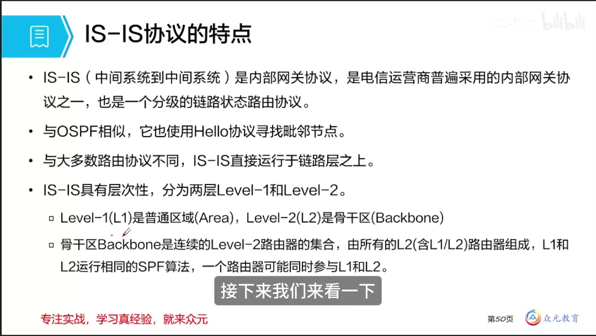

### 1.2 IS-IS的层次结构与区域

IS-IS 将路由域划分为两个层次：

| 层次 | 名称 | 主要职责 | 数据库与 SPF |
| ---- | ---- | -------- | ------------ |
| Level-1 | 普通区域（Area） | 负责本区域内部的路由；只学习本区域的链路状态和前缀 | 维护 L1 LSDB，运行 L1 SPF |
| Level-2 | 骨干区域（Backbone） | 负责区域之间的路由；连接不同的 L1 区域 | 维护 L2 LSDB，运行 L2 SPF |
| Level-1/2 | 边界路由器 | 同时参与 L1 和 L2，维护两套 LSDB，运行两次 SPF | L1 LSDB 与 L2 LSDB |

几个关键结论：

1. **L1 是普通区域，L2 是骨干区域。** L1 区域内的路由器只掌握本区域的拓扑，去往其他区域时依赖 L1/L2 路由器。
2. **骨干区域是连续的 L2 路由器的集合**，由所有 L2 路由器（含 L1/L2 路由器）组成。L1 和 L2 运行相同的 SPF 算法，但使用各自独立的链路状态数据库。
3. **一台路由器可以同时参与 L1 和 L2**，此时称为 L1/L2 路由器。它相当于 OSPF 中的区域边界路由器（ABR），负责在区域之间传递路由。
4. **一台 IS-IS 路由器只能属于一个 L1 区域。** 这是 IS-IS 与 OSPF 最容易被混淆的差异：OSPF 路由器的不同接口可以属于不同区域，而 IS-IS 的区域属性属于整台路由器，不能按接口分别划分。
5. L1 路由器去往区域外时，L1/L2 路由器会在 L1 LSP 中设置 Attached 位（ATT 位），L1 路由器据此生成指向该 L1/L2 路由器的默认路由。
6. IS-IS 优先选择区域内（L1）路由，其次才选择区域间（L2）路由。

IS-IS 的区域架构可以表示为：多个 L1 区域通过 L1/L2 路由器接入连续的 L2 骨干。下图给出 Area 1 至 Area 5 的示意，其中 Area 1 为骨干，其他区域通过 L1/L2 路由器与骨干相连。

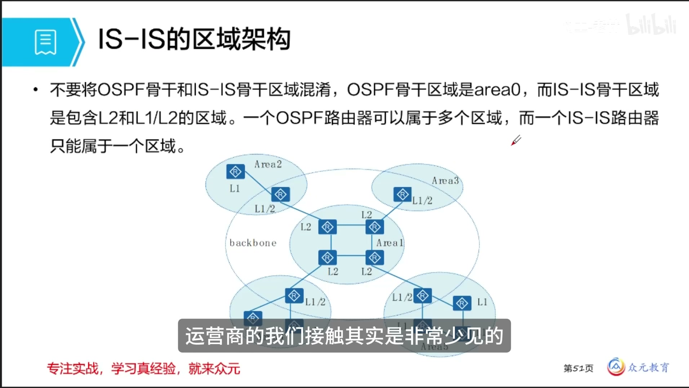

[手写批注] 图中红色箭头指向“一个 IS-IS 路由器只能属于一个区域”，用于强调 IS-IS 与 OSPF 在区域划分上的差异。

### 1.3 NET地址与NSAP结构

IS-IS 不使用 IP 地址作为路由器标识，而使用 **NET（Network Entity Title，网络实体名称）**。NET 是一种特殊的 NSAP 地址，其选择符 SEL 固定为 00，表示“路由器本身”。

NSAP 地址由两部分组成：

```
NSAP = IDP + DSP
```

| 部分 | 组成 | 含义 |
| ---- | ---- | ---- |
| IDP（Initial Domain Part，初始域部分） | AFI（1 字节）+ IDI（可变长） | 标识地址所属的行政域和授权机构 |
| DSP（Domain Specific Part，域特定部分） | High Order DSP（区域地址）+ System ID（6 字节）+ NSEL（1 字节） | 标识区域、路由器和选择符 |

NET 的关键字段：

| 字段 | 长度 | 说明 |
| ---- | ---- | ---- |
| AFI | 1 字节 | 授权与格式标识符；**49** 为私有网络地址，IDI 可省略 |
| IDI | 可变 | 初始域标识符，由授权机构分配；私有网络中使用 AFI 49 时通常省略 |
| Area Address（区域地址） | 可变，通常 1～13 字节 | 由 IDP 和 High Order DSP 组成，同一区域内的路由器共享相同的区域地址 |
| System ID | **6 字节（48 位）** | 唯一标识一台路由器，通常由 Loopback 地址或 MAC 地址派生 |
| NSEL | **1 字节** | 选择符；NET 中固定为 **00**，表示路由器本身 |

NET 的总长度为 **8～20 字节**。常见格式为：

```
49.0001.0000.0000.0001.00
```

其中：

- `49` 为 AFI，表示私有地址；
- `0001` 为区域号；
- `0000.0000.0001` 为 6 字节 System ID；
- `00` 为 NSEL。

因此，该地址的区域地址为 `49.0001`，System ID 为 `0000.0000.0001`。同一区域内的所有路由器必须配置相同的区域地址；System ID 用于唯一标识路由器，应在整个 IS-IS 路由域内保持唯一。

需要区分以下概念：

| 概念 | 含义 |
| ---- | ---- |
| NSAP | 网络服务访问点，完整的 OSI 网络层地址 |
| NET | NSEL 为 00 的 NSAP，用于标识 IS-IS 路由器 |
| Area Address | NSAP 中用于标识区域的部分，不包含 System ID 和 NSEL |
| System ID | 6 字节，唯一标识区域或路由域中的一台路由器 |

### 1.4 IS-IS的报文与工作过程

IS-IS 的协议数据单元称为 PDU。常见的四类 PDU 如下：

| PDU | 全称 | 主要作用 |
| --- | ---- | -------- |
| IIH | IS-IS Hello PDU | 发现、建立和维护邻居关系；广播网分为 L1 LAN IIH、L2 LAN IIH，点到点链路使用 P2P IIH |
| LSP | Link State PDU | 描述本路由器的链路状态、邻居、接口前缀和度量；每个级别生成一个 LSP |
| CSNP | Complete Sequence Number PDU | 携带数据库中全部 LSP 的摘要，用于数据库同步 |
| PSNP | Partial Sequence Number PDU | 携带部分 LSP 的摘要，用于请求缺失的 LSP 或确认收到的 LSP |

IS-IS 的工作过程可以概括为五个阶段：

1. **发现邻居**：路由器周期性地发送 IIH。只有同一级别的路由器才能建立邻居关系，例如 L1 路由器与 L1 路由器建立 L1 邻居，L2 路由器与 L2 路由器建立 L2 邻居，L1/L2 路由器之间可以同时建立 L1 和 L2 两种邻居关系。
2. **同步数据库**：邻居之间通过 CSNP 交换数据库摘要，通过 PSNP 请求缺失的 LSP 或确认收到的 LSP。
3. **泛洪 LSP**：L1 LSP 在本区域内泛洪，L2 LSP 在骨干内泛洪。LSP 携带序列号、剩余生存时间、校验和等字段，用于判断新旧和保证完整性。
4. **运行 SPF**：每台路由器以自己为根，分别对 L1 LSDB 和 L2 LSDB 运行 Dijkstra 算法，生成最短路径树。
5. **生成路由表**：根据 SPF 树计算去往各前缀的最优路径，写入路由表；L1 路由器通过 ATT 位生成的默认路由访问区域外网络。

在广播网络中，IS-IS 选举 **DIS（Designated Intermediate System，指定中间系统）**，作用类似于 OSPF 的 DR。DIS 负责代表该广播网段生成伪节点 LSP，减少邻接关系和泛洪开销。DIS 的选举依据优先级，优先级相同时比较 SNPA（通常为 MAC 地址）；IS-IS 的 DIS 具有**抢占性**，新加入的高优先级路由器可以取代原 DIS，并且没有备份 DIS。

IS-IS 的度量值与接口带宽没有必然关系。早期默认度量通常为 10，所有接口相同；扩展的宽度量（wide metric）使用 24 位度量值，可根据带宽、时延等因素规划。考试中一般只需掌握“IS-IS 使用链路状态和 SPF 计算路由”，不必深入度量细节。

### 1.5 IS-IS与OSPF的对比

| 比较项 | OSPF | IS-IS |
| ------ | ---- | ----- |
| 协议类型 | 链路状态 IGP | 链路状态 IGP |
| 封装方式 | 直接封装在 IP 中，IP 协议号 **89** | **直接封装在链路层**，不经过 IP |
| 区域划分依据 | 按**接口**划分 | 按**路由器**划分 |
| 一台路由器的区域归属 | 可以属于多个区域（ABR） | 只能属于一个 L1 区域；L1/L2 路由器同时参与 L2 骨干 |
| 骨干区域 | **Area 0** | 由连续的 L2 路由器和 L1/L2 路由器组成的骨干 |
| 区域边界 | ABR（区域边界路由器） | L1/L2 路由器 |
| 邻居发现 | Hello 报文 | IIH PDU |
| 链路状态信息 | LSA（Type 1～Type 7 等） | LSP（TLV 结构） |
| 数据库同步 | DD、LSR、LSU、LSAck | CSNP、PSNP |
| 广播网选举 | DR/BDR | DIS |
| 度量值 | Cost，默认参考带宽 100 Mbps | 默认度量，Cisco 常见默认值为 10；可使用宽度量 |
| 扩展方式 | 增加新的 LSA 类型 | 增加新的 TLV，扩展灵活 |
| 典型应用 | 企业网、园区网、数据中心 | 运营商骨干、大型网络 |

两者的共同点是：都属于链路状态协议，都维护 LSDB，都使用 SPF 算法，都支持 VLSM/CIDR，都具有较快的收敛速度，都通过分层限制拓扑变化范围。

选择上的常见结论：

- OSPF 的协议生态更完整，厂商实现和排错资料多，适合企业网和园区网。
- IS-IS 的 TLV 结构扩展性好，运行在链路层，不依赖 IP 可达性，适合运营商骨干和超大规模网络。
- 考试中若问“按路由器划分区域”的协议，应选 IS-IS；若问“按接口划分区域、骨干为 Area 0”的协议，应选 OSPF。

### 1.6 典型例题

#### 例题1：IS-IS协议的说法辨析

以下关于 IS-IS 路由选择协议的说法中，错误的是（ ）。

- A、IS-IS 路由协议是一种基于链路状态的 IGP 路由协议
- B、IS-IS 路由协议可将自治系统划分为骨干区域和非骨干区域
- C、IS-IS 路由协议中的路由器的不同接口可以属于不同的区域
- D、IS-IS 路由协议的地址结构由 IDP 和 DSP 两部分组成

答案：**C** [正确]

解答：

- A 项 [正确]。IS-IS 是链路状态内部网关协议，使用 SPF 算法计算路由。
- B 项 [正确]。IS-IS 分为 L1 普通区域和 L2 骨干区域，因此可以理解为骨干区域和非骨干区域。
- C 项 [错误]。IS-IS 以路由器为单位划分区域，一台路由器只能属于一个 L1 区域，其不同接口不能分别属于不同区域。按接口划分区域是 OSPF 的特点。
- D 项 [正确]。NSAP/NET 地址由 IDP（初始域部分）和 DSP（域特定部分）两部分组成；DSP 中又包含区域地址、System ID 和 NSEL。

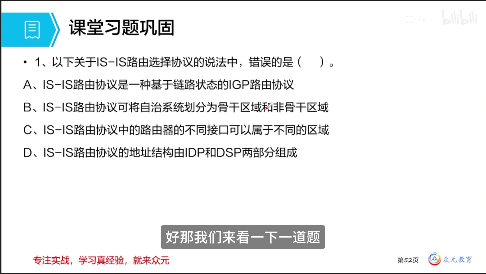

---

## 2.BGP协议

### 2.1 BGP概述

BGP（Border Gateway Protocol，边界网关协议）是用于自治系统之间传递路由信息的**外部网关协议（EGP）**，当前主流版本为 **BGP-4**，由 RFC 4271 定义。支持 IPv6 和多协议扩展的版本通常称为 BGP-4+ 或 MP-BGP。

自治系统（Autonomous System，AS）是处于同一技术管理机构控制之下、采用统一路由策略的一组路由器或网络。每个 AS 具有唯一的自治系统编号（ASN），传统 AS 号为 2 字节，4 字节 AS 号由 RFC 6793 定义。BGP 以 AS 为基本单位交换路由，AS_PATH 记录的正是路由经过的 AS 号序列。

BGP 的基本特征如下：

| 项目 | 内容 |
| ---- | ---- |
| 协议类型 | 外部网关协议（EGP），路径矢量协议（Path-Vector） |
| 传输层 | **TCP，端口号 179** |
| 作用范围 | 不同自治系统（AS）之间；也可在 AS 内部运行 iBGP |
| 交换内容 | 网络层可达信息（NLRI）和路径属性 |
| 度量依据 | AS 路径长度及多种路径属性，不以路由器跳数为唯一依据 |
| 更新方式 | 启动时交换一次完整路由，之后采用**触发更新、增量更新** |
| 防环手段 | AS_PATH、iBGP 水平分割、路由反射器的 Originator_ID/Cluster_List 等 |
| 典型能力 | CIDR、路由聚合、路由衰减、路由策略、MP-BGP、VPN、IPv6 |

BGP 属于**路径矢量协议**。它与距离矢量协议相似之处在于都从邻居学习路由，但 BGP 记录的是路由经过的 AS 序列（AS_PATH），而不是逐台路由器的跳数。因此，BGP 的“距离”是 AS 的个数，而不是路由器个数。

BGP 的主要特点可以归纳为：

1. 基于 TCP 179 端口，利用 TCP 提供可靠的连接、重传、确认和排序，BGP 自身不再实现这些机制。
2. 用于自治系统之间传递选路信息，是互联网域间路由的事实标准。
3. 邻居关系分为 EBGP 和 IBGP，周期性发送 Keepalive 报文保持与对等体的连接。
4. 路由携带 AS_PATH，用于路由优选和防止环路。
5. 采用触发更新和增量更新：启动 BGP 时交换一次完整信息，后续只通告网络变化。
6. 提供路由聚合和路由衰减功能，用于抑制路由振荡。
7. 提供丰富的路由策略，可根据多种路径属性控制路由的发布和选择。
8. MP-BGP 支持 VPN、IPv6、组播等新应用，可为 VPN 分配标签、构建专用隧道。

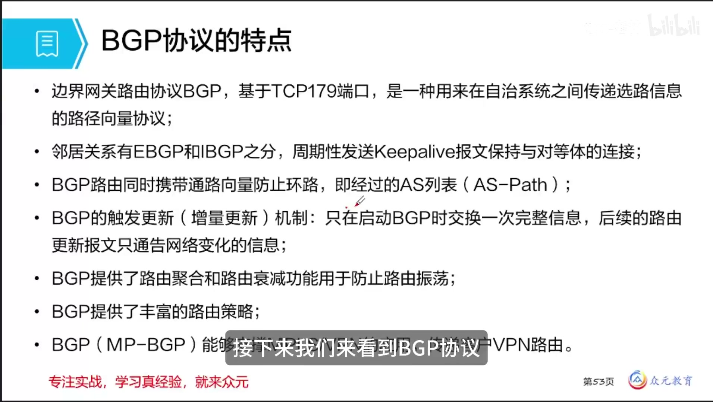

课件在另一页对上述关键词作了红色标注，重点包括“边界网关协议 BGP”“TCP 179 端口”“自治系统之间”“路径向量协议”“EBGP 和 IBGP”“Keepalive”“AS-Path”“增量更新”“路由聚合和路由衰减”“MP-BGP”等。这些词是 BGP 选择题的高频落点。

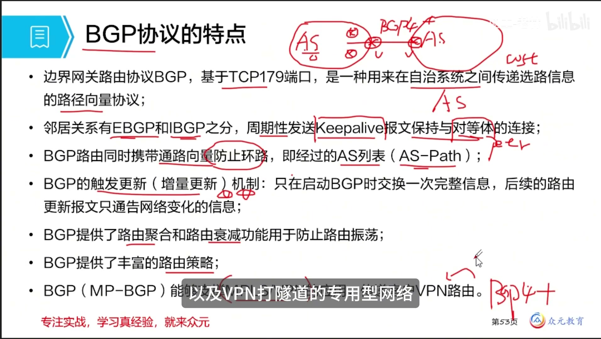

[手写批注] 图中在 AS 1 与 AS 2 之间标注“BGP 4”，在右下角标注“BGP4+”，用于区分 IPv4 的 BGP-4 与支持 IPv6 的扩展版本。

### 2.2 BGP路由器角色与对等体

运行 BGP 的路由器称为 **BGP 发言者（BGP Speaker）** 或 BGP 路由器。两个建立 BGP 会话的路由器互为 **对等体（Peer）**，它们之间交换 BGP 路由表。BGP 通常称对等体而不是邻居，因为两台 BGP 路由器之间可能相隔多台路由器，并不要求直连；厂商配置命令中仍常使用 `neighbor` 这一名称。

BGP 存在两种对等体关系：

| 比较项 | EBGP | IBGP |
| ------ | ---- | ---- |
| 英文 | External BGP | Internal BGP |
| AS 关系 | 位于**不同 AS** 的 BGP 路由器之间 | 位于**同一 AS** 的 BGP 路由器之间 |
| 主要作用 | 在自治系统之间传递路由 | 在 AS 内部同步外部路由，减少重复计算 |
| AS_PATH | 发送路由时添加本地 AS 号 | 不修改 AS_PATH |
| 典型连接 | 直连的物理接口地址 | Loopback 逻辑接口地址 |
| 路由通告 | 可向其他 EBGP 或 IBGP 对等体通告 | 从 IBGP 学到的路由不再通告给其他 IBGP 对等体（水平分割） |
| 全互联要求 | 不要求 | 默认要求全互联，或使用路由反射器/联盟替代 |

EBGP 对等体通常要求 AS 号不同，路由可达，并能正确建立 TCP 连接。IBGP 对等体位于同一 AS 内，主要用于让 AS 内部的所有 BGP 路由器获得一致的外部路由视图。

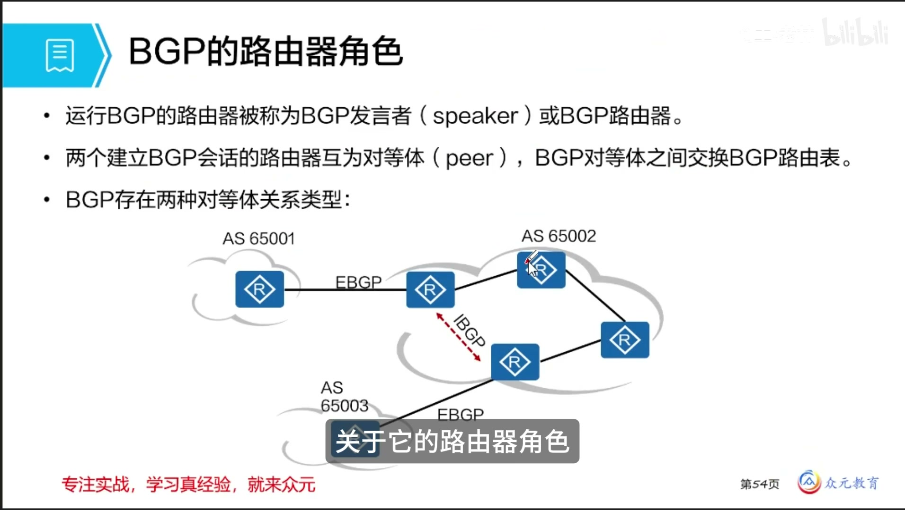

### 2.3 BGP的TCP连接

BGP 对等体之间通过 TCP 179 端口建立会话。建立会话的两台路由器**并不要求直连**，这是 BGP 与许多 IGP 的重要区别。

连接地址的选择原则如下：

| 场景 | 建议使用的地址 | 原因 |
| ---- | -------------- | ---- |
| IBGP 对等体 | **Loopback 地址** | 逻辑接口稳定；物理接口或直连链路故障时，只要 IGP 仍能到达 Loopback，BGP 会话就不会中断 |
| EBGP 对等体 | **直连接口的物理地址** | 通常要求直连，默认 TTL 为 1，可避免多跳和路由不可达问题 |

默认情况下，BGP 使用报文出接口作为 TCP 连接的本地接口。若 IBGP 使用物理接口建立会话，一旦该接口或直连链路故障，即使网络中仍有冗余路径，BGP 会话也会断开；使用 Loopback 地址可以避免这一问题，并提高冗余性和可靠性。

EBGP 默认要求直连，是因为 EBGP 报文的 TTL 默认为 1。若两台 EBGP 路由器之间需要经过多台路由器，必须配置多跳 EBGP（multihop），并相应调整 TTL 和路由。

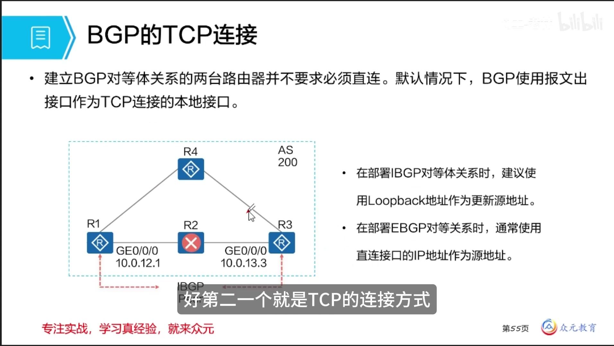

### 2.4 BGP报文类型

BGP-4 定义了四种基础报文：

| 类型 | 报文名称 | 英文 | 主要作用 | 关键内容 |
| ---- | -------- | ---- | -------- | -------- |
| 1 | 打开报文 | OPEN | 与相邻 BGP 发言者建立关系，协商会话参数 | Version、My Autonomous System、Hold Time、BGP Identifier、Optional Parameters |
| 2 | 更新报文 | UPDATE | 发送某一路由的信息，或列出要撤销的多条路由 | Withdrawn Routes、Path Attributes、NLRI |
| 3 | 通知报文 | NOTIFICATION | 发送检测到的差错，随后关闭连接 | Error Code、Error Subcode、Data |
| 4 | 保活报文 | KEEPALIVE | 确认 OPEN 报文，周期性证实邻站关系 | 仅包含 19 字节的 BGP 头部 |

补充说明：

- **OPEN** 是 TCP 连接建立后双方发送的第一条报文。OPEN 被接受后，对方发送 KEEPALIVE 进行确认。OPEN 中的 BGP Identifier 通常取路由器的 Router ID，用于标识 BGP 发言者。
- **UPDATE** 用于发布可行路由和撤销不可行路由。一条 UPDATE 可以同时携带多个具有相同路径属性的前缀，也可以只撤销路由而不携带 NLRI。
- **KEEPALIVE** 默认发送周期为 **60 秒**，Hold Time 默认 **180 秒**。若在 Hold Time 内未收到 KEEPALIVE 或 UPDATE，则认为连接失效。Hold Time 由双方在 OPEN 报文中协商，取较小值。
- **NOTIFICATION** 用于差错控制。发送 NOTIFICATION 后，BGP 连接立即关闭。
- **Route-refresh** 是 RFC 2918 定义的扩展报文，用于在改变路由策略后请求对等体重新发送路由信息。它不属于 BGP-4 的四种基础报文，只有支持 Route-refresh 能力的设备才会发送和响应。

BGP 报文的最大长度为 4096 字节，最小长度为 19 字节（仅头部）。BGP 头部由 16 字节 Marker、2 字节 Length 和 1 字节 Type 组成。

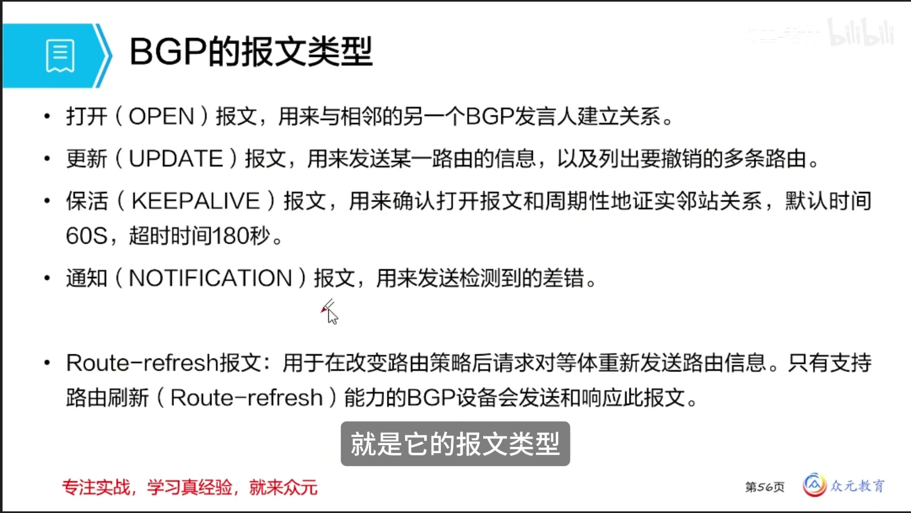

### 2.5 BGP路径属性

每条 BGP 路由都携带多种路径属性（Path Attribute）。BGP 可依据这些属性控制路由选择，因此比只使用单一度量值的 IGP 具有更丰富的可操作性。

按“是否必须携带”划分，BGP 路径属性分为四类：

| 类别 | 含义 | 主要属性 |
| ---- | ---- | -------- |
| 公认必遵（Well-known Mandatory） | 所有 BGP 路由器必须识别，且 UPDATE 中必须携带 | **ORIGIN、AS_PATH、NEXT_HOP** |
| 公认自选（Well-known Discretionary） | 所有 BGP 路由器必须识别，但不一定携带 | **LOCAL_PREF、ATOMIC_AGGREGATE** |
| 可选传递（Optional Transitive） | 可以选择是否携带；即使路由器不识别，也会继续传递给邻居 | **AGGREGATOR、COMMUNITY** |
| 可选非传递（Optional Non-transitive） | 可以选择是否携带；路由器不识别时不继续传递 | **MED、ORIGINATOR_ID、CLUSTER_LIST** |

各属性的含义与选路要点如下：

| 属性 | 类别 | 含义 | 选路/使用要点 |
| ---- | ---- | ---- | ------------- |
| ORIGIN | 公认必遵 | 路径信息的来源 | 取值 IGP（0）、EGP（1）、INCOMPLETE（2）；数值越小越优，即 IGP 优于 EGP，EGP 优于 INCOMPLETE |
| AS_PATH | 公认必遵 | 路由经过的 AS 序列 | 越短越优；接收到的路由若包含本地 AS 号，则拒绝，用于防止 AS 间环路 |
| NEXT_HOP | 公认必遵 | 到达目的网络的下一跳 IP 地址 | 必须能通过 IGP 解析；EBGP 通常改为自身接口地址，IBGP 默认保持不变 |
| LOCAL_PREF | 公认自选 | 本地优先级，判断流量离开本 AS 时的最佳路由 | 数值越大越优；默认 100；只在 IBGP 对等体之间传递，不传给 EBGP 对等体 |
| ATOMIC_AGGREGATE | 公认自选 | 原子聚合标记 | 表示该路由是聚合路由，且不希望被拆分；长度为 0 |
| AGGREGATOR | 可选传递 | 聚合者属性 | 记录生成聚合路由的 AS 号和 BGP 标识符 |
| COMMUNITY | 可选传递 | 团体属性 | 标识具有相同特征的一组路由，便于实施路由策略 |
| MED | 可选非传递 | 多出口鉴别器（Multi-Exit Discriminator） | 数值越小越优；用于同一邻居 AS 的多个入口之间比较；不传递给其他 AS |
| ORIGINATOR_ID | 可选非传递 | 路由发起者的 Router ID | 路由反射器环境中用于防止环路 |
| CLUSTER_LIST | 可选非传递 | 路由经过的集群列表 | 路由反射器环境中用于防止环路 |

需要区分 LOCAL_PREF 与 MED 的作用方向：

- **LOCAL_PREF** 影响流量如何**离开**本 AS，数值越大越优，主要用于 AS 内部选路。
- **MED** 影响流量如何**进入**本 AS，数值越小越优，主要用于向相邻 AS 表达入口偏好。
- MED 只在来自同一邻居 AS 的多条路由之间比较；来自不同 AS 的 MED 不具有可比性。
- LOCAL_PREF 只在 IBGP 内传递；MED 可随 EBGP 路由传入，并可在 IBGP 内传递，但不应再传播给其他相邻 AS。

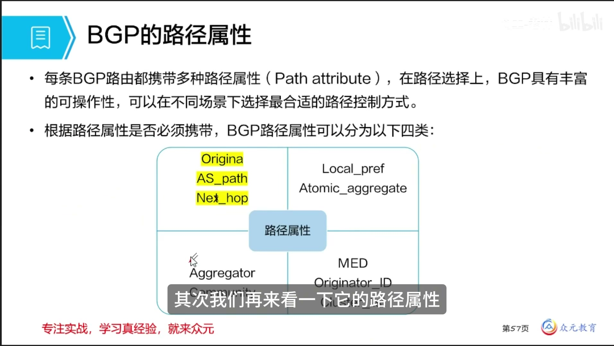

### 2.6 AS_PATH的作用：路由优选与防环

AS_PATH 是 BGP 最重要的路径属性之一，主要有两个作用：

1. **影响 BGP 路由的优选**：在其他条件相同的情况下，AS_PATH 越短，路由越优。
2. **防止路由环路的产生**：BGP 路由器收到一条路由时，若发现 AS_PATH 中包含自己的 AS 号，则拒绝该路由，从而避免路由在 AS 之间循环。

以课件拓扑为例：R1 位于 AS 100，通告网段 10.0.1.0/24。R5 从两个方向收到该网段的路由：

| 来源方向 | AS_PATH | AS 数量 |
| -------- | ------- | ------- |
| 经 AS 200 传来 | 200 100 | 2 |
| 经 AS 400、AS 300 传来 | 400 300 100 | 3 |

在其他属性相同的情况下，R5 选择 AS_PATH 较短的 `200 100`，因为该路径经过的 AS 数量更少。实际部署中，可以通过在 AS_PATH 中重复添加本地 AS 号（AS_PATH prepend）人为加长路径，从而影响邻居的选路结果。

防环过程如下：假设 R2 与 R4 之间新增一条链路，R5 可能从某个方向收到一条 AS_PATH 中已经包含 AS 500 的路由。由于 R5 发现 AS_PATH 中出现自己的 AS 号 500，便不会接收该路由，从而避免形成“R5 → R2 → R4 → R5”的环路。

除了 AS_PATH，BGP 还使用以下机制防环：

| 机制 | 作用范围 | 说明 |
| ---- | -------- | ---- |
| AS_PATH | AS 之间 | 路由包含本地 AS 号时拒绝，防止 AS 间环路 |
| IBGP 水平分割 | AS 内部 | 从 IBGP 对等体学到的路由，不再通告给其他 IBGP 对等体 |
| Originator_ID | 路由反射器环境 | 记录路由发起者的 Router ID，防止反射器环路 |
| Cluster_List | 路由反射器环境 | 记录路由经过的集群 ID，防止集群间环路 |
| 联盟（Confederation） | AS 内部 | 将大 AS 划分为多个子 AS，子 AS 之间使用特殊 AS_PATH 段防环 |

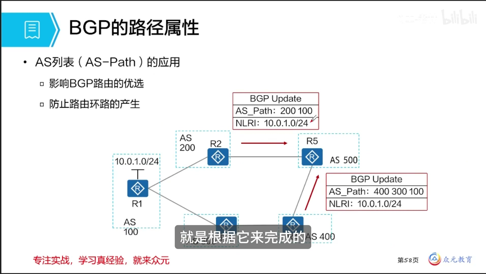

### 2.7 BGP路由生成与聚合

与 IGP 不同，**BGP 自身不会发现并计算产生路由**。BGP 路由来源于 IGP 路由表、直连路由、静态路由等，必须通过注入的方式告知 BGP，再由 UPDATE 报文传递给 BGP 对等体。

BGP 注入路由的方式有两种：

| 方式 | 命令/机制 | ORIGIN 取值 | 特点 |
| ---- | --------- | ----------- | ---- |
| Network | `network` 命令逐条宣告 | IGP（0） | 优先级更高；要求路由表中存在精确匹配的路由（或由聚合产生） |
| import-route | 路由引入 | INCOMPLETE（2） | 可批量引入 IGP、静态、直连等路由；可能引入不必要路由，需配合路由策略 |

因此，ORIGIN 的优先级为：

```
IGP（network） > EGP > INCOMPLETE（import-route）
```

BGP 支持根据已有路由条目进行聚合，生成聚合路由：

| 聚合方式 | IPv4 | IPv6 | 说明 |
| -------- | ---- | ---- | ---- |
| 自动聚合 | 支持 | 不支持 | 按自然网段（A、B、C 类主类网络）聚合，可能造成路由不精确 |
| 手动聚合 | 支持 | 支持 | 可自定义聚合路由的前缀和属性，控制更精细 |

BGP 还提供路由衰减（dampening）功能，用于抑制频繁振荡的路由，避免不稳定路由反复影响网络。路由聚合和路由衰减都是为了防止路由振荡、减小路由表规模。

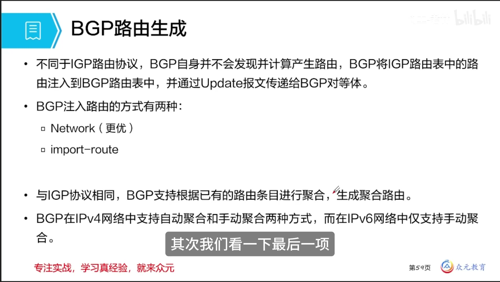

### 2.8 iBGP全互联、路由反射器与同步

#### 2.8.1 iBGP全互联

IBGP 水平分割规定：从 IBGP 对等体学到的路由，不再通告给其他 IBGP 对等体。因此，在一个 AS 内，若所有 BGP 路由器都要学习到外部路由，默认需要建立**全互联**的 IBGP 会话。

n 台 IBGP 路由器全互联需要建立的会话数量为：

```
n × (n - 1) ÷ 2
```

当路由器数量增加时，会话数量按平方增长，配置和管理负担很大。为解决这一问题，可以使用路由反射器或联盟。

#### 2.8.2 路由反射器

路由反射器（Route Reflector，RR）允许一台路由器将 IBGP 路由反射给其他 IBGP 路由器，从而打破全互联要求。相关角色包括：

| 角色 | 说明 |
| ---- | ---- |
| RR | 路由反射器，负责反射路由 |
| Client | RR 的客户端，与 RR 建立 IBGP 会话 |
| Non-client | 非客户端，与 RR 建立 IBGP 会话，但不属于该集群 |

路由反射规则：

- RR 从客户端学到的路由，可以反射给所有其他客户端和非客户端。
- RR 从非客户端学到的路由，只能反射给客户端，不能反射给其他非客户端。
- RR 使用 **Originator_ID** 和 **Cluster_List** 防止反射环路。
- 一个集群内的 RR 可以有多个，形成冗余。

#### 2.8.3 联盟

联盟（Confederation）将一个大 AS 划分为多个子 AS（Sub-AS），子 AS 之间运行特殊的 IBGP，对外仍表现为一个 AS。联盟使用 `AS_CONFED_SEQUENCE` 和 `AS_CONFED_SET` 路径段防环，可减少 IBGP 全互联的规模。

#### 2.8.4 同步机制

BGP 同步（Synchronization）是一条历史规则：若本 AS 内通过 IBGP 学到了某条路由，但 IGP 尚未传播该路由，则 BGP 不应把该路由通告给 EBGP 对等体。其目的是避免 AS 内部出现路由黑洞。

现代网络中，同步机制通常被关闭，因为：

- 大型网络中将大量 BGP 路由引入 IGP 会给路由器带来巨大的处理和存储负担。
- 关闭同步后，必须通过 IBGP 全互联、路由反射器或联盟，确保 AS 内所有 BGP 路由器都学习到该路由，否则仍可能出现路由黑洞。
- 因此，“关闭同步”并不是无条件安全，必须保证 IBGP 路由在 AS 内完整传播。

### 2.9 BGP选路原则

BGP 的选路比 OSPF、RIP 复杂，因为它可以同时比较多种路径属性。RFC 4271 定义的决策过程分为三个阶段：

1. **计算优先级**：为每条路由计算本地偏好程度。对于 IBGP 路由，通常直接使用 LOCAL_PREF；对于 EBGP 路由，按本地策略计算。
2. **选择最佳路由**：在优先级相同的候选路由中，依次比较 AS_PATH、ORIGIN、MED、EBGP/IBGP、IGP 度量、BGP Identifier、对等体地址等。
3. **路由发布**：将选中的最佳路由安装到 Loc-RIB，并按策略向对等体发布。

厂商实现的典型选路顺序如下（不同厂商的细节可能略有差异）：

| 顺序 | 比较项 | 优选规则 | 说明 |
| ---- | ------ | -------- | ---- |
| 1 | 本地权重/首选值 | 数值越大越优 | 厂商私有，Cisco 称 Weight，华为称 Preferred Value；只在本路由器有效，不传递 |
| 2 | LOCAL_PREF | 数值越大越优 | 仅在 IBGP 内有效；默认 100 |
| 3 | 本地起源 | 本地产生的路由优先 | 通过 network、aggregate、import-route 产生的路由优先 |
| 4 | AS_PATH | 越短越优 | AS_SET 计为 1，无论其中包含多少个 AS |
| 5 | ORIGIN | IGP > EGP > INCOMPLETE | 数值越小越优 |
| 6 | MED | 数值越小越优 | 只比较来自同一邻居 AS 的路由；默认 0 |
| 7 | EBGP/IBGP | EBGP 优于 IBGP | 外部路由优先 |
| 8 | IGP 度量 | 到 NEXT_HOP 的 IGP Cost 越小越优 | 即“热土豆路由”，尽快把流量送出本 AS |
| 9 | 其他 | Cluster_List 短、Router ID 小、对等体地址小 | 用于最终打破平局，厂商实现略有差异 |

需要特别注意：

- **Weight/Preferred Value 不是 RFC 4271 定义的标准属性**，而是厂商的本地优先级，不会传递给邻居。
- **LOCAL_PREF 只在 IBGP 内传递**，不能传给 EBGP 对等体；因此它影响的是本 AS 内部如何选择出口。
- **MED 只在同一邻居 AS 的多条路由之间比较**，不同邻居 AS 的 MED 不能直接比较。
- 选路是逐项比较的过程：只有前一项相同，才比较下一项；一旦分出优劣，后续属性不再比较。
- 考试中常见的简化说法是“先看本地优先级，再看 AS_PATH 长短，再看 Origin”，这一顺序与典型实现一致，但实际选路还包括 MED、EBGP/IBGP、IGP Cost 等。

### 2.10 典型例题

#### 例题1：BGP协议描述辨析

关于 BGP 协议描述不正确的是（ ）。

- A、BGP 是一种距离矢量路由协议，在设计上就避免了环路
- B、BGP 协议是基于 TCP 的路由协议
- C、BGP 协议用于实现不同 AS 之间的路由可达
- D、BGP 协议计算路由的过程会暴露 AS 内部的网络拓扑

答案：**D** [正确]

解答：

- A 项 [正确]。课件将 BGP 归入距离矢量家族；严格来说，BGP 是路径矢量协议。BGP 通过 AS_PATH 等机制在设计上避免环路。
- B 项 [正确]。BGP 使用 TCP 179 端口建立对等体会话。
- C 项 [正确]。BGP 是外部网关协议，用于不同自治系统之间的路由可达。
- D 项 [错误]。BGP 只通告网络前缀和路径属性（如 AS_PATH），不会把 AS 内部的完整拓扑暴露给其他 AS。完整拓扑的泛洪是链路状态协议（如 OSPF、IS-IS）在区域内的工作方式。

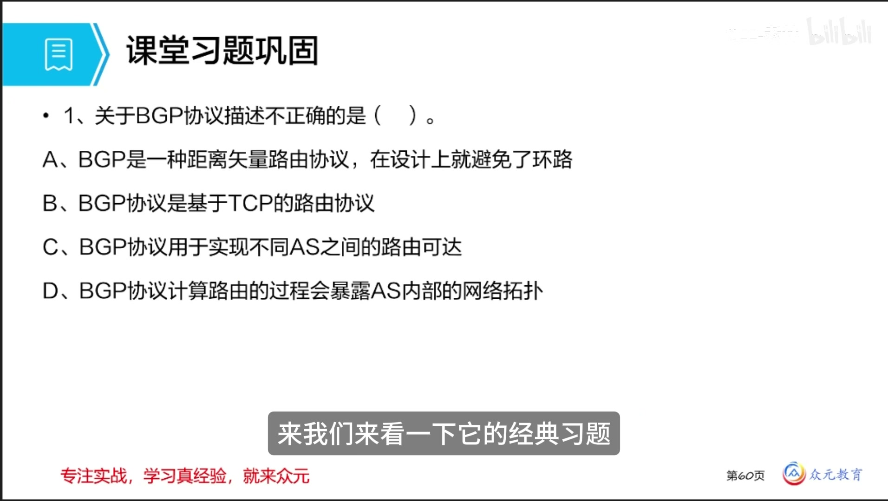

#### 例题2：BGP报文与邻居建立

边界网关协议 BGP 的报文（1）传送。一个外部路由器通过发送（2）报文与另一个外部路由器建立邻居关系，如果得到应答，才能周期性地交换路由信息。

（1）

- A、通过 TCP 连接
- B、封装在 UDP 数据报中
- C、通过局域网
- D、封装在 ICMP 包中

（2）

- A、Update
- B、Keepalive
- C、Open
- D、通告

答案：（1）**A** [正确]；（2）**C** [正确]

解答：

- BGP 使用 TCP 179 端口，报文通过 TCP 连接传送，不封装在 UDP 或 ICMP 中。
- 建立邻居关系时，双方首先交换 OPEN 报文，协商版本、AS 号、Hold Time、BGP Identifier 等参数；OPEN 被接受后，对方发送 KEEPALIVE 进行确认。

#### 例题3：OPEN报文的响应

在 BGP4 协议中，当接收到对方 OPEN 报文后，路由器采用（ ）报文响应，从而建立两个路由器之间的邻居关系。

- A、hello
- B、update
- C、keepalive
- D、notification

答案：**C** [正确]

解答：BGP 没有 Hello 报文。收到可接受的 OPEN 报文后，路由器发送 KEEPALIVE 报文进行确认，邻居关系随之建立。UPDATE 用于发布路由，NOTIFICATION 用于报告差错。

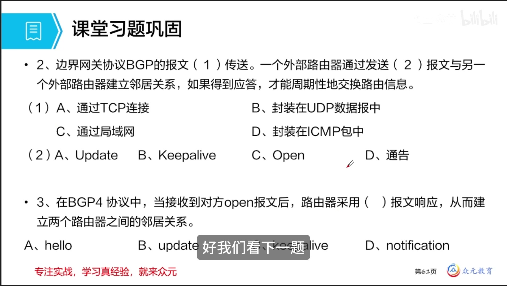

#### 例题4：BGP防环措施

下列属于 BGP 路由协议防环措施的是（ ）。

- A、从 EBGP 邻居收到的路由不会转发给另外一个 EBGP 邻居
- B、从 IBGP 邻居收到的路由转发给 EBGP 邻居时，修改下一跳地址
- C、设置最大跳数不超过 15
- D、从 IBGP 邻居收到的路由不会转发给另外一个 IBGP 邻居

答案：**D** [正确]

解答：

- A 项 [错误]。EBGP 路由可以通告给其他 EBGP 邻居；BGP 依靠 AS_PATH 判断是否会产生环路，而不是一律不转发。
- B 项 [错误]。修改下一跳地址是 BGP 的下一跳处理行为，不是防环机制。
- C 项 [错误]。最大 15 跳是 RIP 的限制，不是 BGP 的防环措施。
- D 项 [正确]。IBGP 水平分割规定，从 IBGP 邻居学到的路由不再通告给其他 IBGP 邻居，以防止 AS 内部环路。BGP 还使用 AS_PATH 防止 AS 间环路，并在路由反射器环境中使用 Originator_ID 和 Cluster_List 防环。

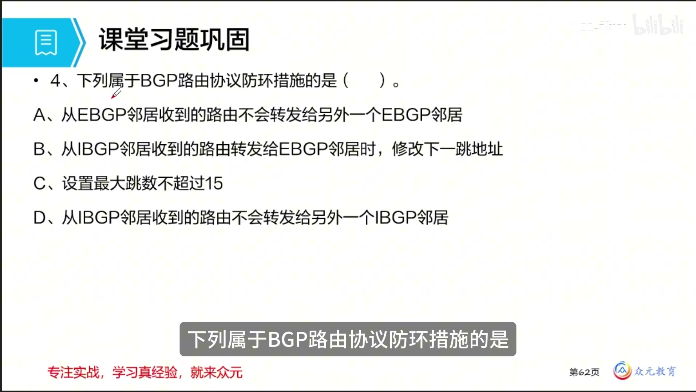

---

## 3.广域网技术

### 3.1 广域网基本概念

广域网（Wide Area Network，WAN）是一种跨地区的数据通信网络，通常覆盖一个国家或地区，由两个或多个局域网组成。计算机通常使用电信运营商提供的设备作为信息传输平台，通过公用网（如电话网、分组交换数据网、帧中继网）实现远距离互联。国际互联网是目前最大的广域网。

广域网的基本特征：

| 项目 | 内容 |
| ---- | ---- |
| 覆盖范围 | 跨地区、跨城市、跨国家，范围远大于局域网 |
| 建设与运营 | 通常租用电信运营商的线路和设备，由多个网络组成 |
| 主要目的 | 实现远程局域网之间、远程终端与主机之间的互联 |
| 典型技术 | PSTN、X.25、帧中继、DDN、ISDN、ATM、SDH、OTN、MPLS、PPP/PPPoE、光接入 |
| OSI 层次 | 主要涉及物理层、数据链路层和网络层 |

对照 OSI 参考模型，广域网技术主要位于底层的三个层次：

- **物理层**：负责比特传输，涉及接口电气特性、传输介质、同步和时钟等。
- **数据链路层**：负责帧的封装、差错检测、流量控制，典型协议有 HDLC、PPP、Frame Relay 等。
- **网络层**：负责寻址和路由，典型协议有 IP、X.25 分组层等。

广域网的典型拓扑是：家庭或校园局域网通过接入网连接到运营商网络，运营商网络再由骨干网连接不同地区。下图中的“长沙·家庭局域网”和“深圳·校园局域网”通过 ISP 网络互联，局域网与 ISP 之间通常使用 HDLC 或 PPP 封装。

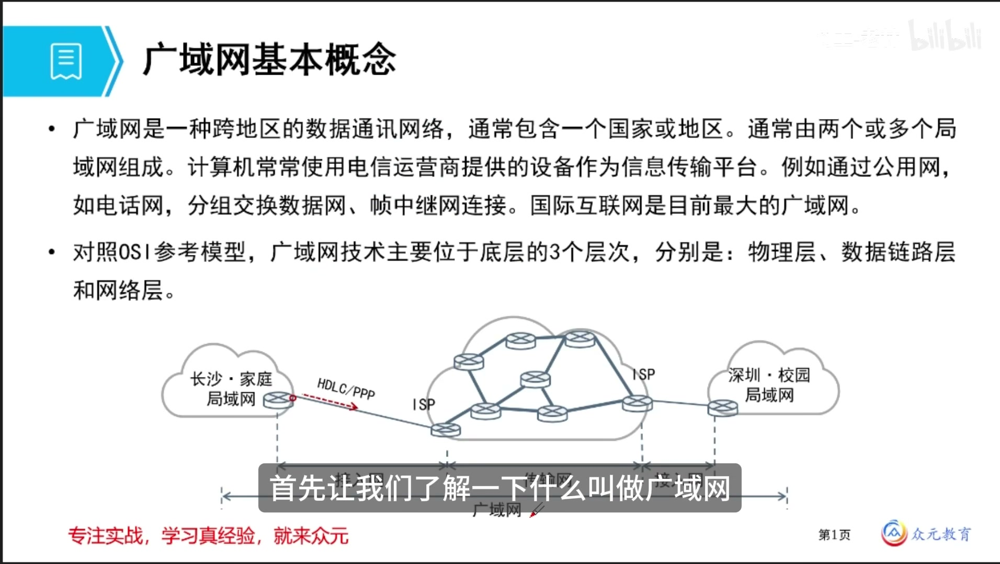

[手写批注] 图中圈出“国际互联网”并标注“WAN”，同时圈出两处“ISP”，强调广域网由运营商网络和接入网组成，国际互联网是最大的广域网。

### 3.2 广域网的交换方式与发展

广域网的发展经历了从模拟语音网到数字数据网、从分组交换到 IP/MPLS 的演进。常见的交换方式如下：

| 交换方式 | 连接建立 | 带宽分配 | 时延 | 线路利用率 | 典型技术 |
| -------- | -------- | -------- | ---- | ---------- | -------- |
| 电路交换 | 建立专用物理通路 | 固定占用 | 低 | 低 | PSTN、ISDN |
| 报文交换 | 存储转发整个报文 | 动态共享 | 高 | 较高 | 早期电报网、报文交换网 |
| 分组交换 | 存储转发分组，可使用虚电路或数据报 | 动态共享 | 较低 | 高 | X.25、帧中继、IP |
| 信元交换 | 使用固定长度信元 | 动态共享 | 低 | 高 | ATM |
| 标签交换 | 按标签转发 | 动态共享 | 低 | 高 | MPLS |

广域网网络类型的演进可以概括为：

```
PSTN（电话网） → X.25（分组网） → 帧中继（FR） → ATM（信元网） → IP/MPLS → OTN/SDH 光传输
```

其中，PSTN、X.25、帧中继、ATM 等传统广域网技术大多已被淘汰或边缘化，最终胜出的是基于 IP 的互联网。SDH、OTN 作为底层光传输技术仍然广泛存在，MPLS 则常用于运营商承载网和 VPN。

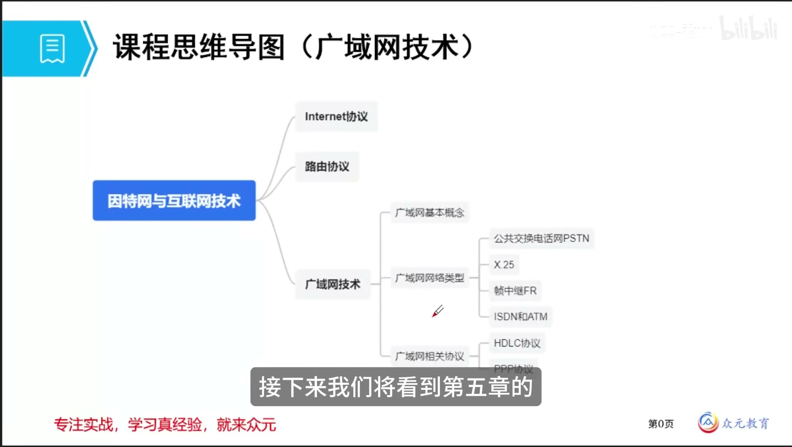

### 3.3 电路交换与PSTN

#### 3.3.1 电路交换

电路交换（Circuit Switching）在通信开始前建立一条专用的物理通路，通信期间该通路被双方独占，通信结束后拆除。其过程分为三个阶段：

1. **建立连接**：在主叫与被叫之间建立一条端到端的物理通路。
2. **传输数据**：双方沿专用通路持续传输数据，带宽固定。
3. **拆除连接**：通信结束后释放通路资源。

电路交换的特点是：时延小、传输连续、适合语音和实时业务；但通路利用率低，建立连接需要时间，且双方速率必须匹配。

#### 3.3.2 PSTN

PSTN（Public Switched Telephone Network，公共交换电话网）是为语音通信建设的电话网，主要由电话机、端局、长途局、中继局和传输线路组成。

| 部分 | 说明 |
| ---- | ---- |
| 用户回路 | 用户电话到最近端局的铜线双绞线，距离通常 1～10 km，传输模拟信号 |
| 端局 | 本地交换局，负责用户接入和本地交换 |
| 长途局 | 负责长途呼叫的交换和转接 |
| 中继局 | 位于长途局之间，负责中继传输 |
| 长途干线 | 端局与长途局、长途局与中继局之间的光纤或高速数字线路，传输数字信号 |

PSTN 的语音信道带宽为 64 kbps。用户回路传输模拟信号，长途干线传输数字信号，因此在发送端和接收端需要进行模数转换和数模转换，通常由调制解调器（Modem）完成。20 世纪 60 年代起，PSTN 也被用于数据传输，早期拨号上网速率为 56 kbps，现已淘汰。

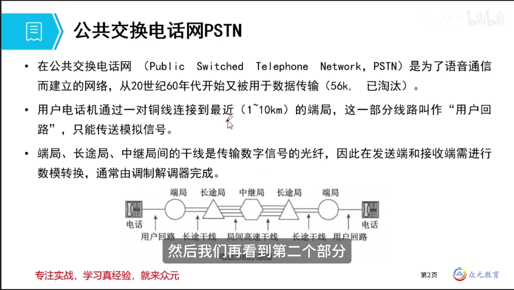

### 3.4 X.25

X.25 是由 ITU-T 提出的面向计算机数据通信的分组交换协议，主要用于描述数据终端设备（DTE）和数据电路终端设备（DCE）之间的接口。

X.25 分为三个协议层，分别对应 OSI 参考模型的低三层：

| X.25 层次 | 对应 OSI 层 | 主要功能 |
| --------- | ----------- | -------- |
| 物理层 | 物理层 | 定义 DTE 与 DCE 之间的电气、机械和规程特性 |
| 链路层 | 数据链路层 | 使用 LAPB 协议，提供可靠的数据传输、差错控制和流量控制 |
| 分组层 | 网络层 | 使用分组层协议（PLP），负责分组的路由、复用和虚电路管理 |

X.25 使用**虚电路**（Virtual Circuit）提供服务，将物理信道划分为多条逻辑信道。一条物理链路上可以建立多条逻辑电路，从而提高线路利用率。虚电路分为两类：

| 类型 | 英文 | 特点 |
| ---- | ---- | ---- |
| 交换虚电路 | SVC（Switched Virtual Circuit） | 每次通信前通过呼叫建立，通信结束后拆除；类似打电话 |
| 永久虚电路 | PVC（Permanent Virtual Circuit） | 由网络预先配置的固定虚电路，无需建立和拆除，可直接传送数据；类似专线 |

X.25 的工作过程遵循“建立链路 → 传输数据 → 拆除链路”三个步骤：

1. 建立逻辑链路（虚电路）。
2. 分组按序传输，链路层确保可靠性，出错时重传。
3. 通信结束后拆除逻辑链路。

X.25 的典型速率为 64 kbps。早期传输介质和终端设备性能较弱，因此需要在底层提供可靠的差错控制和流量控制。随着光纤和终端性能的提升，底层不再需要复杂的纠错，可靠性可以交给高层协议处理，X.25 因而逐渐被帧中继和 IP 分组网取代。

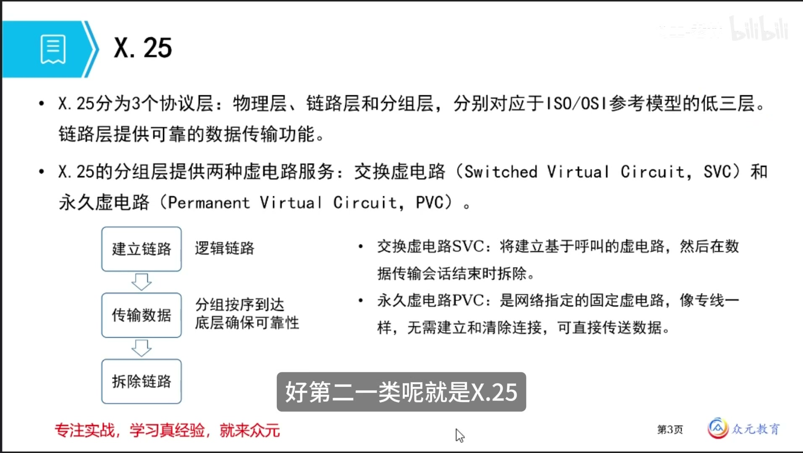

### 3.5 帧中继

帧中继（Frame Relay，FR）是一种高效、低成本的分组交换数据传输技术，主要用于广域网的数据通信，通过虚电路实现逻辑连接和带宽复用。它可以看作 X.25 协议的简化版本。

帧中继的技术特性如下：

| 特性 | 说明 |
| ---- | ---- |
| 数据传输单位 | 以帧为单位传送信息；网络对帧结构和传输差错进行检查，出错帧直接丢弃，不重传 |
| 虚电路标识 | 使用数据链路连接标识符（DLCI）标识虚电路；**DLCI 只在本地接口有效**，不具有全局唯一性 |
| 带宽利用 | 支持承诺信息速率（CIR）和额外信息速率（EIR），允许动态分配带宽，提高物理资源利用率 |
| 协议简化 | 简化了 X.25 的复杂纠错功能，降低设备成本和网络时延，提高传输速率 |
| 逻辑连接 | 传输链路是逻辑连接而非物理连接；一条物理链路上可复用多条逻辑连接，实现带宽复用和动态分配 |

帧中继与 X.25 的主要区别：

| 比较项 | X.25 | 帧中继 |
| ------ | ---- | ------ |
| 工作层次 | 物理层、链路层、分组层 | 物理层、链路层 |
| 差错控制 | 逐段可靠传输，出错重传 | 不纠错，出错帧直接丢弃，可靠性交给高层 |
| 协议开销 | 大，时延较高 | 小，时延较低 |
| 传输速率 | 典型 64 kbps | 可达 45 Mbps（T3/DS3） |
| 典型时期 | 早期分组交换网 | 20 世纪 90 年代广域网主流技术 |

帧中继的帧长度可变，速率可达到 45 Mbps。它在 20 世纪 90 年代是广域网建设的主流技术，后来逐渐被 ATM 和 IP/MPLS 取代。

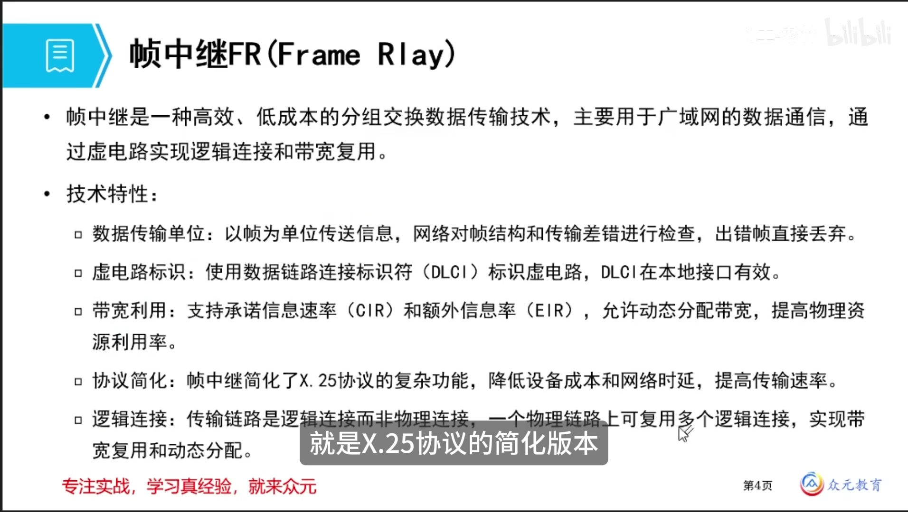

### 3.6 DDN

DDN（Digital Data Network，数字数据网）是利用数字信道提供永久性连接的数字数据传输网络，通常以**专线**方式向用户提供点到点的数字连接。

DDN 的主要特点：

| 项目 | 内容 |
| ---- | ---- |
| 连接方式 | 点到点专用数字电路，固定建立，不需要拨号 |
| 传输速率 | 通常为 N×64 kbps，如 64 kbps、128 kbps、256 kbps、512 kbps、2 Mbps 等 |
| 传输质量 | 数字传输，误码率低，时延小，带宽固定 |
| 线路利用率 | 专线独占，利用率较低 |
| 适用场景 | 对带宽、时延和稳定性要求较高、流量较稳定的企业专线互联 |
| 缺点 | 成本较高，带宽固定，不适合突发流量 |

DDN 与帧中继的对比：

| 比较项 | DDN | 帧中继 |
| ------ | --- | ------ |
| 连接性质 | 专用物理/数字电路 | 共享分组网络中的虚电路 |
| 带宽 | 固定独占 | 按 CIR/EIR 动态分配 |
| 线路利用率 | 低 | 高 |
| 时延 | 低且稳定 | 较低，可能随负载变化 |
| 成本 | 高 | 相对较低 |
| 适用场景 | 稳定、大流量、质量要求高的专线 | 多站点、突发流量、成本敏感的场景 |

DDN 是传统专线技术的代表，随着 SDH/OTN、MPLS VPN 和以太网专线的普及，纯 DDN 专线已逐渐减少，但在考试中仍作为“数字专线”的典型概念出现。

### 3.7 ISDN与ATM

#### 3.7.1 ISDN

ISDN（Integrated Services Digital Network，综合数字业务网）的目的是用数字系统代替模拟电话系统，把音频、视频、数据等业务放在一个网络中统一传输。ISDN 分为窄带 ISDN（N-ISDN）和宽带 ISDN（B-ISDN）。

窄带 ISDN 提供两种用户接口：

| 接口 | 结构 | 速率 | 说明 |
| ---- | ---- | ---- | ---- |
| 基本速率接口 BRI | 2B+D | **144 kbps** | 2 个 64 kbps 的 B 信道 + 1 个 16 kbps 的 D 信道 |
| 基群速率接口 PRI | 30B+D | **2.048 Mbps** | E1 体系，30 个 64 kbps 的 B 信道 + 1 个 64 kbps 的 D 信道 |
| 基群速率接口 PRI（北美） | 23B+D | 1.544 Mbps | T1 体系，23 个 B 信道 + 1 个 D 信道 |

其中，B 信道用于传输用户数据，D 信道用于传输信令和控制信息。

#### 3.7.2 ATM

宽带 ISDN 即 ATM（Asynchronous Transfer Mode，异步传输模式）。ATM 是一种信元交换技术，将数据分割成固定长度的信元（Cell）进行传输。

ATM 的关键参数：

| 项目 | 内容 |
| ---- | ---- |
| 信元长度 | **53 字节**固定长度 |
| 信元结构 | 5 字节头部 + 48 字节有效载荷 |
| 利用率 | 48 ÷ 53 ≈ **90.6%** |
| 复用方式 | 异步时分复用（ATDM），用户数据不固定占用时隙，可动态分配 |
| 连接方式 | 面向连接的虚电路，使用 VPI/VCI 标识 |
| 典型速率 | 线路速率 155.52 Mbps（STM-1/OC-3），也有 25 Mbps、622 Mbps 等 |
| 标准 | ITU-T I.361 等；20 世纪 90 年代初被 ITU-T 确定为宽带综合业务数字网的传输方式 |

ATM 的特点是：信元长度固定，交换速度快，时延和抖动小，支持 QoS，适合语音、视频和数据综合传输。它在 20 世纪 90 年代是多媒体通信的主流方案，后来被 IP/MPLS 取代，但其“固定长度信元、面向连接、QoS”的设计思想对后续网络技术有重要影响。

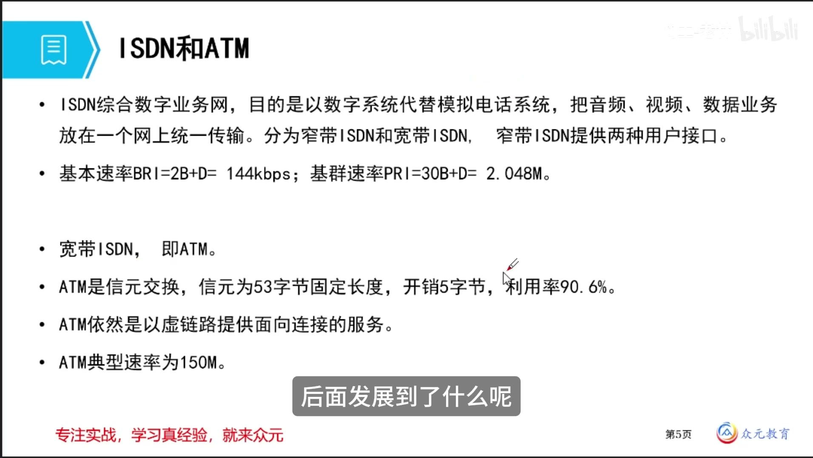

### 3.8 MPLS与MPLS VPN

#### 3.8.1 MPLS的基本原理

MPLS（Multiprotocol Label Switching，多协议标签交换）是一种标签交换技术。它在数据链路层帧头和网络层报文之间插入一个 32 位的 MPLS 标签，路由器根据标签而不是目的 IP 地址进行转发。

MPLS 标签的 32 位结构如下：

| 字段 | 长度 | 含义 |
| ---- | ---- | ---- |
| Label | 20 位 | 标签值，用于转发决策 |
| EXP/TC | 3 位 | 实验位，后用于流量类别（Traffic Class），支持 QoS |
| S | 1 位 | 栈底标志（Bottom of Stack），1 表示最后一个标签 |
| TTL | 8 位 | 生存时间，防止环路 |

MPLS 的基本角色和概念：

| 概念 | 说明 |
| ---- | ---- |
| LER | 标签边缘路由器（Label Edge Router），位于 MPLS 网络边缘，负责压入或弹出标签 |
| LSR | 标签交换路由器（Label Switch Router），位于 MPLS 网络内部，负责交换标签 |
| LSP | 标签交换路径（Label Switched Path），一条单向的标签转发路径 |
| 标签操作 | Push（压入）、Swap（交换）、Pop（弹出） |
| 标签分发 | 可使用 LDP、RSVP-TE 等协议分发标签 |
| MPLS TE | MPLS 流量工程，可基于带宽和约束条件建立显式路径 |

MPLS 的转发过程：

1. 入口 LER 收到 IP 报文，根据目的前缀查找转发表，压入标签。
2. 核心 LSR 根据入标签查找标签转发表，将标签交换为出标签，转发到下一跳。
3. 出口 LER 弹出标签，恢复为普通 IP 转发。

#### 3.8.2 MPLS VPN

MPLS VPN 利用 MPLS 标签转发和 BGP 扩展，在运营商网络上构建隔离的虚拟专用网络。常见角色如下：

| 角色 | 说明 |
| ---- | ---- |
| CE | 用户边缘路由器（Customer Edge），位于用户网络边缘 |
| PE | 运营商边缘路由器（Provider Edge），连接 CE，维护 VRF |
| P | 运营商核心路由器（Provider），只负责标签转发，不维护客户 VPN 路由 |

MPLS L3VPN 的关键机制：

| 机制 | 说明 |
| ---- | ---- |
| VRF | 虚拟路由转发实例，为每个 VPN 维护独立的路由表和转发表，实现地址空间隔离 |
| RD | 路由区分符（Route Distinguisher），64 位，与 IPv4 前缀组合成 VPN-IPv4 前缀，保证不同 VPN 的相同私网地址不冲突 |
| RT | 路由目标（Route Target），BGP 扩展团体属性，控制 VPN 路由的导入和导出 |
| MP-BGP | 多协议 BGP，在 PE 之间传递 VPN-IPv4 路由和 VPN 标签 |
| 双层标签 | 外层标签用于骨干网转发，内层标签（VPN 标签）用于识别目的 VPN 和 CE |

MPLS VPN 的主要优点：

- 由运营商统一维护，用户无需建设完整的专线网状连接。
- 支持任意站点之间的互联，扩展方便。
- 通过 VRF、RD、RT 实现不同 VPN 的隔离。
- 可结合 QoS、流量工程，提供差异化服务。
- 支持 L3VPN 和 L2VPN（如 VPLS、VPWS）等多种业务。

### 3.9 SDH与OTN

#### 3.9.1 SDH

SDH（Synchronous Digital Hierarchy，同步数字体系）是 ITU-T G.707 定义的同步光传输体制，主要用于城域网和骨干网的传送。

SDH 的基本速率等级：

| 等级 | 速率（精确值） | 速率（约值） |
| ---- | -------------- | ------------ |
| STM-1 | 155.52 Mbps | 155 Mbps |
| STM-4 | 622.08 Mbps | 622 Mbps |
| STM-16 | 2488.32 Mbps | 2.5 Gbps |
| STM-64 | 9953.28 Mbps | 10 Gbps |
| STM-256 | 39813.12 Mbps | 40 Gbps |

STM-1 的帧结构为 **9 行 × 270 列字节**，每帧 2430 字节，帧周期为 **125 微秒**，即每秒 8000 帧。帧中包含段开销（SOH）、管理单元指针（AU-PTR）和净负荷（Payload）。STM-N 的帧为 9 行 × 270×N 列，采用字节间插复用。

SDH 的关键概念：

| 概念 | 说明 |
| ---- | ---- |
| VC-4 | 虚容器，STM-1 中可承载一个 VC-4，速率约 150.336 Mbps |
| AU-4 | 管理单元，由 VC-4 加 AU 指针构成 |
| 指针 | 用于定位 VC 在帧中的起始位置，支持同步和复用 |
| 开销 | 段开销（SOH）、通道开销（POH），用于运维、管理和差错监视 |
| 保护 | 复用段保护（MSP）1+1/1:1、通道保护等，提高可靠性 |
| 设备 | ADM（分插复用器）、DXC（数字交叉连接设备） |

SDH 的优点是：同步传输、标准光接口、强大的 OAM 能力、灵活的复用和交叉连接、完善的保护机制。缺点是：带宽粒度较小、IP 数据业务承载效率不高、扩展性受限。

#### 3.9.2 OTN

OTN（Optical Transport Network，光传送网）是 ITU-T G.709 定义的新一代光传输体制，结合了 SDH 的管理能力和 DWDM 的大容量传输能力。

OTN 的层次结构：

| 层次 | 说明 |
| ---- | ---- |
| OCh | 光通道层，负责端到端的波长通道 |
| OMS | 光复用段层，负责多个波长的复用和放大 |
| OTS | 光传输段层，负责光纤线路的传输 |

OTN 的容器和速率：

| 容器 | 速率（约值） | 说明 |
| ---- | ------------ | ---- |
| OTU1 | 2.666 Gbps | 可承载 STM-16/OC-48 |
| OTU2 | 10.709 Gbps | 可承载 STM-64/OC-192 或 10GE |
| OTU3 | 43.018 Gbps | 可承载 STM-256/OC-768 或 40GE |
| OTU4 | 111.809 Gbps | 可承载 100GE |

OTN 的关键特点：

- 采用 ODUk/OTUk 容器，支持多种客户信号（SDH、以太网、IP/MPLS 等）的透明传送。
- 具有完整的开销字段，支持分层管理和故障定位。
- 支持前向纠错（FEC），延长传输距离，降低误码率。
- 支持 ROADM（可重构光分插复用器），实现波长的灵活调度。
- 支持大容量、长距离传输，是骨干光网络的主流技术。
- 后续发展包括 FlexO、OTUCn 等灵活速率和超 100G 技术。

SDH 与 OTN 的对比：

| 比较项 | SDH | OTN |
| ------ | --- | --- |
| 标准 | ITU-T G.707 | ITU-T G.709 |
| 基本速率 | STM-1 155.52 Mbps | OTU1 2.666 Gbps |
| 复用方式 | 字节间插、指针调整 | ODUk/OTUk 容器、波长复用 |
| 管理开销 | 段开销、通道开销 | OTN 开销、FEC |
| 保护方式 | MSP、通道保护 | OLP、ODUk SNCP 等 |
| 客户信号 | 以 TDM 业务为主 | 透明承载 SDH、以太网、IP 等 |
| 典型定位 | 城域传送、传统骨干 | 大容量骨干、长距光传输 |

### 3.10 HDLC协议

HDLC（High-level Data Link Control，高级数据链路控制）是一种应用广泛的**面向比特**的高级数据链路控制协议，也是 Cisco 路由器上默认的 WAN 接口封装协议。

HDLC 的帧结构如下：

| 字段 | 长度 | 说明 |
| ---- | ---- | ---- |
| 帧标志 F | 8 位 | **01111110**，帧定界符，标识帧的开始和结束 |
| 地址 | 8 位 | 从站或对端地址；在点对点链路中可用于标识方向 |
| 控制 | 8 位 | 标识帧类型，包含序号、确认号等 |
| 数据 | ≥0 位 | 用户数据，长度可变 |
| 校验和 FCS | 16 位或 32 位 | 帧校验序列，用于差错检测 |
| 帧标志 F | 8 位 | 下一个帧的起始标志，也可作为当前帧的结束标志 |

HDLC 使用 **零比特填充**（Zero-bit Stuffing）来避免数据部分出现与帧标志相同的比特序列：

- 发送端在数据部分每出现 **5 个连续的 1**，就插入一个 0，避免出现 6 个连续的 1。
- 接收端在数据部分每检测到 5 个连续的 1，就删除其后的一个 0，恢复原始数据。
- 这样，帧标志 `01111110` 就不会在数据中意外出现，从而实现透明传输。

HDLC 的控制字段决定帧的类型：

| 帧类型 | 控制字段第 1、2 位 | 作用 | 子类型 |
| ------ | ------------------- | ---- | ------ |
| 信息帧（I 帧） | 第 1 位为 **0** | 传输用户数据 | 携带 N(S)、N(R)，可捎带确认 |
| 监控帧（S 帧） | 第 1、2 位为 **10** | 进行流量控制和差错控制，不携带信息字段 | RR、REJ、RNR、SREJ |
| 无编号帧（U 帧） | 第 1、2 位为 **11** | 进行链路控制，如建立连接、拆除连接、命令和响应 | 无序号，携带控制功能码 |

监控帧的四种类型：

| 第 3、4 位 | 名称 | 英文 | 作用 |
| ---------- | ---- | ---- | ---- |
| 00 | 接收就绪 | RR（Receive Ready） | 表示已准备好接收下一帧，可确认之前收到的帧 |
| 01 | 拒绝 | REJ（Reject） | 回退 N 帧 ARQ，要求从出错帧开始重发其后的所有帧 |
| 10 | 接收未就绪 | RNR（Receive Not Ready） | 表示忙，暂时不能接收，要求对方等待 |
| 11 | 选择拒绝 | SREJ（Selective Reject） | 选择重发 ARQ，只要求重发出错的那一帧 |

HDLC 的序号采用 0～7 循环编号，即模 8 编号。发送方维护 N(S)，接收方维护 N(R)，通过窗口机制实现流量控制和差错控制。

HDLC 的典型工作过程：

1. 建立链路（U 帧）。
2. 响应/确认（S 帧）。
3. 发送信息（I 帧）。
4. 接收方反馈（S 帧）。
5. 断开链路（U 帧）。

需要说明：标准 HDLC 是面向比特的协议，不定义网络层协议类型字段；Cisco 路由器上的 HDLC 封装是 Cisco 私有实现，在标准 HDLC 基础上增加了 2 字节协议类型字段，用于标识网络层协议，但仍不能与其他厂商的标准 HDLC 直接互通。考试中若提到“Cisco 默认 WAN 封装”，通常指 Cisco HDLC。

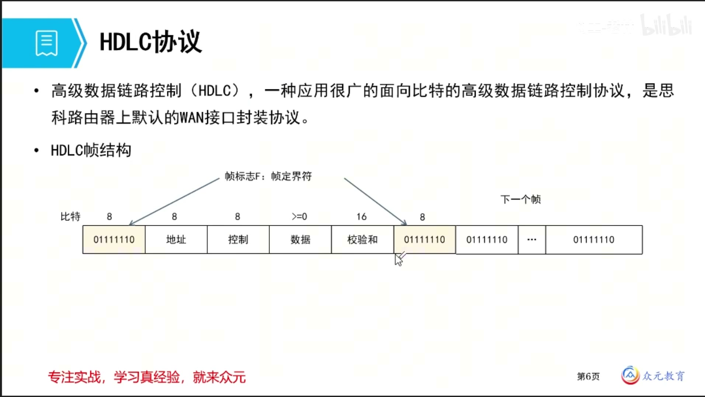

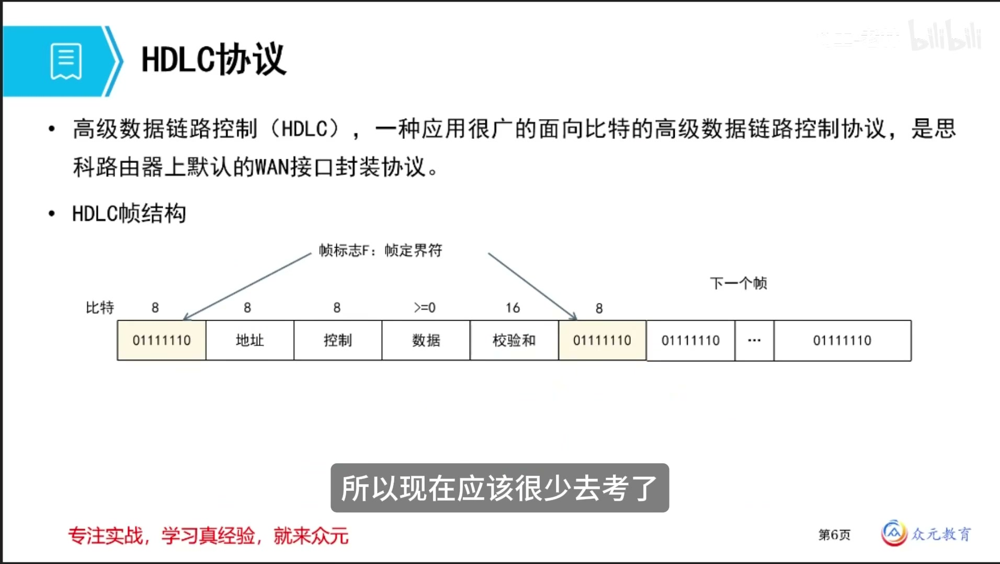

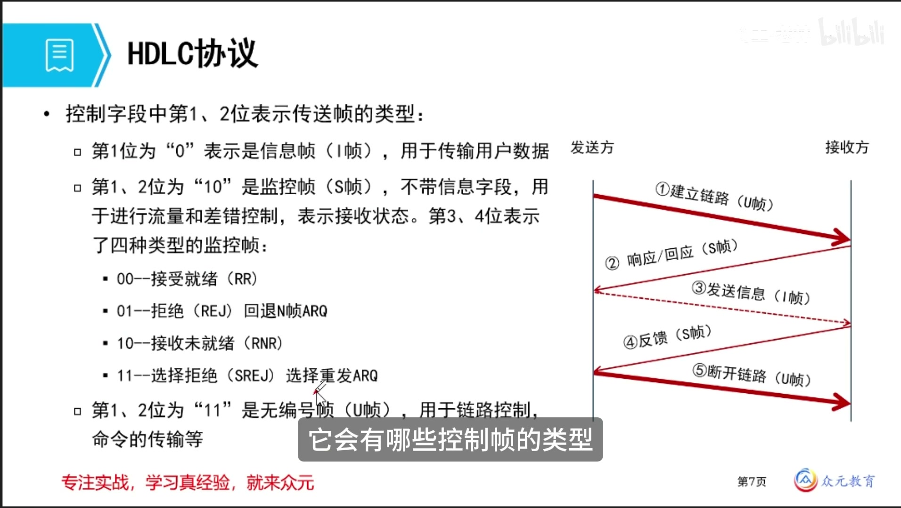

### 3.11 PPP与PPPoE

PPP（Point-to-Point Protocol，点到点协议）是面向字节的链路控制协议，广泛用于拨号、专线和宽带接入。PPP 由 RFC 1661 定义，支持多种网络层协议，具有错误检测、地址协商和身份认证等功能。

PPP 的主要特点：

| 功能 | 说明 |
| ---- | ---- |
| 链路控制 | 通过 LCP（Link Control Protocol）建立、配置、测试和关闭数据链路 |
| 网络层协议支持 | 通过 NCP（Network Control Protocol）支持 IP、IPX 等多种网络层协议 |
| 错误检测 | 使用 FCS 进行帧校验 |
| 地址协商 | 允许在连接时协商 IP 地址 |
| 身份认证 | 支持 PAP 和 CHAP 两种认证方式 |
| 应用 | PPPoE（以太网上的点对点协议）广泛用于宽带拨号上网 |

PPP 的帧格式如下：

| 字段 | 长度 | 说明 |
| ---- | ---- | ---- |
| 标志 | 1 字节 | **0x7E** |
| 地址 | 1 字节 | **0xFF**（广播地址） |
| 控制 | 1 字节 | **0x03**（无编号信息） |
| 协议 | 2 字节 | 标识净负荷类型，如 0x0021 表示 IP，0xC021 表示 LCP，0xC023 表示 PAP，0xC223 表示 CHAP |
| 信息 | 可变 | 用户数据或控制报文 |
| FCS | 2 或 4 字节 | 帧校验序列 |
| 标志 | 1 字节 | **0x7E** |

PPP 使用字节填充（Byte Stuffing）实现透明传输：当信息字段中出现与标志 `0x7E` 相同的字节时，将其转义为 `0x7D 0x5E`；出现 `0x7D` 时，转义为 `0x7D 0x5D`。

PPP 的认证方式：

| 认证方式 | 握手次数 | 口令传输 | 安全性 | 特点 |
| -------- | -------- | -------- | ------ | ---- |
| PAP | 两次握手 | 明文传送口令 | 较低 | 被验证方首先发起验证请求，实现简单 |
| CHAP | 三次握手 | 不直接发送口令，使用挑战—响应和哈希 | 较高 | 主验证方首先发起挑战，安全性比 PAP 高 |

PPPoE（PPP over Ethernet，以太网上的点对点协议）由 RFC 2516 定义，将 PPP 帧封装在以太网帧中，广泛用于家庭宽带拨号。PPPoE 分为发现阶段和会话阶段：

1. **发现阶段**：客户端通过广播发现接入集中器（AC），获取 Session ID。
2. **会话阶段**：在以太网上建立 PPP 会话，进行 LCP 协商、认证、NCP 协商，然后传输 IP 数据。

由于 PPPoE 头部占用 8 字节，PPP 的 MRU/MTU 通常设置为 **1492 字节**，以避免以太网帧超过 1500 字节。

PPP 与 HDLC 的对比：

| 比较项 | HDLC | PPP |
| ------ | ---- | --- |
| 面向 | 面向比特 | 面向字节 |
| 标准化 | ISO 标准；Cisco HDLC 为私有实现 | RFC 标准，多厂商互通 |
| 网络层协议 | 标准 HDLC 不定义协议类型字段；Cisco HDLC 增加 2 字节协议字段，可标识多种协议 | 通过协议字段支持多种网络层协议 |
| 认证 | 不定义 | 支持 PAP、CHAP |
| 地址协商 | 不支持 | 支持 IP 地址协商 |
| 典型应用 | Cisco 路由器串行链路默认封装 | 拨号、专线、PPPoE 宽带接入 |

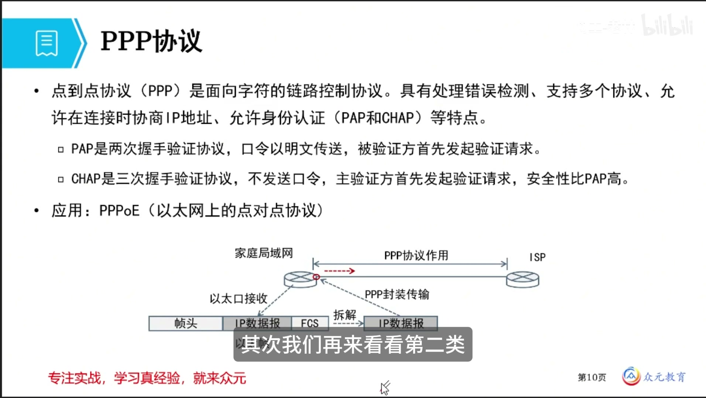

### 3.12 光接入网

光接入网是用户接入网的发展方向，典型结构为 **PON（Passive Optical Network，无源光网络）**。PON 由以下三部分组成：

| 组成部分 | 说明 |
| -------- | ---- |
| OLT | 光线路终端（Optical Line Terminal），位于运营商局端，负责接入控制和调度 |
| ODN | 光分配网（Optical Distribution Network），由光纤和分光器组成，无源器件 |
| ONU/ONT | 光网络单元/光网络终端，位于用户侧，负责光电转换和用户接口 |

PON 的典型拓扑为点到多点：OLT 通过一根光纤连接到无源分光器，分光器再分支到多个 ONU。下行方向采用广播/TDM 方式，上行方向采用 TDMA 方式，ONU 在 OLT 分配的时隙内发送数据。

常见 PON 标准：

| 标准 | 下行速率 | 上行速率 | 说明 |
| ---- | -------- | -------- | ---- |
| EPON（IEEE 802.3ah） | 1.25 Gbps | 1.25 Gbps | 基于以太网帧，对称速率 |
| GPON（ITU-T G.984） | 2.5 Gbps | 1.25 Gbps | 使用 GEM 封装，支持多业务 |
| XG-PON（ITU-T G.987） | 10 Gbps | 2.5 Gbps | 10G PON 的非对称版本 |
| XGS-PON（ITU-T G.9807） | 10 Gbps | 10 Gbps | 10G 对称 PON |
| 10G-EPON（IEEE 802.3av） | 10 Gbps | 10 Gbps | 10G 以太网 PON |

光接入的典型部署方式：

| 方式 | 含义 |
| ---- | ---- |
| FTTH | 光纤到户（Fiber To The Home），光纤直接进入用户家庭 |
| FTTB | 光纤到楼（Fiber To The Building），光纤到楼宇，楼内再用铜线或 LAN 接入 |
| FTTC | 光纤到路边（Fiber To The Curb），光纤到路边，最后一段用铜线接入 |
| FTTD | 光纤到桌面（Fiber To The Desk） |

与有源光网络（AON）相比，PON 的 ODN 全部由无源器件组成，无需供电，维护成本低，适合大规模接入。PON 已成为家庭宽带、企业专线和 5G 前传的重要接入方式。

### 3.13 典型例题

#### 例题1：HDLC协议的基本概念

HDLC 协议是一种（1），采用（2）标志作为帧定界符。

（1）

- A、面向比特的同步链路控制协议
- B、面向字节计数的同步链路控制协议
- C、面向字符的同步链路控制协议
- D、异步链路控制协议

（2）

- A、10000001
- B、01111110
- C、10101010
- D、10101011

答案：（1）**A** [正确]；（2）**B** [正确]

解答：

- HDLC 是面向比特的同步链路控制协议，不是面向字节计数或面向字符的协议，也不是异步协议。
- HDLC 使用 `01111110` 作为帧定界符，并通过零比特填充避免数据中出现相同的比特序列。以太网的前导码（前 7 个字节为 `10101010`，最后 1 个字节为 `10101011`）不能与 HDLC 帧标志混淆。

#### 例题2：监控帧的作用

采用 HDLC 协议进行数据传输时，监控帧（S）的作用是（ ）。

- A、传输数据并对对端信息帧进行捎带应答
- B、进行链路设置、连接管理等链路控制
- C、采用后退 N 帧或选择性重传进行差错控制
- D、进行介质访问控制

答案：**C** [正确]

解答：

- A 项 [错误]。该描述是信息帧（I 帧）的作用。
- B 项 [错误]。该描述是无编号帧（U 帧）的作用。
- C 项 [正确]。监控帧用于流量和差错控制，包括 RR、REJ、RNR、SREJ 四种，其中 REJ 采用后退 N 帧重传，SREJ 采用选择重传。
- D 项 [错误]。介质访问控制不是 HDLC 监控帧的功能。

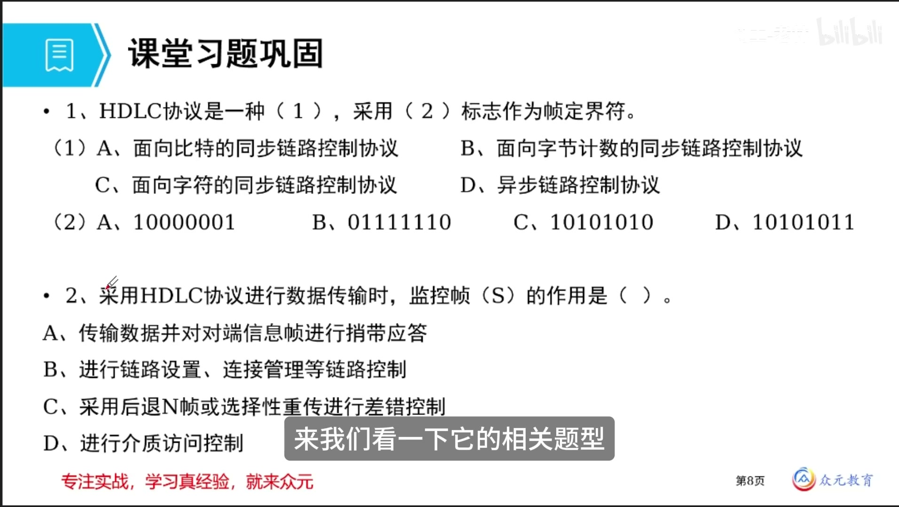

#### 例题3：HDLC的REJ与SREJ

采用 HDLC 协议进行数据传输，帧 0～7 循环编号，当发送站发送了编号为 0～4 的 5 帧时，收到了对方应答帧 REJ3，此时发送站应发送的后续 3 帧为（1）；若收到的对方应答帧为 SREJ3，则发送站应发送的后续 3 帧为（2）。

（1）

- A、2、3、4
- B、3、4、5
- C、3、5、6
- D、5、6、7

（2）

- A、2、3、4
- B、3、4、5
- C、3、5、6
- D、5、6、7

答案：（1）**B** [正确]；（2）**C** [正确]

解答：

- 发送站已发送 0、1、2、3、4 共 5 帧。收到 **REJ3** 表示从 3 号帧开始回退，3、4 号帧以及新的 5 号帧都需要重发，因此后续 3 帧为 **3、4、5**。
- 收到 **SREJ3** 表示只选择重发 3 号帧；4 号帧已被正确接收，因此重发 3 号帧后，继续发送新的 5、6 号帧，后续 3 帧为 **3、5、6**。

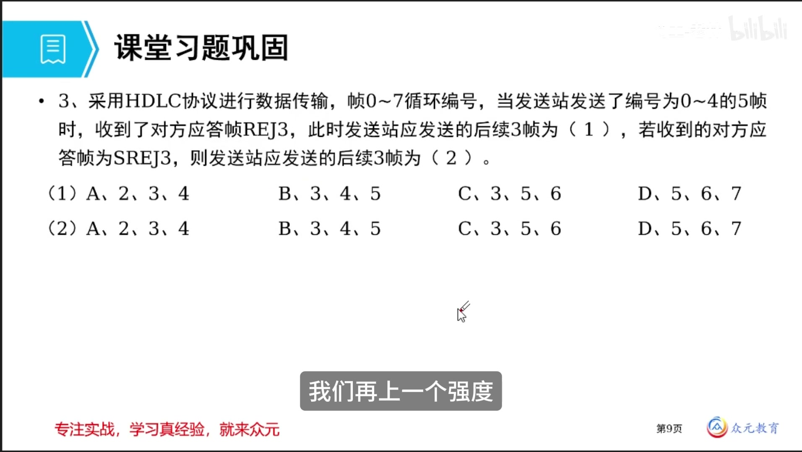

#### 例题4：PPP协议的特点

PPP 是连接广域网的一种封装协议，下面关于 PPP 的描述中错误的是（ ）。

- A、能够控制数据链路的建立
- B、能够分配和管理广域网的 IP 地址
- C、只能采用 IP 作为网络层协议
- D、能够有效地进行错误检测

答案：**C** [正确]

解答：

- A 项 [正确]。PPP 通过 LCP 控制数据链路的建立、配置和关闭。
- B 项 [正确]。PPP 允许在连接时协商 IP 地址，可通过 NCP 分配和管理 IP 地址。
- C 项 [错误]。PPP 通过协议字段支持多种网络层协议，不只支持 IP；还可支持 IPX 等协议。
- D 项 [正确]。PPP 使用 FCS 进行帧校验，能够有效检测错误。

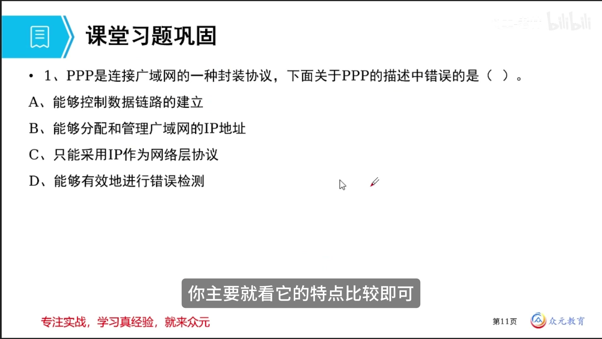

---

## 4.本章小结

### 4.1 核心知识表

| 知识块 | 核心内容 |
| ------ | -------- |
| IS-IS 定位 | 链路状态 IGP；电信运营商广泛采用；直接运行于链路层；使用 Hello（IIH）发现邻居；SPF 计算路由 |
| IS-IS 层次 | L1 为普通区域，L2 为骨干区域；L1/L2 路由器同时参与两层；骨干由连续的 L2/L1-L2 路由器组成 |
| IS-IS 区域特点 | 按路由器划分区域，一台路由器只能属于一个 L1 区域；OSPF 按接口划分，可属于多个区域 |
| IS-IS 地址 | NET 是 NSEL=00 的 NSAP；NSAP = IDP + DSP；System ID 为 6 字节；NET 长度为 8～20 字节；AFI 49 为私有地址 |
| IS-IS 报文 | IIH、LSP、CSNP、PSNP；LSP 携带链路状态，CSNP/PSNP 用于数据库同步 |
| IS-IS 与 OSPF | 都为链路状态、SPF、分层；OSPF 封装在 IP 中（协议号 89）、骨干为 Area 0、按接口划分；IS-IS 封装在链路层、骨干为 L2、按路由器划分 |
| BGP 定位 | 外部网关协议；路径矢量；BGP-4 由 RFC 4271 定义；TCP 179 端口；用于 AS 之间传递路由 |
| BGP 对等体 | EBGP 位于不同 AS，IBGP 位于同一 AS；IBGP 默认需要全互联，或使用 RR/联盟 |
| BGP 连接 | 不要求直连；IBGP 建议使用 Loopback，EBGP 通常使用直连接口；EBGP 默认 TTL=1 |
| BGP 四种报文 | OPEN、UPDATE、KEEPALIVE、NOTIFICATION；Route-refresh 是扩展报文，不属于四种基础报文 |
| BGP 定时器 | KEEPALIVE 默认 60 秒；Hold Time 默认 180 秒 |
| BGP 路径属性 | 公认必遵：ORIGIN、AS_PATH、NEXT_HOP；公认自选：LOCAL_PREF、ATOMIC_AGGREGATE；可选传递：AGGREGATOR、COMMUNITY；可选非传递：MED、ORIGINATOR_ID、CLUSTER_LIST |
| BGP 选路 | 典型顺序：本地权重/首选值 → LOCAL_PREF → 本地起源 → AS_PATH → ORIGIN → MED → EBGP 优于 IBGP → IGP Cost → 其他 |
| BGP 防环 | AS_PATH 防 AS 间环路；IBGP 水平分割防 AS 内环路；RR 使用 Originator_ID、Cluster_List 防环 |
| BGP 路由生成 | BGP 自身不发现路由；通过 network 或 import-route 注入；network 的 ORIGIN 为 IGP，import-route 为 INCOMPLETE |
| BGP 聚合 | IPv4 支持自动聚合和手动聚合；IPv6 仅支持手动聚合 |
| 广域网概念 | 跨地区数据通信网络；通常由多个局域网组成，租用运营商线路；涉及物理层、数据链路层、网络层 |
| 交换方式 | 电路交换、报文交换、分组交换、信元交换、标签交换 |
| PSTN | 公共交换电话网；语音业务；用户回路模拟、长途干线数字；64 kbps 语音信道；已被 IP 网络取代 |
| X.25 | 分组交换；物理层、链路层、分组层；LAPB 可靠传输；SVC/PVC 虚电路；典型 64 kbps；已淘汰 |
| 帧中继 | X.25 的简化；二层帧交换；DLCI 本地有效；CIR/EIR；不纠错；可达 45 Mbps；90 年代主流 |
| DDN | 数字数据网；点到点数字专线；N×64 kbps；固定带宽、低时延、高成本 |
| ISDN | 综合数字业务网；BRI 2B+D=144 kbps；PRI 30B+D=2.048 Mbps（E1）或 23B+D=1.544 Mbps（T1） |
| ATM | 信元交换；53 字节信元（5 字节头 + 48 字节载荷）；利用率约 90.6%；异步时分复用；虚电路 VPI/VCI；典型 155 Mbps |
| MPLS | 标签交换；32 位标签（20 位标签 + 3 位 EXP/TC + 1 位 S + 8 位 TTL）；LER/LSR/LSP；LDP/RSVP-TE |
| MPLS VPN | PE/P/CE；VRF、RD、RT；MP-BGP 分发 VPN-IPv4 路由；双层标签；L3VPN/L2VPN |
| SDH | 同步数字体系；STM-1 155.52 Mbps；帧 9×270 字节、125 微秒；VC-4、AU 指针、MSP 保护 |
| OTN | 光传送网；G.709；ODUk/OTUk；OTU1 2.666 Gbps、OTU2 10.709 Gbps、OTU3 43.018 Gbps、OTU4 111.809 Gbps；FEC、ROADM |
| HDLC | 面向比特；Cisco 默认 WAN 封装；帧标志 01111110；零比特填充；I/S/U 帧；S 帧 RR/REJ/RNR/SREJ |
| PPP | 面向字节；RFC 1661；LCP/NCP；PAP 两次握手、CHAP 三次握手；PPPoE 用于宽带拨号；MTU 1492 |
| 光接入 | OLT、ODN、ONU/ONT；EPON 1.25G 对称；GPON 2.5G/1.25G；XG-PON 10G/2.5G；XGS-PON 10G/10G；FTTH/FTTB/FTTC |

### 4.2 高频考点与易错点

1. **IS-IS 的区域划分**：IS-IS 按路由器划分区域，一台路由器只能属于一个 L1 区域；OSPF 按接口划分，一台路由器可以属于多个区域。这是最容易被混淆的考点。
2. **IS-IS 的骨干**：IS-IS 没有 Area 0，骨干由连续的 L2 路由器和 L1/L2 路由器组成；OSPF 的骨干固定为 Area 0。
3. **IS-IS 的封装**：IS-IS 直接运行在链路层，不封装在 IP 中；OSPF 封装在 IP 中，协议号 89。
4. **IS-IS 的 NET**：NET 是 NSEL=00 的 NSAP；NSAP = IDP + DSP；System ID 为 6 字节；AFI 49 为私有地址；NET 长度为 8～20 字节。
5. **IS-IS 的 PDU**：IIH 发现邻居，LSP 描述链路状态，CSNP/PSNP 同步数据库；不要与 OSPF 的 Hello、DD、LSR、LSU、LSAck 混淆。
6. **BGP 的定位**：BGP 是外部网关协议，严格来说是路径矢量协议；课件可能将其归入距离矢量家族，考试中应根据题目表述判断。
7. **BGP 的传输层**：BGP 使用 TCP 179 端口；不是 UDP，也不是直接封装在 IP 中。
8. **BGP 的四种报文**：OPEN、UPDATE、KEEPALIVE、NOTIFICATION；Route-refresh 是扩展报文，不属于四种基础报文。
9. **BGP 的邻居建立**：先发 OPEN，收到可接受的 OPEN 后回 KEEPALIVE；不是用 Hello 建立邻居。
10. **BGP 的 KEEPALIVE 定时器**：默认 60 秒发送一次，Hold Time 默认 180 秒；Hold Time 由双方协商，取较小值。
11. **EBGP 与 IBGP**：EBGP 位于不同 AS，通常直连，TTL 默认 1；IBGP 位于同一 AS，通常使用 Loopback，不改变 AS_PATH。
12. **IBGP 全互联**：默认需要全互联，n 台路由器需要 n(n-1)/2 条会话；可用路由反射器或联盟替代。
13. **BGP 的下一跳**：EBGP 通常将 NEXT_HOP 改为自身接口地址；IBGP 默认不改变 NEXT_HOP，因此需要保证 NEXT_HOP 通过 IGP 可达，必要时配置 next-hop-self。
14. **LOCAL_PREF 与 MED**：LOCAL_PREF 越大越优，影响流量离开本 AS，只在 IBGP 内传递；MED 越小越优，影响流量进入本 AS，只在同一邻居 AS 间比较。
15. **AS_PATH 防环**：收到的路由若包含本地 AS 号，则拒绝；AS_PATH 越短越优；AS_SET 计为 1。
16. **BGP 选路顺序**：先比本地权重/首选值，再比 LOCAL_PREF、本地起源、AS_PATH、ORIGIN、MED、EBGP/IBGP、IGP Cost；不同厂商细节略有差异。
17. **BGP 路由生成**：BGP 自身不发现路由，必须通过 network 或 import-route 注入；network 的 ORIGIN 为 IGP，优先级高于 import-route 的 INCOMPLETE。
18. **BGP 聚合**：IPv4 支持自动聚合和手动聚合；IPv6 仅支持手动聚合。
19. **BGP 同步**：传统规则要求 IBGP 路由被 IGP 传播后才能通告给 EBGP；现代网络通常关闭同步，但必须通过全互联/RR/联盟避免路由黑洞。
20. **电路交换与分组交换**：电路交换建立专用物理通路，带宽固定、时延低、利用率低；分组交换动态共享带宽、利用率高、时延较低。
21. **X.25 与帧中继**：X.25 三层、可靠传输、逐段纠错、典型 64 kbps；帧中继二层、不纠错、出错丢弃、DLCI 本地有效、可达 45 Mbps。
22. **DLCI 的本地性**：DLCI 只在本地接口有效，不具有全局唯一性；不要把它与 IP 地址或 MAC 地址混淆。
23. **ATM 信元**：固定 53 字节，5 字节头 + 48 字节载荷，利用率约 90.6%；采用异步时分复用和虚电路。
24. **ISDN 速率**：BRI 2B+D=144 kbps；PRI 30B+D=2.048 Mbps（E1）；B 信道 64 kbps，D 信道 16 kbps（BRI）或 64 kbps（PRI）。
25. **DDN 与帧中继**：DDN 是固定带宽的数字专线，帧中继是共享网络的虚电路；前者带宽独占、成本高，后者带宽动态复用、成本较低。
26. **MPLS 标签**：32 位，20 位标签 + 3 位 EXP/TC + 1 位 S + 8 位 TTL；LER 压入/弹出标签，LSR 交换标签。
27. **MPLS VPN 三要素**：VRF 实现路由隔离，RD 保证私网地址不冲突，RT 控制路由导入导出；PE 之间通过 MP-BGP 传递 VPN-IPv4 路由。
28. **SDH 速率**：STM-1 155.52 Mbps，STM-4 622.08 Mbps，STM-16 2.5 Gbps，STM-64 10 Gbps，STM-256 40 Gbps；帧为 9×270 字节、125 微秒。
29. **OTN 速率**：OTU1 约 2.666 Gbps，OTU2 约 10.709 Gbps，OTU3 约 43.018 Gbps，OTU4 约 111.809 Gbps；支持 FEC 和透明承载。
30. **HDLC 帧标志**：01111110；采用零比特填充，每 5 个连续 1 插入一个 0；不要与以太网前导码混淆。
31. **HDLC 监控帧**：RR 00、REJ 01、RNR 10、SREJ 11；REJ 回退 N 帧，SREJ 只重发出错帧。
32. **PPP 的认证**：PAP 两次握手，明文口令；CHAP 三次握手，挑战—响应，不直接发送口令，安全性更高。
33. **PPPoE 的 MTU**：PPPoE 头部占 8 字节，PPP MTU 通常为 1492 字节；不要与以太网 1500 字节混淆。
34. **PON 的速率**：EPON 1.25G 对称；GPON 2.5G 下行/1.25G 上行；XG-PON 10G/2.5G；XGS-PON 10G/10G。
35. **光接入的组成**：OLT 位于局端，ODN 由光纤和无源分光器组成，ONU/ONT 位于用户侧；下行广播/TDM，上行 TDMA。

### 4.3 规范依据与核实说明

本笔记的关键参数已结合公开标准、RFC 与厂商文档核对：

| 内容 | 核实依据 |
| ---- | -------- |
| IS-IS 的定位、L1/L2、区域划分、NET/NSAP、LSP/CSNP/PSNP、DIS | ISO/IEC 10589；RFC 1195；Cisco/Huawei 配置文档 |
| OSPF 的 IP 协议号 89、Area 0、LSA 类型 | RFC 2328 |
| BGP-4 的 TCP 179、OPEN/UPDATE/KEEPALIVE/NOTIFICATION、路径属性、决策过程 | RFC 4271 |
| BGP Route-refresh | RFC 2918 |
| BGP 路由反射器与 Originator_ID、Cluster_List | RFC 4456 |
| BGP 联盟 | RFC 5065 |
| BGP COMMUNITY 属性 | RFC 1997 |
| BGP 4 字节 AS 号 | RFC 6793 |
| MP-BGP | RFC 4760 |
| MPLS 标签格式（20+3+1+8） | RFC 3032 |
| PPP 帧格式、LCP/NCP、PAP/CHAP | RFC 1661；RFC 1334；RFC 1994 |
| PPPoE | RFC 2516 |
| SDH 速率与帧结构 | ITU-T G.707 |
| OTN 容器与速率 | ITU-T G.709 |
| GPON 速率 | ITU-T G.984 |
| X.25 | ITU-T X.25 |
| 帧中继 | ITU-T Q.922、X.76 |
| ATM | ITU-T I.361；ATM Forum |
| DDN | 运营商与教材资料 |

存疑与说明：

- **BGP 的四种报文与 Route-refresh**：课件列出 OPEN、UPDATE、KEEPALIVE、NOTIFICATION、Route-refresh 五种。RFC 4271 只定义前四种，Route-refresh 是 RFC 2918 的扩展报文。考试若问“BGP 报文类型”，通常按四种基础报文作答；若选项中出现 Route-refresh，应知道其用途，但不要把它归入四种基础报文。
- **BGP 的分类**：课件将 BGP 称为“特殊的距离矢量路由协议”。严格来说，BGP 是路径矢量协议，通过 AS_PATH 记录 AS 序列。考试中若按课件分类选“距离矢量”，应按题目语境判断；若题目强调“路径矢量”，则应选“路径矢量”。
- **iBGP 全互联**：课件强调“IBGP 路由器必须是全互联的”。这是 BGP 的基础行为；实际部署中可使用路由反射器或联盟替代全互联，二者都是标准机制。
- **BGP 同步**：课件提到“关闭同步后导致路由黑洞”。同步机制本身是历史规则，现代网络通常关闭；关闭后必须保证 IBGP 路由在 AS 内完整传播，否则仍可能出现黑洞。不能简单理解为“关闭同步一定安全”或“关闭同步一定导致黑洞”。
- **HDLC 的私有性**：课件称 HDLC 是“Cisco 路由器上默认的 WAN 接口封装协议”。这指的是 Cisco 的 HDLC 实现；Cisco HDLC 在标准 HDLC 基础上增加了 2 字节协议类型字段，二者并不完全相同，Cisco HDLC 不能与其他厂商的标准 HDLC 直接互通。
- **ATM 的速率**：课件写“ATM 典型速率 150M”。STM-1/OC-3 的线路速率为 155.52 Mbps，ATM 有效信元速率约为 149.76 Mbps；课件中的 150M 是简化说法，本笔记在速率表中写作线路速率 155.52 Mbps。
- **帧中继的速率**：课件写“可达 45M”，对应 T3/DS3 的 44.736 Mbps，本笔记写作 45 Mbps。
- **X.25 的速率**：课件写“64k”，这是典型值；实际 X.25 网络也可能提供更高速率，但受协议开销和设备性能限制。
- **DDN、MPLS VPN、SDH、OTN、光接入**：这些内容在 p45 课件中没有逐一展开，本笔记依据标准和公开资料补充，作为广域网知识体系的完整化；考试中应以教材和考试大纲的深度为准。
- **p45 后段的课程回顾**：p45 后半部分是全课程章节小结（应用层、传输层、网络层、路由、广域网），其中大量内容属于前面章节。本笔记只吸收与本节相关的路由和广域网要点，未逐条展开应用层、传输层和 IPv4/IPv6 的复习内容，以避免与前面笔记重复。
- **IS-IS 例题的 D 项**：D 项“地址结构由 IDP 和 DSP 两部分组成”是正确的。NSAP 由 IDP 和 DSP 组成；DSP 中又包含 High Order DSP、System ID 和 NSEL。C 项才是错误项，因为 IS-IS 不能按接口划分区域。

### 4.4 课程章节回顾（路由与广域网部分）

p45 末尾对本课程进行了整体回顾，其中与本章相关的要点如下：

| 回顾项 | 要点 |
| ------ | ---- |
| ARP | 维护 ARP 缓存表；广播请求、单播响应；实现 IP 地址到 MAC 地址的映射 |
| 路由表 | 包含目的地址、优先级、开销、下一跳等信息；路由汇聚可减小路由表规模 |
| 静态路由 | 手工配置；可配置默认路由、等价路由、浮动路由 |
| 动态路由 | 自动计算路由；按作用范围分为 IGP 和 EGP；按工作原理分为距离矢量（RIP/BGP）和链路状态（OSPF/IS-IS） |
| 典型路由协议 | RIP：30 秒周期更新、跳数度量、适合小网络；OSPF：链路状态、Cost、分区、适合大型网络；IS-IS：链路状态、按路由器划分区域；BGP：外部网关、路径属性丰富、用于 AS 之间 |
| 广域网 | 传统技术多已淘汰，最终主流是互联网/IP；广域网技术位于物理层、数据链路层和网络层 |

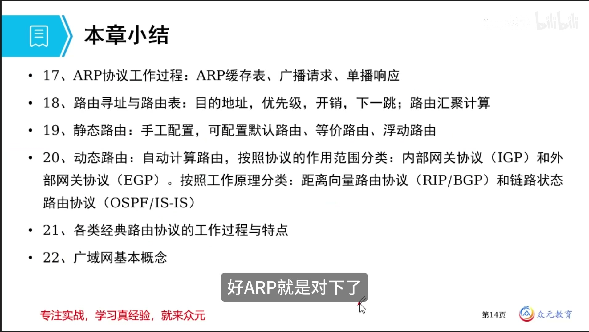
