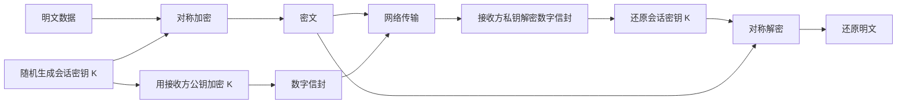
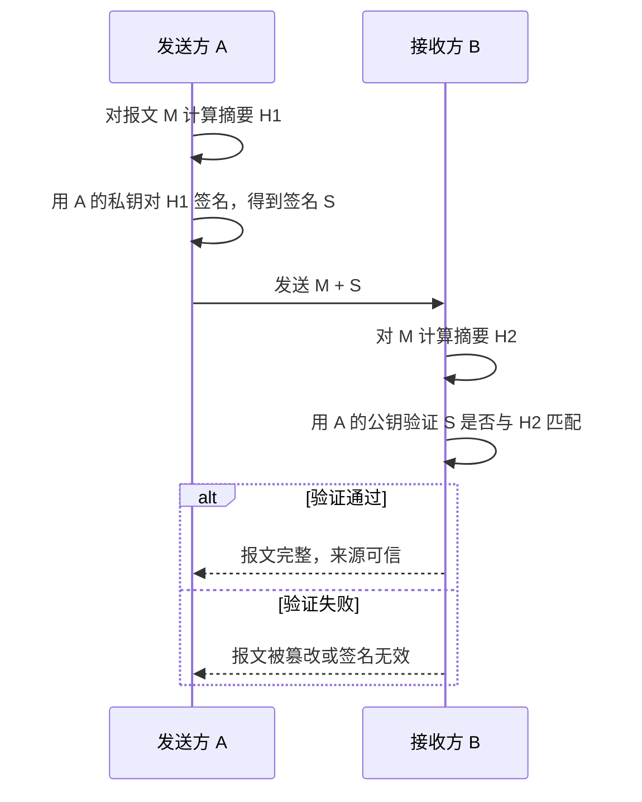

# 网络安全基础与加密技术 · 完整笔记

---

## 1.课程知识脉络

本章知识体系可分为三部分：网络安全基础（含等级保护、防范技术、攻击类型）、加密技术及其应用（密码体制、数字签名、数字证书、报文摘要）与网络安全防护系统。

本章围绕网络安全的三个核心问题展开：什么样是安全的（安全要素）、有哪些防护技术手段、面临哪些经典攻击行为。后续章节将逐一展开各技术细节。

---

## 2.网络安全的定义

网络安全的通用定义：网络系统的硬件、软件及其系统中的数据受到保护，不因偶然的或者人为恶意的原因遭到破坏、更改、泄露，系统连续、可靠、正常地运行，网络服务不中断。

网络安全主要包括两大部分：

| 组成部分 | 内容 |
| -------- | ---- |
| 网络系统安全 | 保证信息处理和传输系统的安全（物理设备、应用环境、应用软件等），保障服务不中断、系统可靠稳定运行 |
| 网络上的信息安全 | 网络信息安全（保护信息的保密性、真实性和完整性，保护合法用户的利益和隐私）与网络信息传播安全（进行信息过滤，避免公用通信网络上传输的信息失控） |

其中：

- 信息安全（静态存储安全）：信息不能被非授权用户看懂；接收到的必须是合法用户的信息而不是伪冒身份；信息要原封不动地到达目的端，不被修改篡改。
- 传播安全（动态传输安全）：强调公共网络中信息的可控性与管理性，防止非法信息传播，避免自由传输的信息失控（如诽谤、不真实信息造成舆论危机）。

---

## 3.五大基本安全要素

| 要素 | 含义 |
| ---- | ---- |
| 机密性 | 网络中的保密信息只能供经过允许的人员以经过允许的方式使用 |
| 完整性 | 网络中的信息在存储和传输过程中，不会被修改、破坏或丢弃 |
| 可用性 | 网络资源在需要时能方便顺畅获得，尽可能地不受系统故障等方面的影响 |
| 可控性 | 网络管理员对网络系统本身和所传播信息的范围及内容有控制能力，保证网络的使用和信息的传播遵守相关的国家法律法规 |
| 可审查性 | 对网络系统中的活动留有记录，能够审计、追踪和追责，常与不可抵赖性一起讨论 |

其中**机密性、完整性、可用性**是核心三要素，合称 **CIA 三元组**。严格说，可审查性强调“有记录可查”，不可抵赖性强调“事后不能否认”，二者相关但不能完全等同；教材常把不可抵赖性作为可审查性的延伸一起列出。

考试方向：

1. 早期直接考查概念辨析（如下方例题 1），现已较少单独考查。
2. 现在多结合攻击行为考查：给出某种攻击/破坏行为，判断其破坏了哪些安全要素。例如黑客植入后门仅监听聊天信息并发布到网上，破坏的是**机密性**（非法用户看到了不该看到的信息）。

---

## 4.网络安全法律法规与等级保护

### 4.1 相关法律法规

做好安全防护，最底层的支撑是法律法规。《网络安全法》于 2016 年提出、2017 年实施，最新修正案于 2025 年通过、2026 年 1 月 1 日正式生效。此外还有《密码法》（2019 年通过、2020 年 1 月 1 日实施）、《数据安全法》（2021 年通过、2021 年 9 月 1 日实施）等。从事信息安全工作必须先熟悉法律法规，明确行为的合法边界。

### 4.2 等级保护的五个保护等级

依据**受侵害的客体**和**对客体的侵害程度**，网络信息划分为 5 个保护等级，分别是：自主保护、指导保护、监督保护、强制保护、专控保护。

定级要素与安全保护等级的关系：

| 受侵害的客体 | 一般损害 | 严重损害 | 特别严重损害 |
| ------------ | -------- | -------- | ------------ |
| 公民、法人和其他组织的合法权益 | 第一级 | 第二级 | 第二级 |
| 社会秩序、公共利益 | 第二级 | 第三级 | 第四级 |
| 国家安全 | 第三级 | 第四级 | 第五级 |

| 等级 | 名称 | 典型对象 | 备案与测评要求 |
| ---- | ---- | -------- | -------------- |
| 一级 | 自主保护 | 个人、小型私营企业、中小学、乡镇所属信息系统等，破坏影响不大 | 一般不需要备案，测评周期无要求 |
| 二级 | 指导保护 | 县级以上或地市级以上国家机关、企业单位内的一般信息系统，对外服务类系统 | 需向公安机关备案，建议每两年评估检测一次 |
| 三级 | 监督保护 | 地市级或国家机关、企业、事业单位的重要信息系统，涉及工作秘密、商业秘密和敏感信息 | 每年检测一次 |
| 四级 | 强制保护 | 省级、电力调度系统等非常重要的信息系统 | 备案、定期评估、强制性保护，更高频度评审（半年一次） |
| 五级 | 专控保护 | 军事领域、航天领域等涉及国家安全的机密系统 | 必须严格备案，接受高频率的安全评估 |

### 4.3 等级保护 2.0（三分技术，七分管理）

《网络安全等级保护 2.0》于 2019 年 12 月 1 日正式实施。安全保护建设要求分为**技术要求**与**管理要求**两方面，即"**三分技术，七分管理**"：

- 安全威胁的来源：一是**突发性天灾**（洪水、火灾等自然破坏，无法完全避免，只能做预防、备案、分布式部署、CDN 内容分发等冗余措施）；二是**人为因素**（包括无意的操作失误与有意的恶意攻击）。管理（提高人员安全意识、应急预案、追责）比技术更重要，技术是支撑。
- 等保 1.0 到等保 2.0 的变化主要在技术要求的描述和范围定义上：等保 1.0 按具体对象划分（物理安全、网络安全、主机安全、应用安全、数据安全及备份恢复）；随着设备一体化（如防火墙集成了多种功能），等保 2.0 改为更广泛的区域化划分（安全物理环境、安全通信网络、安全区域边界、安全计算环境、安全管理中心）。管理要求（管理制度、机构、人员、建设、运维）变化不大。

| 版本 | 技术要求 | 管理要求 |
| ---- | -------- | -------- |
| 等保 1.0 | 物理安全、网络安全、主机安全、应用安全、数据安全及备份恢复 | 安全管理制度、安全管理机构、人员安全管理、系统建设管理、系统运维管理 |
| 等保 2.0（最新） | 安全物理环境、安全通信网络、安全区域边界、安全计算环境、安全管理中心 | 安全管理制度、安全管理机构、安全管理人员、安全建设管理、安全运维管理 |

即等保 2.0 强调"**一个中心、三重防御**加物理安全"。

### 4.4 等级保护的五个规定动作（2.0）

网络安全等级保护工作包括五个阶段：**定级 → 备案 → 建设整改 → 等级测评**，整个过程中始终贯穿着**监督检查**（类比商场与居民不同的防火要求，未达标会被要求整改）。

| 规定动作 | 主要内容 |
| -------- | -------- |
| 定级 | 依据受侵害客体和侵害程度确定安全保护等级 |
| 备案 | 按规定向公安机关备案 |
| 建设整改 | 按相应等级的安全要求建设和整改 |
| 等级测评 | 由测评机构对安全状况进行检测评估 |
| 监督检查 | 贯穿全过程，检查是否持续符合等级保护要求 |

| 等保级别 | 测评对象 | 测评方法 | 测评内容 | 频次 |
| -------- | -------- | -------- | -------- | ---- |
| 第二级 | 关键设备 | 以核查为主 | 安全机制 | 两年一次 |
| 第三级 | 主要设备 | 在核查基础上还要进行测试验证工作 | 安全机制、安全策略 | 一年一次 |
| 第四级 | 所有设备 | 在核查基础上还要进行测试验证工作 | 安全机制、安全策略 | 半年一次 |

---

## 5.网络安全防范技术

### 5.1 OSI 安全体系结构

OSI 安全体系结构（X.800）强调**安全服务 + 安全机制**。教材按认证对象和目的细分为八大类安全服务，并归纳为八大安全机制；X.800 原文把安全服务归为五类（认证、访问控制、数据保密、数据完整性、不可抵赖性），其中认证又分为对等实体认证和数据源点认证。一个安全服务由多种安全机制支撑，不能孤立看待。

安全服务与安全机制的对应关系（Y 表示该服务包含该机制）：

| 服务＼机制 | 加密 | 数字签名 | 访问控制 | 数据完整性 | 认证 | 流量填充 | 路由控制 | 公证 |
| ---------- | ---- | -------- | -------- | ---------- | ---- | -------- | -------- | ---- |
| 对等实体认证 | Y | Y | | | Y | | | |
| 数据源点认证 | Y | Y | | | | | | |
| 数据保密 | Y | | | | | Y | Y | |
| 数据完整性 | Y | Y | | Y | | | | |
| 不可抵赖性 | | Y | | Y | | | | Y |
| 信息流安全 | Y | | | | | Y | Y | |
| 访问控制 | | | Y | | | | | |
| 可用性 | | | | Y | Y | | | |

要点说明：

- 对等实体认证是通信双方（实体对实体）的认证；数据源点认证针对发送方。
- 加密机制几乎被大部分服务采用；数字签名类似"笔迹"，用于身份确认与不可抵赖；报文摘要（哈希）支撑数据完整性。
- 认证机制包括认证交换（口令、挑战—响应）、IC 卡/智能卡认证、生物认证（指纹、虹膜等）等；公证属于不可抵赖性机制，不是认证机制。
- 流量填充与路由控制用于传输过程中的信息流安全，配合访问控制使用。
- 此表一般出现在选项中，考查频率不高，理解即可。

### 5.2 常见的网络安全防范技术（教材列举）

| 防范技术 | 说明 | 常见设备/手段 |
| -------- | ---- | -------------- |
| 数据加密 | 将明文（看得懂的内容）变成密文（一串代码），非授权者无法读懂 | 各类加密算法 |
| 数字签名 | 验证数据或程序的完整性、真实性，类似"签名"，不可抵赖 | 基于非对称加密 |
| 身份认证（用户识别） | 认证用户的合法性 | 密码技术、人体生理特征（指纹、虹膜、声音）、智能 IC 卡（门禁卡、U 盾）、数字证书 |
| 防火墙 | 位于两个网络之间的屏障，进行访问控制 | 基础防火墙、一体化防火墙、WAF（Web 应用防火墙，针对网页服务类攻击）、支持防病毒模块的防火墙等 |
| 入侵检测和阻断 | 对网络流量或应用访问进行攻击特征匹配和过滤，发现并阻断非法攻击 | IDS（入侵检测系统，侧重发现告警）、IPS（入侵防御系统，侧重阻断）、WAF 等 |
| 访问控制 | 在骨干网络设备或服务器配置访问控制策略，允许或拒绝某些源对目标的访问 | ACL（访问控制列表，可对源/目的 IP、访问服务、时间等做限制，常配合防火墙使用） |
| 行为审计 | 对网络行为或用户操作进行审计，阻断非法操作或高危操作行为，用于追责与内部管理 | 数据库审计系统、堡垒机（记录运维人员操作）、上网行为管理系统等 |

关于身份认证的补充：

- 双因子认证/多因子认证：叠加多种认证手段（如密码 + 虹膜）以提高安全性。
- 口令认证最常用也最基础，应使用**健壮密码**（长密码、复杂密码，由大小写字母、数字、特殊符号组成），并定期更换；也可使用一次性口令、随机口令。

前面的 OSI 安全体系结构属于理论层面，本节的防范技术是实际应用层面，两者互通。

---

## 6.经典网络攻击类型

### 6.1 被动攻击与主动攻击

根据是否影响源站（发送方）与目的站（接收方）的通信内容，分为被动攻击和主动攻击。

| 类型 | 特点 | 典型代表 | 破坏的要素 | 防护手段 |
| ---- | ---- | -------- | ---------- | -------- |
| 被动攻击 | 窃听或监视数据传输，不影响正常通信，难以察觉 | 消息内容泄露（窃听、监听）攻击、流量分析（捕获流量分析）攻击 | 机密性 | 加密 |
| 主动攻击 | 改写数据流、添加错误数据流、删除丢弃数据，对通信造成破坏 | 中断、篡改、伪造、重放 | 见下文 | 见下文 |

主动攻击的四类代表：

1. **篡改**：A 发给 B 的信息被中间截获、修改后再发给 B（如把约见时间"9 点"改成"6 点"），信息不再是原来的信息，破坏**完整性**。防护：数字签名、报文鉴别/报文摘要。
2. **伪造（假冒）**：攻击者冒充合法身份（如假冒 DHCP 服务器发放 IP、冒充公检法诈骗），破坏**真实性**。防护：端点鉴别、身份认证。
3. **重放**：攻击者 C 在监听中捕获 A 的关键参数，冒用该参数向 B 请求服务，B 以为是 A 在请求。类似"票被捡走冒用"。防护：身份认证 + **时间戳**（有效期）+ **一次性参数**（不重复使用）。
4. **中断（拒绝服务）**：见 6.2 节，破坏**可用性**。

### 6.2 DoS 与 DDoS 攻击

- **拒绝服务攻击（DoS）**：通过发送大量非正常报文，消耗目标主机资源，使其宕机（破坏其**可用性**），导致合法用户的请求无法得到服务。
- **分布式拒绝服务攻击（DDoS）**：指处于不同位置的多个攻击者同时向一个或数个目标发动攻击，或者一个攻击者控制了位于不同位置的多台机器并利用这些机器对受害者同时实施攻击。比 DoS 攻击强度更大、成倍占用资源，隐藏性更好（难以追查幕后主使）。

DDoS 涉及的四个角色：

| 角色 | 说明 |
| ---- | ---- |
| 实际攻击者 | 幕后发起攻击的人 |
| 跳板主机（控制方） | 攻击者用来下发控制命令的主机 |
| 僵尸主机（肉机、被控制方） | 被控制、实际发出攻击流量的主机，构成僵尸网络 |
| 被攻击者（攻击目标） | 被攻击的服务器/系统 |

常见的 DoS 攻击名词（判断题型关键词）：

| 攻击名称 | 原理 |
| -------- | ---- |
| TCP SYN Flooding（SYN 泛洪） | 发送大量 SYN 请求却不响应确认，建立大量半连接，耗尽服务器资源 |
| Ping of Death（死亡之 Ping） | 发送畸形报文，消耗目的主机资源 |
| UDP Flood | 大量 UDP 报文泛洪 |
| Teardrop（泪滴攻击） | 修改 IP 包分片偏移参数，使接收方无法重组数据包，不停尝试直至崩溃 |
| Smurf 攻击 | 利用 ICMP 应答报文放大攻击流量 |
| LAND 攻击 | 与 IP 欺骗有关，将源地址和目标地址都设为被攻击者的 IP，使其不断向自己发送 SYN+ACK 消息，产生大量空连接 |

判断要点：看到 **flood（泛洪）** 等关键词基本可判定为 DoS 类攻击。

防护手段：访问控制（防火墙、ACL）对流量进行筛选与身份辨别；流量清洗（实时识别并清洗异常流量）；服务器分布式部署（不放在一个"篮子"里）；针对 SYN 泛洪还可采用 SYN Cookie、调整半连接队列和超时时间等措施。TCP 三次握手本身不能阻止攻击者发送大量 SYN，仍需专门的抗 DoS 机制配合。

### 6.3 恶意软件

恶意软件是人为恶意行为的实现载体（如控制大量主机、植入后门实现监听、植入木马实现远程控制与命令下发等）。会损害计算机或信息系统的文件或程序，包括木马、流氓软件、间谍软件、勒索软件、僵尸网络软件、病毒（按命名后缀常见 Hack、worm、macro、script、Trojan 等）等。

经典恶意程序：

| 经典恶意程序 | 描述 |
| ------------ | ---- |
| 逻辑炸弹 | 故意插入到软件系统的一段代码，当满足指定的条件时就会引发恶意功能（触发式破坏） |
| 垃圾邮件程序 | 用于发送大量不必要的电子邮件，常为植入木马做铺垫 |
| 僵尸 | 活跃在被感染的机器上并向其他机器发起攻击的程序（即肉机） |
| 间谍软件 | 从一个计算机上收集信息并发送到其他系统的软件 |
| 广告软件 | 整合到软件中的广告（常见于网页下载时的流氓软件） |
| 木马（trojan） | 伪装成正常程序，诱使用户执行，夺取计算机控制权并建立秘密控制通道 |
| 勒索软件 | 对用户终端的数据进行加密（锁定）来阻止用户的正常访问，需付费解锁 |

计算机病毒：指编制或在计算机程序中插入的破坏计算机功能或毁坏数据、影响计算机使用，并能自我复制的一组计算机指令或程序代码。特征：**可执行性、传染性、破坏性、潜伏性、隐蔽性、针对性、触发性**。

病毒命名按后缀分类（常考后缀）：

| 后缀/名称 | 类型 | 特点 |
| --------- | ---- | ---- |
| Hack（黑客类） | 针对性攻击病毒 | 专门编写的特异性攻击程序 |
| worm（蠕虫） | 蠕虫 | 通过网络自我复制传播，消耗带宽和系统资源，导致网络拥塞或系统崩溃 |
| Macro（宏） | 宏病毒 | 针对 Office 软件（文档、Excel 等）的宏编程进行控制 |
| script | 脚本病毒 | 主要在 IE 浏览器浏览网页时被激活感染，也容易被清除 |
| Trojan（特洛伊木马） | 木马 | 重点掌握：夺取计算机控制权，通常包括服务端（被植入）与客户端（建立连接访问控制）两部分 |

木马的应用方向：一是破坏性较大的远程控制类（配合 DoS 攻击等）；二是盗号木马（盗取账号，隐蔽性强）。木马的关键特征是**夺取计算机控制权、建立秘密控制通道**，为进一步攻击做铺垫。

恶意软件的防护：

1. 杀毒软件并定期更新升级、及时修补系统漏洞补丁（理论建议；实际新版系统初期可能不稳定）。
2. 关闭多余的端口（建立连接依赖 MAC 地址、IP、端口号，关闭不必要端口可减少被监听、嗅探的机会）。
3. 加强安全意识：不打开来路不明的邮件、不随便点击链接、不访问非官方认证的站点、不随意扫码。

### 6.4 Web 攻击

随着架构从 C/S 发展到 B/S（万维网广泛应用），Web 攻击变得非常多。常考的有 SQL 注入、跨站脚本（XSS）、跨站请求伪造（CSRF）、Shell 攻击、利用软件漏洞的攻击等。CSRF 是诱使已登录用户在不知情的情况下向目标站点发送请求，利用的是用户的登录态，与 XSS 的“在页面中执行恶意脚本”不同。

#### 6.4.1 SQL 注入攻击

SQL 注入攻击：导致 Web 的数据库信息被篡改或窃取。SQL 是访问数据库的命令语言；由于服务端**未对输入信息进行检查和过滤**，攻击者把恶意 SQL 片段注入到 SQL 命令中，导致 SQL 命令功能被修改。

注入原理示例（恒真条件）：

```
正常：SELECT * FROM users WHERE user_id = 'alice' AND pw = '123456';
注入：SELECT * FROM users WHERE user_id = '' OR '1'='1' /*' AND pw = '任意值'*/;
结果：条件恒真，数据库返回 users 表的全部记录。
```

注入 `OR '1'='1'` 后条件恒成立，无论用户名、密码是什么都能通过验证并读取整张表的数据，还可以进一步注入删除数据（"删库跑路"）。

SQL 注入的攻击链路：客户端参数值等数据被修改 → 服务端把未经检查和过滤的数据注入到 SQL 命令中 → 数据库引擎执行被修改后的 SQL 命令 → 服务端将注入的结果返回给客户端 → 客户端根据上次注入获取的敏感信息构造注入语句，进一步注入。

防护手段：

1. 对输入参数做**规则约束与过滤**（如注册时提示"用户名包含不应出现的符号"就是参数约束）。
2. 部署 Web 应用防火墙（WAF）。
3. 使用专业的漏洞扫描工具排查规则漏洞。
4. 部署数据库防火墙或 IPS（入侵防御系统），及时阻断非法访问。

#### 6.4.2 跨站脚本攻击（XSS）

跨站脚本攻击（Cross Site Scripting），简称 XSS 攻击：恶意攻击者往 Web 页面里插入恶意 Script 代码，当用户浏览该页时，嵌入 Web 里面的 Script 代码会被执行，从而达到恶意攻击用户的目的。如：攻击者恶意评论，弹出 alert、盗取用户 Cookie、破坏页面结构、重定向到其他网站等。

XSS 攻击判断依据：

1. **在 HTML 中内嵌的文本中，恶意内容以 script 标签形式注入**（最关键判断依据）。
2. 在内联的 JavaScript 中，拼接的数据突破了原本的限制（字符串、变量、方法名等）。
3. 在标签属性中，恶意内容包含引号，从而突破属性值的限制，注入其他属性或者标签。
4. 在标签的 href、src 等属性中，包含 javascript 等可执行代码。
5. 在 onload、onerror、onclick 等事件中，注入不受控制代码。
6. 在 style 属性和标签中，包含类似 background-image:url("javascript:...") 的代码。
7. 在 style 属性和标签中，包含类似 expression(...) 的 CSS 表达式代码。

判断要点：看到 **script** 关键词、网站跳转/页面结构变化/显示内容与原网站不一致，可往 XSS 方向思考。

防护手段：对代码参数进行辨别与限制（不允许往里输入恶意数据、对编码做处理使其不允许再次运行）；加入阻断设备（如 IPS，发现异常行为及时阻断，不允许跳转）；防火墙等（与 SQL 注入防护方向类似，落实细节不同）。

#### 6.4.3 一句话木马

一句话木马：一种基于 B/S 结构的简短脚本，通过这个脚本，执行 POST 来的任意参数语句，可以提交任意内容，黑客借此进行 SQL 注入或拿到 Shell 写入代码或截取网站私密信息，达到注入非法信息等的目的。常见形式：

- PHP 的一句话木马：`<?php @eval($_POST['pass']);?>`
- ASP 的一句话木马：`<%eval request("pass")%>`
- ASPX 的一句话木马：`<%@ Page Language="Jscript"%><%eval(Request.Item["pass"],"unsafe");%>`

判断关键词：**eval** 函数（配合参考 Unix/Linux 命令条目表等）。

防护手段：限制上传文件的类型；禁止执行权限（不允许脚本被执行启用）；禁止 eval 类函数运行等。

### 6.5 APT 攻击

APT 攻击（高级持续性威胁）是多种常见网络攻击手段/技术的组合，通过间接迂回方式，渗透进组织内部系统潜伏起来，持续不断地收集攻击目标相关的各种信息，其潜伏和收集信息时间可能会长达数年，当条件成熟时，伺机而动，达到攻击目的。这类攻击一般是**有组织、有预谋**的，攻击目标一般为国家和政府部门的核心信息系统（即需要"专控防护"等级保护的系统），一旦对系统造成破坏，对国家安全、社会秩序、经济活动会造成非常大的影响。

APT 攻击的五个阶段：

| 阶段 | 内容 |
| ---- | ---- |
| 信息收集 | 搜集企业信息、锁定攻击目标（可通过邮件、设置后门、监听、漏洞扫描等方式） |
| 外部渗透 | 利用零日漏洞（可在黑客网站购买）、定制恶意软件、发送钓鱼邮件 |
| 命令控制 | 建立 C&C 通道（Command and Control，控制命令通道）、发出控制命令。C&C 攻击与 DoS 相似，但 C&C 攻击使用真实 IP（目的是获取信息、实施控制），DoS 攻击使用伪 IP（只为抢占资源） |
| 内部扩散 | 提升攻击者权限、实现内部扩散（由点到面，覆盖更广范围） |
| 数据泄露 | 窃取数据、转移数据至外网 |

表中“C&C 使用真实 IP、DoS 使用伪 IP”是课件为区分二者所作的简化；实际攻击中两者都可能使用跳板、代理或伪造地址，不能据此作为唯一判断依据。

APT 攻击的防御（单点防御防不住，需要全面铺开的体系）：

1. 大数据安全态势感知系统：对海量数据进行关联分析，发现各类安全威胁事件，还原出 APT 的攻击链与攻击行为。
2. 沙箱技术：将外来数据隔离在固定范围内运行，即使有影响也只影响小范围，不波及内部更大网络。

---

## 7.网络安全基础典型例题

### 7.1 典型例题

#### 例题1：信息安全的属性

信息安全强调信息/数据本身的安全属性，下面（D）不属于信息安全的属性。

- A. 信息的秘密性
- B. 信息的完整性
- C. 信息的可用性
- D. 信息的实时性 [正确]

解答：信息本身需要机密性（秘密性）、完整性、可用性，即 CIA 三元组；实时性不属于安全属性，它往往根据服务的价值或优先级才被强调。

#### 例题2：内防内控的策略

在网络安全管理中，加强内防内控可采取的策略有（D）。

（1）控制终端接入数量
（2）终端访问授权，防止合法终端越权访问
（3）加强终端的安全检查与策略管理
（4）加强员工上网行为管理与违规审计

- A. （2）（3）
- B. （2）（4）
- C. （1）（2）（3）（4）
- D. （2）（3）（4） [正确]

解答：内防内控强调对内部的授权、安全策略、上网行为管理与审计；（1）控制终端接入数量不属于典型的内防内控措施（大型公司偶尔通过黑白名单、设备信息绑定限制非法接入，但较少见）。

#### 例题3：安全性较低的认证方式

下列认证方式中，安全性较低的是（C）。

- A. 生物认证
- B. 双因子认证
- C. 口令认证 [正确]
- D. U 盾认证

解答：口令是最基础的认证方式，也是最容易破解的方式；生物认证、双因子认证、U 盾认证安全性更高。

#### 例题4：不属于主动攻击

（A）不属于主动攻击。

- A. 流量分析 [正确]
- B. 重放
- C. IP 地址欺骗
- D. 拒绝服务

解答：流量分析（以及监听）属于被动攻击，不影响源站与目的站的正常通信；其余均为有破坏性的主动攻击。

#### 例题5：重放攻击

攻击者通过发送一个目的主机已经接收过的报文来达到攻击目的，这种攻击方式属于（A）攻击。

- A. 重放 [正确]
- B. 拒绝服务
- C. 数据截获
- D. 数据流分析

解答：重复使用已接收过的报文属于重放攻击；防护手段是使用一次性参数、时间戳等。

#### 例题6：TCP SYN Flooding 的攻击目标

"TCP SYN Flooding"建立大量处于半连接状态的 TCP 连接，其攻击目标是网络的（D）。

- A. 保密性
- B. 完整性
- C. 真实性
- D. 可用性 [正确]

解答：SYN Flooding 属于拒绝服务（DoS）攻击，使服务中断、不可用，破坏可用性。

#### 例题7：属于 DoS 攻击的行为

下列网络攻击行为中，属于 DoS 攻击的是（B）。

- A. 特洛伊木马攻击
- B. SYN Flooding 攻击 [正确]
- C. 端口欺骗攻击
- D. IP 欺骗攻击

解答：SYN Flooding 是典型的 DoS 攻击；木马攻击主要是为其做铺垫的载体，欺骗类攻击与 DoS 不是一类，注意关键词的唯一性。

#### 例题8：可远程控制计算机的病毒

在下面 4 种病毒中，（C）可以远程控制网络中的计算机。

- A. worm.Sasser.f（蠕虫，吃资源）
- B. Win32.CIH（针对 Windows 系统的病毒）
- C. Trojan.qq3344 [正确]
- D. Macro.Melissa（宏病毒）

解答：能抢占计算机控制权、实现远程控制的是木马（Trojan 前缀）。

#### 例题9：感染特洛伊木马的典型现象

计算机感染特洛伊木马后的典型现象是（B）。

- A. 程序异常退出
- B. 有未知程序试图建立网络连接 [正确]
- C. 邮箱被垃圾邮件填满
- D. Windows 系统黑屏

解答：木马的核心目的是建立秘密控制通道（远程登录、远程连接），再进一步实施其他攻击（控制系统、盗取信息等）。

#### 例题10：案例题——日志中的 Web 攻击识别

【案例题一】网络管理员在对公司门户网站（www.onlineMall.com）巡检时，在访问日志中发现如下入侵记录，这些记录分别是什么攻击。

```text
2026-04-10 21:07:44  219.232.47.183  访问
www.onlineMall.com/manager/html/start?path=<script>alert(/scanner/)</script>

2026-04-10 21:10:44  219.232.47.193  访问
www.xxx.com/default/save.plp，可疑行为：eval(base64_decode($_POST))，已被拦截

2026-04-10 22:07:44  219.232.47.181  访问
www.xxx.com/NewsType.php?SmallClass=' union select 0,username+CHR(124)+password from admin
```

解答（对应关系）：

| 日志特征 | 攻击类型 |
| -------- | -------- |
| `<script>` 标签（脚本信息） | 跨站脚本攻击（XSS） |
| `eval` 函数 | 一句话木马 |
| `union select ... from admin`（SQL 语句） | SQL 注入攻击 |

综合防护措施（案例题一般答三条）：对参数做控制与规则过滤；部署 Web 应用防火墙；部署 IPS 等设备，发现可疑行为及时阻断，减少进一步的攻击控制与信息流失。

#### 例题11：案例题——APT 攻击识别与防护

【案例题二】网络管理员发现邮件系统收到大量不明用户发送的邮件，标题含"武汉旅行信息收集"、"新型冠状病毒肺炎的预防和治疗"等和疫情相关字样，邮件中均包含相同字样的 excel 文件，经检测分析，这些邮件均来自某境外组织，excel 文件中均含有宏，并诱导用户执行宏，下载和执行木马后门程序，这些驻留程序再收集重要目标信息，进一步扩展渗透，获取敏感信息，并利用感染电脑攻击防疫相关的信息系统。上述所示的攻击手段是什么攻击？可采用什么防护措施？

解答：多种手段结合、针对性强、来自境外组织、长期潜伏渗透，属于 **APT 攻击**。

防护措施（灵活作答）：

1. 邮件过滤：对不明用户的邮件进行过滤、拦截。
2. 部署防病毒软件/防病毒防火墙：防护宏病毒、木马等计算机病毒。
3. 部署 IPS 等设备：阻断境外非法外联与攻击行为。
4. 体系化手段：部署大数据安全态势感知系统、沙箱技术。

此类案例题开放性高，从题干原文出发，把所学知识对应上去即可得分（不一定满分）。

---

## 8.密码体制概述

加密技术是信息安全的基础和核心，主要目的是将大家都看得懂的文字（明文）变成只有发送方和接收方看得懂的密文。

### 8.1 两个基本操作

| 操作 | 含义 | 示例 |
| ---- | ---- | ---- |
| 置换 | 改变顺序（调换位置） | 数字 123 按约定规则改为 312 |
| 代换 | 替换符号 | 把 123 改为 IOU、IOY 等 |

### 8.2 算法与密钥

- **算法**：规则性的数学和逻辑变换，需要大量验证其可靠性。
- **密钥**：具体怎么应用规则的参数（如同密码本），不同密钥对同一算法得到不同结果。

密码体制的根本性原则——**柯克霍夫（Kerckhoffs）原则**：密码体制的安全性**不依赖于算法的保密，而仅仅依赖于密钥**。因此主要保护对象是密钥（密码本），而非算法。学习重点是密钥信息及加解密如何实现，不需要深究算法的数学细节。

密码体制分为两大类：对称加密与非对称加密。

---

## 9.对称加密

对称加密：加密和解密使用**相同的密钥**，也称为常规密码体制/共享密钥算法。

特点：

1. **加解密速度快**，适合用于对长报文（大量明文数据）的加解密。
2. 存在**密钥管理与同步**的问题：
   - 密钥的安全分发难题：A 第一次与 B 通信，密钥如何安全交给对方（直接传递容易被截获）。
   - 密钥管理难题：每个人通信所用的密钥都不同，接收方要保存大量的对称密钥。
3. 可采用**密钥分配中心 KDC**，用 **Kerberos 协议**对密钥进行安全分发。

### 9.1 Kerberos 认证服务

Kerberos 体系结构：KDC（密钥分配中心）包含两个角色——**认证服务器（AS）**与**授权服务器（TGS，票据授权服务器）**，外加客户方与应用服务器。

工作流程（线索套线索）：

| 步骤 | 内容 |
| ---- | ---- |
| （1） | 客户方向 AS 请求票据；AS 用客户方的长期密钥（通常由口令导出）加密给客户方的回复 |
| （2） | AS 返回 **TGT（初始票据）** 和 **客户方与 TGS 的会话密钥**；TGT 用 TGS 的密钥加密，会话密钥用客户方长期密钥加密 |
| （3） | 客户方持 TGT 向 TGS 请求服务票据；TGS 用自己的密钥解密 TGT，取出会话密钥 |
| （4） | TGS 返回 **服务票据** 和 **客户方与应用服务器的会话密钥 KAB**；服务票据用应用服务器密钥加密，KAB 用客户方与 TGS 的会话密钥加密 |
| （5） | 客户方持服务票据向应用服务器请求服务；应用服务器解密票据，取出 KAB |
| （6） | 双方用 KAB 保护通信；应用服务器可返回认证符，实现双向认证 |

要点：密钥分发安全了，但过程非常麻烦且复杂，由此引出非对称加密。

### 9.2 常见的对称加密算法

| 分类 | 算法 | 密钥长度/位 | 分组长度/位 | 说明 |
| ---- | ---- | ----------- | ----------- | ---- |
| 分组加密（块加密） | DES | 56 | 64 | 易实现、加密速度快，易破译，已逐渐被淘汰 |
| 分组加密（块加密） | 3DES | 112 或 168 | 64 | 三重 DES，用三把钥匙做三重加密（K1 加密、K2 解密、K3 再加密）；K1=K3 时为两把钥匙、112 位有效强度 |
| 分组加密（块加密） | IDEA | 128 | 64 | 国际数据加密算法，更加安全，加密速度快；设计思想是混合来自不同代数群中的运算；常用于 PGP 安全的邮件服务 |
| 分组加密（块加密） | AES | 128/192/256 | 128 | 美国高级加密标准，应用度最广，支持多种密钥长度，可通过硬件实现，更安全更快 |
| 流加密 | RC4 | 64/128 | 不适用 | 按比特流逐位加密，加密速度快；RC4 已被认为不安全 |

分组加密与流加密的区别：分组加密将明文切片分块逐块处理；流加密按数据流（比特流）逐位处理。

分组密码的工作模式（常见于考试扩展）：

| 工作模式 | 全称 | 特点 |
| -------- | ---- | ---- |
| ECB | 电子密码本模式 | 每个分组独立加密，同明文得同密文，可能泄露明文模式，安全性差 |
| CBC | 密码分组链接模式 | 引入初始向量 IV，当前分组先与前一密文分组异或再加密，隐藏明文模式 |
| CFB | 密文反馈模式 | 用分组算法实现流加密，前一分组密文参与生成密钥流 |
| OFB | 输出反馈模式 | 与 CFB 类似，反馈的是密钥流而非密文，无错误扩散 |
| CTR | 计数器模式 | 引入计数器生成密钥流，可并行处理、可随机访问 |

分组长度对比：AES 分组长度为 128 位；IDEA 与 DES 分组长度均为 64 位。

### 9.3 国产对称加密算法

国产加密算法（SM 系列）详见本章 10.2 节。其中属于对称分组加密的是 SM1（未公开）与 SM4（密钥长度与分组长度均为 128 位）。

---

## 10.非对称加密

非对称加密又称为公钥加密算法，主要是为了**解决不安全信道密钥分发问题**而提出，具有以下特点：

1. **不需要事先通过安全信道共享对称密钥**：密钥分成一对——**公钥**（公开，任何人都能获取，与我通信就拿我的公钥加密）与**私钥**（自己保管，不公开，只有我能解开发给我的消息）。但公钥本身的真实性仍需数字证书/PKI 保障，否则可能遭受中间人替换公钥的攻击。
2. **加解密速度慢**，算法复杂（利用各种数学变换），适合对少量数据的加解密；不太适用于直接加密大量数据。
3. **常应用于对称密钥交换（数字信封）、数字签名**等情况；对大量明文的加密仍由对称加密承担，两者结合称为**混合加密**；其中用接收方公钥加密后的对称密钥称为**数字信封**。

混合加密（数字信封）的工作方式：发送方随机产生一个对称密钥，用该对称密钥加密大量明文数据；再用**接收方的公钥**加密该对称密钥（被公钥加密的对称密钥称为数字信封），一起发送；接收方用**自己的私钥**解出对称密钥，再解密数据。



图中对称密钥 K 只用于本次会话，故称会话密钥；数字信封解决“对称密钥如何安全送达”的问题，对称加密解决“大量数据如何高效加密”的问题。

### 10.1 常见的非对称加密算法

| 算法 | 加密/解密 | 数字签名 | 密钥交换 |
| ---- | --------- | -------- | -------- |
| RSA | 是 | 是 | 是 |
| DH | 否 | 否 | 是 |
| DSS | 否 | 是 | 否 |
| 椭圆曲线（ECC） | 是 | 是 | 是 |

| 算法 | 特点 |
| ---- | ---- |
| RSA | 最典型、最具影响力的非对称算法，计算量极大，难破解；基于**大整数因式分解**的数学难题 |
| DH | 典型的**密钥交换**算法，在 IPSec 中使用非常多；双方利用对方的公钥和自己的私钥各自进行 DH 运算，会得到相同的共享密钥 K，作为对称密钥使用；基于离散对数问题 |
| DSS | 数字签名标准算法，只能签名，不能加密，也不用于密钥交换 |
| ECC（椭圆曲线） | 基于椭圆曲线离散对数的数学运算；在安全性和运算方面都比 RSA 更优 |

此外还有背包算法、Rabin 算法等非对称算法，常考的是上述几种。

DH 密钥交换示意：A 持有 A 的私钥和 B 的公钥，B 持有 B 的私钥和 A 的公钥，双方各自执行 DH 算法，都会产生相同的结果 K，即共享对称密钥。

### 10.2 国产加密算法（SM 系列）

《中华人民共和国密码法》于 2020 年 1 月 1 日起实施。密码分为核心密码、普通密码和商用密码，实行分类管理。

国产密码算法：SM 系列

| 算法名称 | 算法特征描述 |
| -------- | ------------ |
| SM1 | 对称加密，分组长度和密钥长度都为 128 比特（算法未公开） |
| SM2 | 非对称加密，用于公钥加密算法、密钥交换协议、数字签名算法（椭圆曲线问题） |
| SM3 | 杂凑算法（哈希），分组 512 位，输出杂凑值长度为 256 位 |
| SM4 | 对称加密，分组长度和密钥长度都为 128 比特 |
| SM9 | 标识密码算法，支持公钥加密、密钥交换、数字签名等安全功能 |

考试重点：SM1、SM4 属于对称加密；SM2 属于非对称加密；SM3 属于哈希（报文摘要）。

---

## 11.数字签名

数字签名基于**非对称加密体制**实现，类似"笔迹/盖章"。

### 11.1 数字签名的三个作用（可能出简答题）

| 作用 | 对应要素 |
| ---- | -------- |
| 接收者可验证消息来源的**真实性**（确认的确是发送方所发） | 真实性 |
| 发送者**无法否认**发送过该消息（不可抵赖） | 不可抵赖性 |
| 接收者篡改消息后，签名验证无法通过（保证完整性） | 完整性 |

### 11.2 签名与验证过程

- 签名：A 用**自己的私钥**（发送方私钥，唯一、别人不知道）对文件签名。
- 验证：B 用 **A 的公钥**（发送方公钥）核实签名。



| 操作 | 使用哪把钥匙 | 目的 |
| ---- | ------------ | ---- |
| 公钥加密 | 接收方公钥加密，接收方私钥解密 | 机密性 |
| 数字签名 | 发送方私钥签名，发送方公钥验证 | 真实性、完整性、不可抵赖性 |

记忆方法：签名用的是发送方的私钥，验证用的是发送方的公钥——与"加解密"（接收方公钥加密、接收方私钥解密）正好相反，要通过作用去推导，不要死记。

注意：签名后的消息**并没有被加密处理，仍是明文**。若要保证消息机密性，需要对签名后的文件再做加密处理（混合方式）。

### 11.3 数字签名的不足

1. **效率低**：非对称运算本身很慢；若直接对整份文件做签名运算，文件大时处理速度非常慢。实际实现先对报文做哈希，再对摘要签名（见第 13 节），因此这里的“不足”是指直接签名的朴素做法。
2. **信任危机**：无法确认"持有该私钥的人就是 A 本人"（可能被冒名顶替）。解决方式是引入大家都信任的第三方机构做担保，即数字证书（见第 12 节）。

效率问题的解决方式是报文摘要（见第 13 节）。

---

## 12.数字证书与 PKI

### 12.1 数字证书的概念

数字证书又称为数字标识（Digital Certificate, Digital ID），是由证书签证机构（**CA**）签发的**对用户公钥及其身份的认证**，作用是**绑定实体与公钥的关系**，做身份证明（解决数字签名的信任问题）。

证书生成流程（PKI 体系）：

1. 用户向 CA 申请数字证书（规模大的机构设注册机构 RA 负责资格审查，符合条件后提交给 CA；规模小的机构由 CA 直接代替其功能）。
2. CA 用 **CA 的私钥**对用户信息及用户公钥签名，生成数字证书（"盖章"担保）。
3. 用户下载并安装数字证书。

PKI 系统通常包括以下组件：

| 组件 | 作用 |
| ---- | ---- |
| CA（证书颁发机构） | 签发、更新、吊销证书，用 CA 私钥对证书签名 |
| RA（注册机构） | 受理证书申请、审核申请者身份，再把请求提交给 CA |
| 证书库 | 存放已签发证书及其状态信息 |
| CRL / OCSP | 发布证书吊销列表或提供在线证书状态查询 |
| 终端实体 | 证书使用者（用户、服务器、设备等） |

证书被吊销后，验证方需要通过 CRL 或 OCSP 查询其状态，不能只看证书是否在有效期内。

### 12.2 证书链

如果用户数量很多，通常有多个 CA，每个 CA 为一部分用户发行和签署证书。如果有两个 CA（C1 和 C2），假设用户 A 从 C1 获得了证书，用户 B 从 C2 获得证书，如果两个证书发放机构 C1 和 C2 之间存在交叉认证（例如 C1 为 C2 签发证书，或双方互相签发证书），那么它们的证书可以形成**证书链**——如同 A 省公安局与 B 省公安局互相信任，则两边签发的身份证可以互信。只要对方的 CA 是互相信任的，双方用户之间就能互相信任。

### 12.3 证书内容（X.509 格式）

题干中出现"颁布了一个 X.509 文件"时，指的就是数字证书。证书内容包括：

1. 证书的版本信息，普遍采用的是 X.509 V3；
2. 证书的序列号，由签发该证书的 CA 分配，在同一 CA 内唯一；
3. 证书所使用的签名算法；
4. 证书的发行机构名称，命名规则一般采用 X.500 格式；
5. 证书的有效期，通用的证书一般采用 UTC 时间格式，它的计时范围为 1950-2049；
6. 证书所有人的名称，命名规则一般采用 X.500 格式；
7. **证书所有人的公钥**（关键内容）；
8. 证书发行者对证书的签名（由 **CA 的私钥**生成，用 CA 公钥验证，即“盖章”）；
9. 扩展信息：通常包含证书（根证书）的发布地址等可选项。

---

## 13.报文摘要（哈希）

### 13.1 概念

报文摘要是原报文的**固定长度压缩表示**，理想情况下不同报文应得到不同摘要（抗碰撞性），结合数字签名，可用于实现**报文鉴别**（即对报文完整性进行鉴别），也叫作**数字指纹**。

算法特点：**固定长度的输出、单向性、抗碰撞性、雪崩效应**。不定长的输入通过某一类算法输出固定长度的摘要，算法不同则输出长度不同；单向性保证不能由摘要反推原文，抗碰撞性保证难以找到两个不同报文得到相同摘要。

| 算法 | 分组长度 | 输出长度 | 说明 |
| ---- | -------- | -------- | ---- |
| MD5 | 512 位 | 128 位 | 已不具备抗碰撞性，不应再用于安全场景 |
| SHA-1 | 512 位 | 160 位 | 已被认为不安全 |
| SHA-256（SHA-2 家族） | 512 位 | 256 位 | 考试中“SHA-2”通常指 SHA-256 |
| SM3（国产） | 512 位 | 256 位 | 我国商用杂凑标准 |

### 13.2 发送与验证过程

发送方：对原报文做 Hash 运算得到摘要 → 用**发送方私钥**对摘要签名 → 将**签名后的摘要（H）与原文组合发送**。

接收方：

1. 将原文部分做**相同的报文摘要运算**，得到摘要 H2；
2. 用**发送方公钥**验证签名，确认签名对应的摘要 H1 与 H2 一致（RSA 可从签名恢复 H1，DSA/ECDSA 则直接验证）；
3. 一致则说明原文没有被篡改；不一致则说明报文被修改或签名无效。

这样只需对固定长度的简短摘要做签名，既实现完整性保护，又**提高了运算效率**（解决直接对大文件签名效率低的问题）。

### 13.3 哈希算法的扩展应用

- **HMAC**：带密钥的报文鉴别码（Hash-based Message Authentication Code），用共享密钥与哈希函数共同计算，提供完整性和身份鉴别；它不是加密算法，不能提供机密性。
- 哈希函数不仅用于报文摘要的加解密环境，任何需要**完整性保护**的环境都可以使用：如 IPSec 的报文鉴别、密钥/密码的存储（不保存明文，保存加盐哈希值）、区块链（常用 SHA-256 等）等。一提到完整性，就可以考虑报文摘要/哈希算法。

---

## 14.加密技术典型例题

### 14.1 典型例题

#### 例题1：适合大量明文加密的算法

以下加密算法中，适合对大量的原文消息进行加密传输的是（D）。

- A. RSA
- B. SHA-1
- C. MD5
- D. RC5 [正确]

解答：大量明文用对称加密；RC4 是流加密，RC5 是分组加密（分组长度可变），两者都属于对称加密。SHA-1、MD5 是哈希算法，RSA 是非对称算法。

#### 例题2：公钥体系中的加密密钥

公钥体系中，用户甲发送给用户乙的数据要用（C）进行加密。

- A. 甲的公钥
- B. 甲的私钥
- C. 乙的公钥 [正确]
- D. 乙的私钥

解答：数据要由乙解开，只有乙自己有的钥匙（乙的私钥）才能解开；因此加密要用乙的公钥。记忆：**接收方的公钥加密，接收方的私钥解密**；记不住就从"只有接收方能解开"推导。

#### 例题3：RSA 的安全依赖

RSA 加密算法的安全性依赖于（A）问题的困难性。

- A. 大整数分解 [正确]
- B. 子集合
- C. 合数剩余判定
- D. 离散对数

解答：RSA 基于大整数因式分解难题；离散对数是 DH、ECC 等算法的数学基础。

#### 例题4：关于 AES 的错误描述

以下关于 AES 加密算法的描述中，错误的是（A）。

- A. AES 的分组长度可以是 256 比特 [正确]
- B. AES 的密钥长度可以是 128 比特
- C. AES 所用 S 盒的输入为 8 比特
- D. AES 是一种确定性的加密算法

解答：AES 的**分组长度固定为 128 位**，密钥长度可为 128/192/256 位；IDEA 和 DES 的分组长度是 64 位。遇到超纲描述时，从已学的分组长度、密钥长度等常考点推理。

#### 例题5：国产商用分组加密算法

在我国自主研发的商用密码标准算法中，用于分组加密的是（C）。

- A. SM2
- B. SM3
- C. SM4 [正确]
- D. SM9

解答：分组加密与流加密在对称密码中讨论；国产对称分组算法是 SM1 与 SM4，其中 SM1 不公开，商用标准算法中为 SM4。

#### 例题6：Kerberos 认证协议

下面关于 Kerberos 认证协议的叙述中，正确的是（D）。

- A. 密钥分发中心包括认证服务器、票据授权服务器和客户机三个部分 [错误]
- B. 协议的交互采用公钥加密算法加密消息 [错误]
- C. 用户和服务器之间不需要共享长期密钥 [错误]
- D. 协议的目的是让用户获得访问应用服务器的服务许可票据 [正确]

解答：KDC 只包括 AS 与 TGS 两部分（不含客户机）；协议交互采用对称密钥（没有公钥私钥之分）；标准 Kerberos 中，客户机与 AS 共享长期密钥（通常由口令导出），应用服务器与 KDC 共享长期密钥，客户机与应用服务器之间使用 TGS 分发的会话密钥，二者并不直接共享长期密钥。C 项若理解为“完全不需要长期密钥”则错误；若理解为“客户机与服务器之间不共享长期密钥”则字面成立，属于题目表述歧义。本题按课件口径选 D。

#### 例题7：数字签名使用的密钥

在安全通信中，A 将所发送的信息使用（B）进行数字签名，B 收到该消息后可利用（A）验证该消息的真实性。

可选项：A. A 的公钥　B. A 的私钥　C. B 的公钥　D. B 的私钥

解答：签名用发送方（A）的私钥；验证用发送方（A）的公钥。若是**加密**动作则相反：用 B 的公钥加密、B 的私钥解密。通过作用推导，不要混淆。

#### 例题8：数字证书的验证过程

用户 B 收到经 A 数字签名后的消息 M，为验证消息的真实性，首先需要从 CA 获取用户 A 的数字证书，该数字证书中包含（A），可利用（E）验证该证书的真伪，然后利用（A）验证 M 的真实性。

可选项：A. A 的公钥　B. A 的私钥　C. B 的公钥　D. B 的私钥　E. CA 的公钥　F. CA 的私钥

解答：证书中包含**A 的公钥**（验证 A 的身份、确认没拿错钥匙）；验证证书真伪要用 **CA 的公钥**（CA 用自己的私钥盖的章，验章要用 CA 的公钥——注意不能用拿不到的 CA 私钥）；验证消息 M 的真实性用 **A 的公钥**验证签名。

#### 例题9：数字签名的说法辨析

Alice 向 Bob 发送数字签名的消息 M，则不正确的说法是（A）。

- A. Alice 可以保证 Bob 收到消息 M [正确]
- B. Alice 不能否认发送过消息 M
- C. Bob 不能编造或改变消息 M
- D. Bob 可以验证消息 M 确实来源于 Alice

解答：数字签名能提供真实性、不可抵赖、防伪造篡改，但**不能保证对方一定收到消息**（消息包可能因网络问题丢失）。

#### 例题10：数字证书的作用

数字证书的作用是（D）。

- A. 隐藏用户私钥
- B. 防止用户公钥泄露
- C. 保障数据完整性
- D. 绑定实体与公钥 [正确]

解答：数字证书是第三方对用户公钥的认证，把实体身份与公钥绑定在一起做身份证明。

#### 例题11：X.509 与国密算法

X.509 数字证书标准推荐使用的密码算法是（A），而国密 SM2 数字证书采用的公钥密码算法是（D）。

可选项：A. RSA　B. DES　C. AES　D. ECC

解答：按教材口径，X.509 推荐最经典的非对称算法 RSA；国密 SM2 基于椭圆曲线，采用 ECC。严格说 X.509 只规定证书结构，不强制某种算法，实际证书也可使用 ECDSA、SM2 等。

#### 例题12：证书链的顺序

A 从证书颁发机构 X1 获得证书，B 从证书颁发机构 X2 获得证书。假设使用的是 X509 证书，X2《X1》表示 X2 签署的 X1 的证书，A 可以使用证书链来获取 B 的公钥，则该链的正确顺序是（C）。

- A. X2《X1》X1《B》
- B. X2《X1》X2《A》
- C. X1《X2》X2《B》 [正确]
- D. X1《X2》X2《A》

解答：核心是要获得 B 的公钥。B 的公钥由 X2 证明（X2《B》）；要信任 X2，需要 X1 签署信任 X2（X1《X2》）。逐步往后推即可，不要被表达方式绕晕。

#### 例题13：报文摘要的目的

利用报文摘要算法生成报文摘要的目的是（D）。

- A. 验证通信对方的身份，防止假冒
- B. 对传输数据进行加密，防止数据被窃听
- C. 防止发送方否认发送过的数据
- D. 防止发送的报文被篡改 [正确]

解答：报文摘要用于完整性保护（防篡改）；验证对方身份是真实性，防止否认是不可否认性，加密防窃听是机密性——注意与安全要素关联。

#### 例题14：摘要长度计算

某报文的长度是 1000 字节，利用 MD5 计算出来的报文摘要长度是（B）（1）位，利用 SHA 计算出来的报文摘要长度是（D）（2）位。

（1）A. 64　B. 128 [正确]　C. 256　D. 160
（2）A. 64　B. 128　C. 256　D. 160 [正确]

解答：摘要输出长度与报文长度无关，是固定的。MD5 固定输出 128 位；SHA 题干未特别标识版本时默认 SHA-1，输出 160 位（若标明 SHA-2 则为 256 位）。

#### 例题15：识别哈希算法

某算法的输出为 256 位，问它是什么算法、属于哪一类？

解答：输出 256 位的可以是 SHA-2 或国密 SM3，都属于**报文摘要算法（哈希算法）**；我国自主的是 SM3。注意从输出长度辨别算法类别。

---

## 15.本章小结

| 知识点 | 核心内容 |
| ------ | -------- |
| 1. 网络安全定义 | 硬件、软件及数据受保护，不因偶然或恶意原因遭破坏、更改、泄露，系统连续可靠运行，服务不中断；分系统安全与信息安全（存储安全 + 传播安全） |
| 2. 五大安全要素 | 机密性、完整性、可用性（核心，合称 CIA 三元组）、可控性、可审查性（常与不可抵赖性一起讨论） |
| 3. 等级保护 | 五个保护等级（自主、指导、监督、强制、专控）；依据受侵害客体与侵害程度定级；五个规定动作（定级、备案、建设整改、等级测评、监督检查）；等保 2.0 强调三分技术七分管理、一个中心三重防御 |
| 4. OSI 安全体系结构 | 八大类安全服务 + 八大安全机制（加密、数字签名、访问控制、数据完整性、认证交换、流量填充、路由控制、公证）；X.800 原文将服务归为五类，服务由多种机制支撑 |
| 5. 防范技术 | 数据加密、数字签名、身份认证（口令/生物/IC 卡/数字证书、双因子）、防火墙、入侵检测与阻断（IPS、WAF）、访问控制（ACL）、行为审计（数据库审计、堡垒机、上网行为管理） |
| 6. 经典攻击类型 | 被动攻击（窃听、流量分析，破坏机密性，用加密防护）；主动攻击（中断、篡改、伪造、重放）；DoS/DDoS 破坏可用性；恶意软件（病毒、蠕虫、宏病毒、脚本病毒、木马、逻辑炸弹、勒索软件等）；Web 攻击（SQL 注入、XSS、一句话木马）；APT 攻击（信息收集→外部渗透→命令控制→内部扩散→数据泄露） |
| 7. 攻击与要素对应 | 监听破坏机密性（加密防护）；篡改破坏完整性（数字签名、报文摘要防护）；伪造假冒破坏真实性（端点鉴别防护）；拒绝服务破坏可用性（访问控制、流量清洗防护） |
| 8. 密码体制原则 | 柯克霍夫原则：安全性不依赖算法保密，仅依赖密钥 |
| 9. 对称加密 | 加解密同钥，速度快，适合大量数据；密钥管理与同步是难题，用 KDC + Kerberos 解决；算法：DES（56）、3DES（112/168）、IDEA（128）、AES（128/192/256，分组 128）、RC4（流加密）；国密 SM1/SM4 |
| 10. 非对称加密 | 公钥/私钥成对，解决密钥分发问题，速度慢；常用于密钥交换（数字信封）与数字签名；算法：RSA（大整数分解）、DH（仅密钥交换）、DSS（仅签名）、ECC；国密 SM2（椭圆曲线） |
| 11. 数字签名 | 发送方私钥签名、发送方公钥验证；提供真实性、不可抵赖、防伪造篡改；签名后仍是明文，需再加密保证机密性 |
| 12. 数字证书 | CA 用自己的私钥对用户信息及用户公钥签名，绑定实体与公钥；证书含证书所有人公钥与 CA 的签名；多 CA 互信构成证书链；X.509 格式 |
| 13. 报文摘要 | 原报文的固定长度压缩表示（数字指纹），固定长度输出、单向性、抗碰撞性；MD5（128）、SHA-1（160）、SHA-256（256）、SM3（256）；摘要签名 + 原文组合发送，接收方对比摘要验证完整性 |

考试重点：

1. **攻击行为与安全要素的对应**：监听→机密性（加密）；篡改→完整性（数字签名、报文摘要）；伪造假冒→真实性（端点鉴别）；拒绝服务→可用性（访问控制、流量清洗）。
2. **攻击类型的关键词**：flood/畸形报文→DoS；script→XSS；eval→一句话木马；select/union→SQL 注入；境外+渗透+长期潜伏→APT；Trojan 前缀→木马（远程控制）。
3. **算法归类**：RC 系列、DES/3DES/IDEA/AES、SM1/SM4→对称；RSA/DH/DSS/ECC/SM2→非对称；MD5/SHA/SM3→哈希。
4. **密钥使用的推导**：加密用接收方公钥、解密用接收方私钥；签名用发送方私钥、验签用发送方公钥；验证书真伪用 CA 的公钥。
5. **摘要长度**：MD5 固定 128 位；SHA 默认指 SHA-1（160 位），SHA-2 常考 SHA-256（256 位，家族中还有 224/384/512 位）；SM3 为 256 位；摘要长度与报文长度无关。
