# 网络安全防护系统 · 完整笔记

---

## 1.考情与知识框架

### 1.1 核心考点

网络安全防护系统是网络工程师考试中“网络安全”模块的基础内容。本章的核心技术仍围绕**防火墙、IDS、IPS**展开；教材新增的各类安全设备名词，主要要求认识其**含义、作用和应用场景**，能够判断题干和案例背景中描述的是哪一类设备，不要求掌握其完整工作原理和详细配置。

| 考点 | 主要内容 | 常见题型 |
| ---- | -------- | -------- |
| 防火墙 | 定义、访问控制策略、安全区域、部署模式、功能、部署位置与局限 | 选择题、案例题 |
| 防火墙技术类型 | 包过滤、状态检测、应用代理、UTM、NGFW、AI 防火墙 | 选择题 |
| IDS | 基本概念、组成、分类、异常检测与特征检测、旁路部署 | 选择题、案例题 |
| IPS | 基本概念、处理流程、串联部署、与 IDS 的区别 | 选择题、案例题 |
| 其他防护系统 | 网闸、漏洞扫描、WAF、态势感知、沙箱、数据库审计、堡垒机、上网行为管理 | 选择题、案例背景 |
| VPN 与 NAT（补充） | VPN 分类、IPSec、SSL VPN、NAT 的安全作用与局限 | 选择题 |

考试中的基本判断原则：

1. 题干没有特别说明“下一代防火墙”“AI 防火墙”时，一律按**基本防火墙**处理。
2. 基本防火墙的核心功能是**访问控制**，并可兼具路由、NAT、VLAN、链路聚合、网络监控等网络设备功能；但教材中的基本防火墙**不包含应用层防护和查毒功能**。
3. 防火墙擅长边界访问控制，不擅长发现和阻断内部攻击、未知攻击和内容级威胁，因此需要 IDS、IPS、WAF、防病毒等设备配合。

### 1.2 知识框架

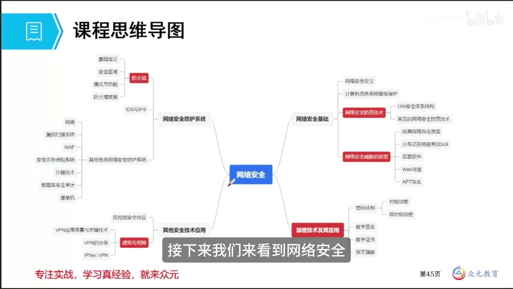

本章知识可归纳为五个层次：

| 层次 | 内容 |
| ---- | ---- |
| 边界访问控制 | 防火墙的基础定义、安全区域、部署模式、访问控制策略 |
| 防火墙技术演进 | 包过滤、状态检测、应用代理、UTM、NGFW、AI 防火墙 |
| 检测与阻断 | IDS 负责发现和告警，IPS 负责实时阻断，二者常与防火墙联动 |
| 专项防护 | 网闸、漏洞扫描、WAF、态势感知、沙箱、数据库审计、堡垒机、上网行为管理 |
| 加密与地址 | VPN 提供加密隧道，NAT 提供地址转换并附带一定的隐藏效果 |

---

## 2.防火墙基础

### 2.1 定义与访问控制

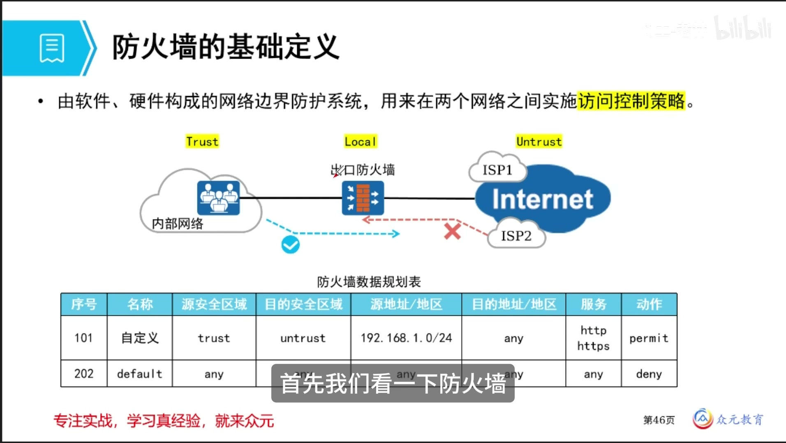

防火墙是由**软件和硬件构成的网络边界防护系统**，部署在两个信任程度不同的网络之间，按照预设的**访问控制策略**判断流量是允许还是拒绝。

防火墙的作用类似小区出入口的保安：内部人员凭证件进出，外部身份不明人员不得随意进入。其技术实质是：**依据安全策略对穿越防火墙的流量执行允许、拒绝、记录等动作**。

防火墙的访问控制策略通常以规则表的形式配置，规则按顺序自上而下匹配，命中即执行相应动作。典型规则表如下：

| 序号 | 名称 | 源安全区域 | 目的安全区域 | 源地址/地区 | 目的地址/地区 | 服务 | 动作 |
| ---- | ---- | ---------- | ------------ | ----------- | ------------- | ---- | ---- |
| 101 | 自定义 | trust | untrust | 192.168.1.0/24 | any | http、https | permit |
| 202 | default | any | any | any | any | any | deny |

规则 101 的含义是：允许 192.168.1.0/24 网段从 trust 区域访问 untrust 区域，且仅限 HTTP、HTTPS 服务。规则 202 是默认规则：若前面的规则均未匹配，则拒绝所有流量。

需要掌握以下要点：

1. **规则匹配顺序**：防火墙通常按规则序号自上而下逐条匹配，命中第一条匹配规则后即执行其动作，不再继续向下匹配。
2. **默认规则**：规则表末尾必须设置默认动作。不同厂商的默认行为不同：华为设备通常默认同一安全区域内部互通、不同安全区域之间不通；思科设备的默认规则更多，但思科防火墙配置已不是当前考试重点。
3. **策略可扩展**：除源/目的地址、区域、服务外，还可以基于时间、用户、应用等条件细化规则。
4. **策略的作用**：实现最小权限访问，只放行业务必需的流量和端口，其余一律拒绝。

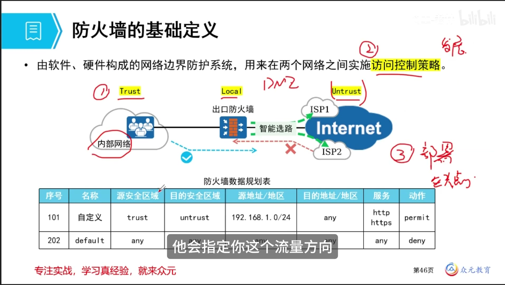

### 2.2 安全区域与优先级

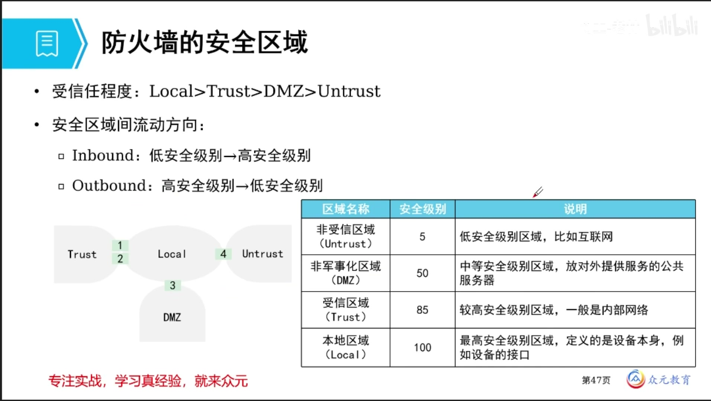

防火墙通过**安全区域（Security Zone）**划分不同信任程度的网络。华为设备预定义四个安全区域，优先级范围为 1～100，数值越大表示越可信：

| 区域名称 | 安全级别 | 说明 |
| -------- | -------- | ---- |
| 非受信区域（Untrust） | 5 | 低安全级别区域，通常用于定义 Internet 等不安全的网络 |
| 非军事化区域（DMZ） | 50 | 中等安全级别区域，放置对外提供服务的公共服务器 |
| 受信区域（Trust） | 85 | 较高安全级别区域，通常是内部网络 |
| 本地区域（Local） | 100 | 最高安全级别区域，定义的是防火墙设备本身，例如设备的接口 |

受信任程度排序为：

```
Local（100） > Trust（85） > DMZ（50） > Untrust（5）
```

各区域的作用：

| 区域 | 主要用途 | 典型设备或对象 |
| ---- | -------- | -------------- |
| Local | 防火墙自身，凡是由防火墙构造、主动发出的报文，以及需要防火墙响应处理的报文，均视为与 Local 区域交互 | 防火墙接口、设备管理流量 |
| Trust | 内部办公网络、内部终端 | PC、内部服务器 |
| DMZ | 对外提供服务的服务器区，介于内网与外网之间 | Web、邮件、FTP、DNS 等服务器 |
| Untrust | 外部网络 | Internet、运营商网络 |

注意一个容易混淆的细节：

- 将接口加入某个安全区域，表示**该接口所连接的网络**属于该区域；
- **接口本身仍然属于 Local 区域**；
- 访问防火墙自身（如 Telnet、SSH、SNMP 管理）时，需要放行对端区域与 Local 区域之间的策略。

视频中提到“默认区域的优先级可以更改”。按照华为官方文档，**预定义区域的优先级是固定的**；管理员可以创建自定义区域并为其设置 1～100 的优先级。不同厂商、不同型号的设备可能存在差异，考试中应以“预定义区域优先级固定、自定义区域可规划优先级”为准。

### 2.3 区域间流量方向

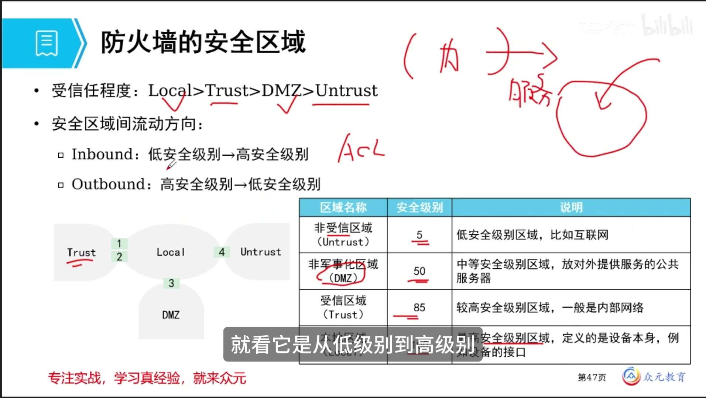

配置区域间安全策略时，需要指定流量的方向：

| 方向 | 级别变化 | 含义 | 示例 |
| ---- | -------- | ---- | ---- |
| Inbound（入方向） | 低安全级别 → 高安全级别 | 流量从较不可信区域进入较可信区域 | Untrust → Trust、Trust → Local |
| Outbound（出方向） | 高安全级别 → 低安全级别 | 流量从较可信区域流向较不可信区域 | Trust → Untrust、Local → Trust |

要点：

1. Inbound 与 Outbound 是**相对于安全区域优先级**定义的，不是相对于物理接口的“进”“出”。
2. 同一安全区域内部的数据流动通常默认允许，不触发区域间安全策略；不同安全区域之间默认拒绝，需要显式放行。
3. 路由器配置路由策略、ACL 时也会使用 in、out 描述方向，但那里的 in/out 是相对于接口的接收和发送，不能与防火墙区域方向混为一谈。

### 2.4 部署模式

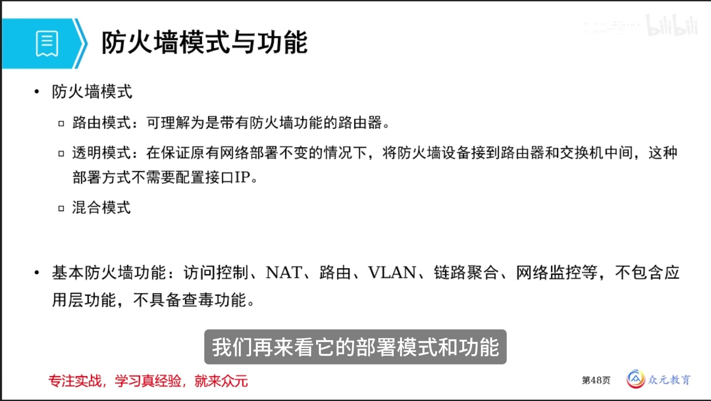

防火墙有三种基本部署模式：

| 模式 | 是否需要接口 IP | 典型位置 | 特点 |
| ---- | --------------- | -------- | ---- |
| 路由模式 | 需要 | 内网与外网之间的边界网关 | 相当于带有防火墙功能的路由器，可配置接口 IP、路由、NAT、VPN 等 |
| 透明模式 | 不需要 | 路由器与核心交换机之间、关键设备之前 | 以二层方式串接在链路中，不改变原有网络拓扑，只对经过的流量做安全检查 |
| 混合模式 | 部分接口需要 | 复杂组网 | 同时包含路由接口和透明接口，按业务需要组合部署 |

判断方法：

- 接口配置了 IP 地址并参与路由转发：路由模式；
- 接口不配置 IP 地址，仅作为流量必经的检测点：透明模式；
- 同时存在上述两类接口：混合模式。

补充说明：

- 防火墙可以是硬件设备，也可以是软件形态；主机上安装的通常是软件防火墙，硬件防火墙性能更强、成本更高。
- 透明模式适合在不改变现有网络地址规划的前提下增加安全检测点；路由模式适合作为出口网关，同时承担 NAT 和路由功能。

### 2.5 功能定位

基本防火墙的功能可以概括为“**访问控制 + 网络设备功能**”：

| 功能类别 | 具体功能 | 说明 |
| -------- | -------- | ---- |
| 安全功能 | 访问控制、流量过滤、状态检测、日志记录 | 依据安全策略允许或拒绝流量 |
| 网络功能 | 路由、NAT、VLAN、链路聚合、网络监控 | 可替代或补充部分路由器、交换机功能 |
| 扩展功能 | 防病毒模块、IPS 模块、应用识别、AI 分析 | 属于后续发展的增强能力，基本防火墙不默认具备 |

基本防火墙的边界：

- 教材中的基本防火墙（默认按包过滤、状态检测理解）**不包含应用层功能，不具备查毒功能**；
- 防病毒、入侵防御、应用识别等功能通常由 UTM、NGFW 或专用安全设备提供；
- 若题目明确强调“下一代防火墙”“AI 防火墙”，才考虑其应用层识别、内容检测、威胁情报等增强能力。

防火墙还可以基于服务类型、带宽、ACL 等条件进行**智能选路**。与路由表中的等价路由、浮动路由相比，防火墙能够匹配更丰富的策略，实现更灵活的流量分配和路径规划。

### 2.6 部署位置与 DMZ


防火墙的常见部署位置如下：

| 部署位置 | 作用 |
| -------- | ---- |
| 内网与外网边界出口 | 作为边界网关，控制内外网之间的访问，阻挡外部未授权访问 |
| DMZ 与 Untrust 之间 | 控制外部用户对 DMZ 服务器的访问，仅开放必要的服务端口 |
| DMZ 与 Trust 之间 | 控制 DMZ 服务器访问内部网络，防止服务器被攻陷后横向渗透 |
| 内部安全域之间 | 在数据中心、核心业务区、办公区之间实施分区隔离和访问控制 |
| 关键设备之前 | 以透明模式串接，对访问关键设备的流量进行检测和过滤 |

DMZ（Demilitarized Zone，非军事化区域）是本章的重点：

1. DMZ 用于放置**需要对外提供服务的公共服务器**，如 Web、邮件、FTP、DNS 服务器。
2. DMZ 的安全优先级介于 Trust 和 Untrust 之间，既不是完全可信的内部网络，也不是完全不可信的外部网络。
3. 外部用户访问 DMZ 服务器时，只开放业务必需的端口；DMZ 服务器访问内部网络时，必须经过防火墙策略控制。
4. 数据库等核心数据服务器不应直接放在 DMZ，而应放在受保护的内部服务器区。
5. DMZ 与 Trust 之间的流量仍然经过防火墙，可以实施安全策略，因此 DMZ 并不是“防火墙之外的免检区”。

双防火墙结构：

```
Internet — 外防火墙 — DMZ — 内防火墙 — 内部网络
```

- 外防火墙主要防范来自 Internet 的攻击；
- 内防火墙主要控制 DMZ 对内部网络的访问；
- 两台防火墙可采用不同厂商产品，攻击者必须同时突破两道防线，安全性更高；
- 缺点是成本高、配置复杂，实际应用不如单防火墙结构广泛。

### 2.7 防火墙的局限性

防火墙是边界安全的基础设备，但不能解决全部安全问题。其主要局限如下：

| 局限 | 说明 |
| ---- | ---- |
| 防外不防内 | 传统边界防火墙对内部网络高度信任，难以发现和阻止内部主机发起的攻击、内部人员违规操作 |
| 难以防护应用层威胁 | 基本防火墙主要检查网络层、传输层头部信息，难以识别 SQL 注入、跨站脚本、恶意文件等内容级攻击 |
| 不具备查毒能力 | 基本防火墙不包含防病毒模块，不能查杀计算机病毒、木马、恶意软件 |
| 访问控制粒度较粗 | 主要基于 IP、端口、协议等要素，难以精确到用户、应用、内容 |
| 配置复杂，易产生漏洞 | 规则数量多、顺序敏感，配置不当会出现冲突、冗余或误放行 |
| 无法防止绕过 | 内部用户通过拨号、无线网络、VPN、U 盘等方式绕过边界，防火墙无法管控 |
| 加密流量存在盲区 | 对 HTTPS、SSL VPN 等加密流量，防火墙难以检查载荷内容，需要 SSL 解密或代理配合 |
| 单点故障与性能瓶颈 | 防火墙串接在链路中，设备故障或性能不足会影响业务连续性 |
| 不能替代其他安全设备 | 防火墙不能替代 IDS、IPS、WAF、防病毒、堡垒机等专项防护手段 |
| NAT 不等于安全 | NAT 可以隐藏内部地址，但不检查内容、不实施访问控制，不能作为安全功能使用 |

因此，实际组网通常采用“**防火墙 + IDS/IPS + WAF + 防病毒 + 审计**”的纵深防御体系，而不是只依赖一台防火墙。

---

## 3.防火墙技术类型与发展

### 3.1 包过滤防火墙

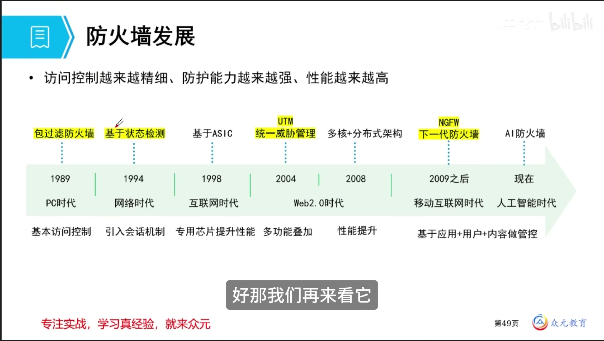

包过滤防火墙是最基础的一类防火墙，工作在**网络层**，通过检查数据包的头部信息决定是否放行。

主要检查字段：

| 字段 | 说明 |
| ---- | ---- |
| 源 IP 地址 | 数据包的发送方地址 |
| 目的 IP 地址 | 数据包的接收方地址 |
| 源端口 | 传输层源端口号 |
| 目的端口 | 传输层目的端口号 |
| 协议类型 | TCP、UDP、ICMP 等 |

上述源/目的 IP、源/目的端口、协议类型通常合称**五元组**。包过滤防火墙依据五元组和预配置的 ACL 规则进行匹配，本质上就是基本 ACL 的扩展应用。

特点：

- 工作在**网络层**，处理速度快、对用户透明、实现简单；
- 不维护连接状态，每个数据包独立匹配规则；
- 只能检查头部信息，**不能检查负载内容**；
- 难以防护应用层攻击；
- 规则配置复杂，容易出现冲突和漏洞；
- 容易受到 IP 地址欺骗等攻击。

### 3.2 状态检测防火墙

状态检测防火墙工作在**网络层**，是包过滤防火墙的升级。它在包过滤的基础上引入**会话机制**和**状态表**：

1. 对每条连接记录源 IP、目的 IP、源端口、目的端口、协议、连接状态等信息；
2. 收到数据包时，先判断其是否属于已建立的合法连接；
3. 若属于已建立连接，可直接放行，无需逐条重复匹配静态规则；
4. 若不属于已建立连接，再按包过滤规则检查；
5. 连接结束或超时后，动态删除状态表项。

优势：

- 可以根据连接状态**动态生成或删除过滤规则**，减少规则匹配工作量；
- 能够识别并放行返回流量，避免为双向通信配置大量临时规则；
- 对 SYN Flood、TCP 端口扫描等异常行为具有一定的检测和抵御能力；
- 比包过滤防火墙更安全，性能优于应用代理防火墙。

局限：

- 仍然主要检查网络层、传输层头部，**不能检查应用层内容**；
- 允许外部主机与内部主机建立直接连接，存在被直接攻击的风险；
- 状态表会消耗设备内存，大规模并发连接时对性能要求较高。

### 3.3 应用代理防火墙

应用代理防火墙工作在**应用层**，也称为应用级网关。它不在客户端和服务器之间建立直接连接，而是作为**中间人**分别建立两段连接：

```
客户端 ——— 连接 1 ——— 代理防火墙 ——— 连接 2 ——— 服务器
```

工作过程：

1. 客户端向代理防火墙发起连接请求；
2. 代理检查源/目的地址、用户身份和访问策略；
3. 若允许，代理与客户端建立连接，并代替客户端与服务器建立另一条连接；
4. 代理接收应用层数据，进行检查、过滤后转发；
5. 连接结束后记录日志。

优势：

- 工作在应用层，可以检查完整的应用层数据，实现基于内容的过滤；
- 隐藏内部网络拓扑和 IP 地址，外部只能看到代理；
- 支持用户身份认证，访问控制粒度细；
- 日志记录能力强，便于审计。

局限：

- 需要对每个应用提供单独的代理模块，支持的应用种类有限；
- 处理速度慢、延迟大，不适合高带宽、实时性强的业务；
- 配置和维护复杂；
- 对操作系统和应用软件依赖较强，自身也可能存在漏洞。

总体规律：**工作层次越高，安全性越强，但效率越低**。包过滤和状态检测侧重网络层，速度快；应用代理侧重应用层，安全性高但性能差。

### 3.4 统一威胁管理（UTM）

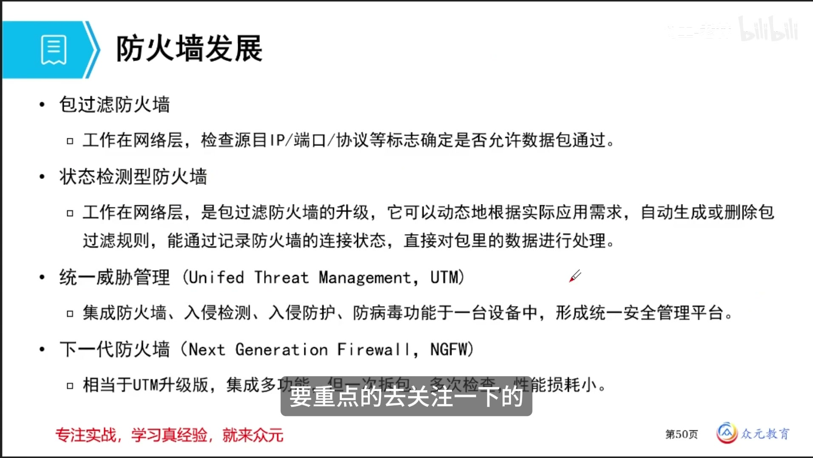

UTM（Unified Threat Management，统一威胁管理）将多种安全功能集成到一台设备中，形成统一的安全管理平台。典型集成功能包括：

- 防火墙；
- 入侵检测（IDS）；
- 入侵防御（IPS）；
- 防病毒（AV）；
- 部分产品还包括反垃圾邮件、URL 过滤、VPN 等。

优势：

- 一台设备提供多种防护，降低硬件采购和部署成本；
- 统一管理界面，简化运维；
- 适合中小型网络或安全预算有限的场景。

局限：

- 多种功能集成后，**单项防护能力相对削弱**，整体抗风险能力下降；
- 所有安全模块同时开启时，对设备 CPU、内存、吞吐量要求很高；
- 多模块串行处理会增加延迟，性能损耗较大；
- 不同厂商的模块协同和特征库质量存在差异。

### 3.5 下一代防火墙（NGFW）与 AI 防火墙

NGFW（Next Generation Firewall，下一代防火墙）可以理解为 UTM 的升级版本，核心改进包括：

| 改进点 | 说明 |
| ------ | ---- |
| 应用识别 | 能够识别具体应用，而不仅依赖 IP 和端口 |
| 用户识别 | 将流量与用户身份关联，实现基于用户的访问控制 |
| 内容识别 | 对应用层内容进行检测，识别威胁和数据泄露风险 |
| 一次拆包、多次检查 | 数据包只解析一次，多个安全引擎并行检查，降低性能损耗 |
| 高性能架构 | 采用多核、分布式、专用芯片等架构提升吞吐量 |
| 威胁情报与沙箱联动 | 结合云端情报、沙箱检测未知威胁 |

AI 防火墙是在 NGFW 基础上进一步引入人工智能、大数据分析能力的安全设备，能够进行更智能的威胁识别和策略优化。当前考试主要要求认识名词和基本特点，不要求掌握其算法和配置细节。

### 3.6 防火墙类型对比

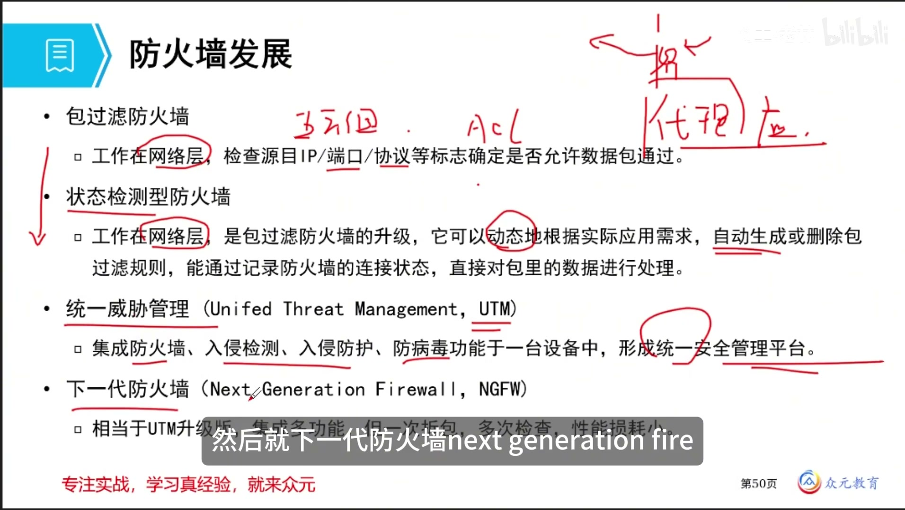

| 类型 | 工作层次 | 是否维护状态 | 是否检查内容 | 速度 | 安全性 | 典型特点 |
| ---- | -------- | ------------ | ------------ | ---- | ------ | -------- |
| 包过滤 | 网络层 | 否 | 否 | 快 | 较低 | 五元组、ACL、无状态 |
| 状态检测 | 网络层/传输层 | 是 | 否 | 较快 | 中等 | 状态表、会话机制、动态规则 |
| 应用代理 | 应用层 | 是 | 是 | 慢 | 高 | 中间人、两段连接、内容检查 |
| UTM | 网络层至应用层 | 是 | 部分 | 中等 | 中等 | 多功能集成、统一管理、性能损耗大 |
| NGFW | 网络层至应用层 | 是 | 是 | 较快 | 高 | 应用/用户/内容识别、一次拆包多次检查 |

防火墙发展阶段：

| 时间 | 阶段 | 代表技术 | 主要特征 |
| ---- | ---- | -------- | -------- |
| 1989 | PC 时代 | 包过滤防火墙 | 基本访问控制 |
| 1994 | 网络时代 | 状态检测 | 引入会话机制 |
| 1998 | 互联网时代 | 基于 ASIC | 专用芯片提升性能 |
| 2004 | Web 2.0 时代 | UTM | 多功能叠加 |
| 2008 | 移动互联网时代 | 多核 + 分布式架构 | 性能提升 |
| 2009 之后 | 移动互联网时代 | NGFW | 基于应用、用户、内容做管控 |
| 现在 | 人工智能时代 | AI 防火墙 | 智能分析、威胁情报、自动化响应 |

发展规律：**访问控制越来越精细，防护能力越来越强，性能越来越高**。

---

## 4.入侵检测系统（IDS）

### 4.1 基本概念与组成

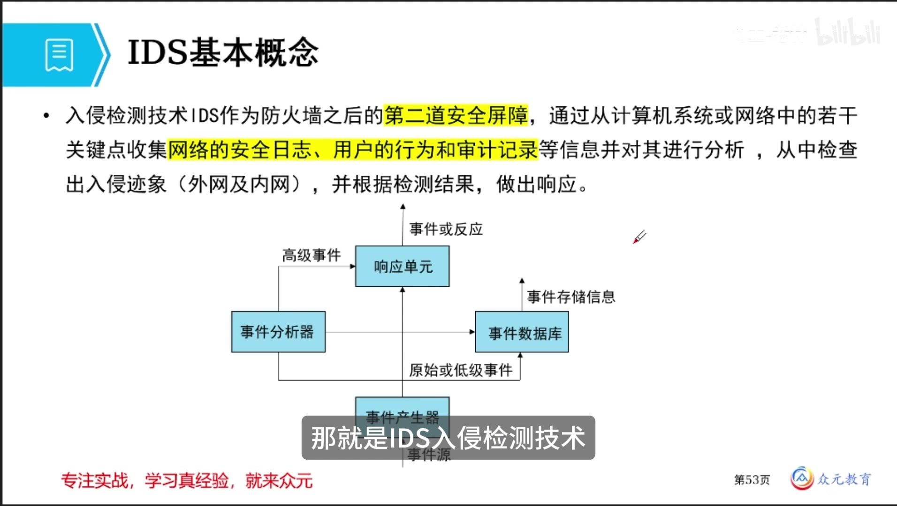

IDS（Intrusion Detection System，入侵检测系统）是防火墙之后的**第二道安全屏障**。它从计算机系统或网络的关键点收集安全日志、用户行为、审计记录等信息，并对其进行分析，检查是否存在入侵迹象，再根据检测结果做出响应。

IDS 的核心特征是：

- **被动检测**：只监听、分析流量，不直接阻断；
- **旁路部署**：通常不串接在业务流量路径中；
- **检测范围**：既关注外部入侵，也关注内部网络的异常行为；
- **响应方式**：记录日志、发出告警，或联动防火墙等设备进行阻断。

IDS 的通用组成如下：

| 组成部分 | 作用 |
| -------- | ---- |
| 事件产生器（事件源） | 从网络或主机采集原始事件、流量、日志、审计记录 |
| 事件分析器 | 对原始事件进行分析、比对，判断是否为入侵 |
| 响应单元 | 根据分析结果发出告警、记录日志或触发联动动作 |
| 事件数据库 | 存储原始事件、低级事件、高级事件及历史记录，为后续分析提供依据 |

数据处理流程：

```
事件源 → 事件产生器 → 事件分析器 → 响应单元
                │              │
                └→ 事件数据库 ←┘
```

### 4.2 分类

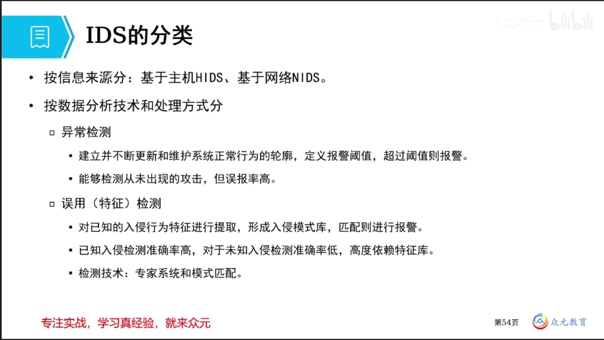

IDS 可以从两个维度分类：

| 分类维度 | 类型 | 说明 |
| -------- | ---- | ---- |
| 按信息来源 | 基于主机（HIDS） | 安装在单台主机上，监控系统日志、进程、文件、系统调用等 |
| 按信息来源 | 基于网络（NIDS） | 部署在网络关键节点，分析网络流量和协议行为 |
| 按信息来源 | 分布式 IDS | 多个检测点协同工作，由管理中心统一汇总和分析 |
| 按数据分析方式 | 异常检测 | 建立正常行为轮廓，偏离轮廓即报警 |
| 按数据分析方式 | 误用检测（特征检测） | 提取已知入侵特征，形成入侵模式库，匹配即报警 |

### 4.3 检测方法

| 方法 | 基本原理 | 优点 | 缺点 |
| ---- | -------- | ---- | ---- |
| 异常检测 | 建立并不断更新系统正常行为的轮廓，设定报警阈值；当行为偏离正常轮廓或超过阈值时报警 | 能够发现从未出现过的新型攻击、未知攻击 | 误报率较高；正常行为轮廓难以完整建立和维护；攻击者可能通过缓慢改变行为绕过 |
| 误用检测（特征检测） | 对已知入侵行为的特征进行提取，形成入侵模式库；流量或行为与特征匹配时报警 | 对已知攻击检测准确率高；规则明确、可解释 | 无法检测未知攻击和变种攻击；高度依赖特征库的完整性和更新速度 |

异常检测与特征检测的典型对比：

| 比较项 | 异常检测 | 特征检测 |
| ------ | -------- | -------- |
| 比对对象 | 正常行为基线 | 已知攻击特征库 |
| 未知攻击 | 能检测 | 不能检测 |
| 已知攻击 | 可检测，但误报较多 | 准确率高 |
| 误报率 | 高 | 较低 |
| 关键依赖 | 正常行为模型的完整性 | 特征库的完整性和更新速度 |
| 典型技术 | 统计分析、机器学习、阈值判断 | 专家系统、模式匹配、字符串匹配 |

考试中的判断方法：

- 题目强调“检测未知攻击”“检测从未出现过的攻击”：选择**异常检测**；
- 题目强调“依据已知攻击特征”“匹配入侵模式库”：选择**特征检测/误用检测**；
- 题目问“不属于入侵检测技术”的设备或方法：注意**漏洞扫描**属于脆弱性评估，不属于 IDS 的检测方法。

### 4.4 部署方式

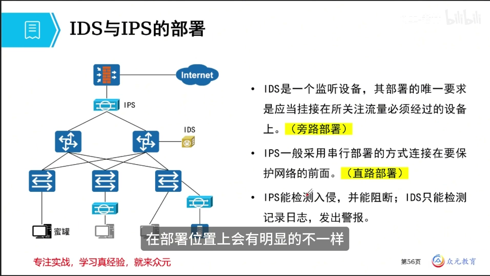

IDS 通常采用**旁路部署**：

| 部署方式 | 说明 |
| -------- | ---- |
| 交换机端口镜像 | 将需要分析的流量镜像到连接 IDS 的端口，IDS 只接收副本，不影响业务流量 |
| 网络分光/分流器（TAP） | 在链路中旁路复制流量，IDS 分析副本 |
| 旁挂于核心交换机 | 将 IDS 接在核心交换机旁，监控关键网段或出口流量 |

华为设备中常使用**观察端口、转发端口**描述镜像关系：将需要检测的流量镜像或转发至连接 IDS 的端口。不同产品版本的术语可能写作“观察端口”“镜像端口”“转发端口”，配置时应以具体设备文档为准。

旁路部署的特点：

- IDS 不在业务流量的实时路径上，**设备故障不会中断业务**；
- 不增加网络延迟；
- 只能检测，不能直接阻断；
- 需要与防火墙、IPS 等设备联动才能完成阻断；
- 高速链路下可能出现丢包，影响检测完整性。

### 4.5 IDS 的局限

| 局限 | 说明 |
| ---- | ---- |
| 只能检测，不能阻断 | 发现攻击后只能告警、记录，阻断依赖联动设备 |
| 被动性 | 攻击发生后才能发现，难以在攻击造成损害前终止 |
| 误报与漏报 | 异常检测误报率高，特征检测对未知攻击漏报率高 |
| 加密流量盲区 | 无法检查加密载荷，除非具备解密能力 |
| 高速流量丢包 | 流量超过处理能力时会丢包，导致漏检 |
| 特征库滞后 | 新攻击出现后，需要时间更新特征库 |
| 自身安全性 | IDS 自身也可能成为攻击目标，需要保护 |

IDS 的这些不足推动了 IPS 的发展：IPS 在检测能力的基础上增加了**实时阻断**能力。

---

## 5.入侵防御系统（IPS）

### 5.1 基本概念

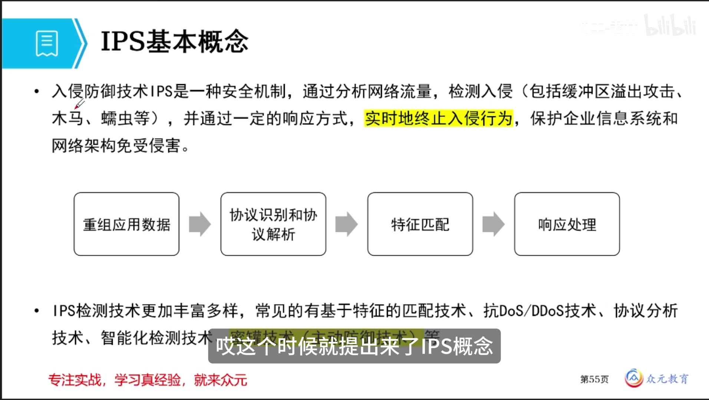

IPS（Intrusion Prevention System，入侵防御系统）是一种**主动**安全机制。它通过分析网络流量，检测缓冲区溢出、木马、蠕虫等入侵行为，并通过一定的响应方式**实时终止入侵行为**，保护信息系统和网络架构。

与 IDS 的根本区别：

| 比较项 | IDS | IPS |
| ------ | --- | --- |
| 工作方式 | 被动监听 | 主动检测并阻断 |
| 部署方式 | 旁路 | 串联（直路） |
| 是否影响业务流量 | 不进入流量路径 | 串接在流量路径中 |
| 发现攻击后的动作 | 记录日志、告警、联动 | 直接丢弃、阻断、重置连接 |
| 故障影响 | 设备故障通常不影响业务 | 设备故障可能导致业务中断 |
| 性能要求 | 相对较低 | 很高，不能成为瓶颈 |
| 误报后果 | 告警噪声 | 误阻断合法业务 |

### 5.2 处理流程

IPS 的典型处理流程为：

```
重组应用数据 → 协议识别和协议解析 → 特征匹配 → 响应处理
```

| 步骤 | 作用 |
| ---- | ---- |
| 重组应用数据 | 将分片、分段的报文还原为完整的应用层数据 |
| 协议识别和协议解析 | 识别应用协议，解析协议字段和载荷 |
| 特征匹配 | 将解析结果与攻击特征库、异常模型进行匹配 |
| 响应处理 | 对命中规则的流量执行告警、丢弃、阻断、重置连接等动作 |

由于需要重组应用数据，IPS 的处理时延通常高于包过滤和状态检测防火墙；串联部署时，设备性能必须满足链路峰值流量要求，否则会成为网络瓶颈。

IPS 的常见检测技术：

- 基于特征的匹配技术；
- 抗 DoS/DDoS 技术；
- 协议分析技术；
- 智能化检测技术；
- 蜜罐诱导技术。

### 5.3 部署方式

IPS 一般采用**串联部署（直路部署）**，连接在被保护网络的前面：

| 部署位置 | 作用 |
| -------- | ---- |
| 防火墙之后、核心交换机之前 | 对进入内网的流量进行深度检测和阻断 |
| 特定服务器或关键设备之前 | 为重点保护对象提供针对性防护 |
| 数据中心边界 | 防护来自外部和不同安全域之间的攻击 |

串联部署的特点：

- 流量必须经过 IPS，IPS 才能实时阻断；
- 会增加网络延迟；
- IPS 故障可能中断业务，因此需要旁路（Bypass）功能、双机热备等高可用设计；
- 误报可能阻断合法业务，因此需要持续调优规则；
- 具备深度检测和主动阻断能力，设备成本通常高于 IDS。

### 5.4 IDS 与 IPS 对比

| 比较维度 | IDS | IPS |
| -------- | --- | --- |
| 中文名称 | 入侵检测系统 | 入侵防御系统 |
| 核心能力 | 检测、记录、告警 | 检测、阻断、防御 |
| 动作属性 | 被动 | 主动 |
| 部署方式 | 旁路（镜像、TAP） | 串联（Inline） |
| 对流量的影响 | 无直接影响 | 增加延迟，可能成为瓶颈 |
| 故障影响 | 不影响业务连续性 | 可能导致业务中断 |
| 误报后果 | 告警噪声 | 误阻断合法流量 |
| 典型位置 | 核心交换机旁、关键网段 | 防火墙后、被保护网络前 |
| 联动需求 | 需要联动防火墙等设备阻断 | 可自身完成阻断 |
| 适用阶段 | 初期部署、规则调优、审计取证 | 规则成熟后、需要实时防护的场景 |

一句话概括：**IDS 负责“看见”，IPS 负责“拦住”；IDS 旁路，IPS 串联。**

### 5.5 蜜罐


蜜罐（Honeypot）是一种**诱骗技术**：通过部署看似有价值、实际为诱饵的主机或服务，诱导攻击者访问和攻击，从而：

- 延缓真实攻击的进度；
- 转移攻击者的注意力；
- 记录攻击者的行为、工具和来源；
- 为分析和取证争取时间；
- 研究新型攻击手法。

蜜罐的特点：

| 特点 | 说明 |
| ---- | ---- |
| 诱骗性 | 模拟真实业务或漏洞，吸引攻击者 |
| 隔离性 | 通常部署在独立区域，与真实业务隔离 |
| 可观测性 | 攻击者的所有操作都可被记录和分析 |
| 非直接阻断 | 蜜罐本身不是阻断设备，主要作用是诱骗、检测和分析 |
| 维护成本 | 需要持续更新诱饵内容和监控规则 |

蜜罐不能替代防火墙、IDS、IPS，通常作为纵深防御体系中的辅助手段。

---

## 6.其他网络安全防护系统

### 6.1 网闸

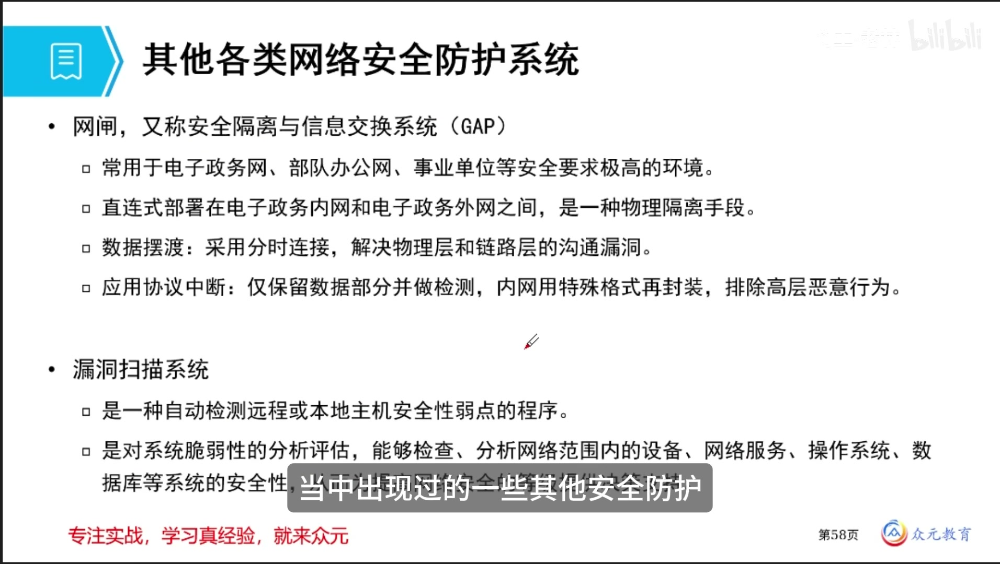

网闸又称**安全隔离与信息交换系统（GAP）**，用于安全要求极高的网络之间，实现**物理隔离**条件下的受控数据交换。

适用环境：

- 电子政务网；
- 部队办公网；
- 事业单位；
- 其他对保密性、安全性要求极高的网络。

典型部署位置：

```
电子政务外网（办事大厅、Internet） — 网闸 — 电子政务内网（内部办公网络）
```

网闸与防火墙的区别：

| 比较项 | 防火墙 | 网闸 |
| ------ | ------ | ---- |
| 隔离性质 | 逻辑隔离 | 物理隔离 |
| 连接方式 | 内外网可通过防火墙建立连接 | 内外网在任何时刻都不直接连接 |
| 检查对象 | 主要检查网络层、传输层头部，部分可检查应用层 | 剥离协议，仅交换应用层数据 |
| 实时性 | 实时转发 | 分时连接、数据摆渡，实时性较差 |
| 适用场景 | 一般网络边界 | 政务、军工等高安全隔离场景 |

网闸的核心原理：

| 原理 | 说明 |
| ---- | ---- |
| 物理隔离 | 内外网处理单元与隔离交换单元在任意时刻不同时连接，不存在直接的物理链路 |
| 数据摆渡 | 采用分时连接方式，将数据先写入中间缓冲区，再摆渡到另一侧，类似摆渡船往返运输；用于切断物理层、链路层的直接通信 |
| 协议中断 | 剥离 TCP/IP 协议，仅保留应用层数据；内网侧用特殊格式重新封装，排除高层恶意行为 |
| 内容检查 | 对摆渡的数据进行病毒、恶意代码、格式、内容等安全检查 |
| 专用硬件控制 | 通过专用隔离交换硬件控制开关和读写时序，保证内外网不同时连通 |

网闸通常采用“2+1”架构：

```
内网主机系统 — 隔离交换单元 — 外网主机系统
```

- 内网主机系统：连接内网，完成协议终止、内容检查、数据缓冲；
- 外网主机系统：连接外网，完成同样的处理；
- 隔离交换单元：专用硬件，负责在内外网之间摆渡数据，任意时刻只与一侧连接。

网闸的局限：

- 吞吐量较低，不适合大流量、实时性要求高的业务；
- 支持的应用类型有限，通常以文件、数据库同步等为主；
- 配置和管理复杂；
- 不能替代防火墙，二者解决的是不同层面的问题；
- 如果网闸厂商解析并代理应用协议，可能削弱物理隔离效果，因此应坚持“协议落地、数据交换”的原则。

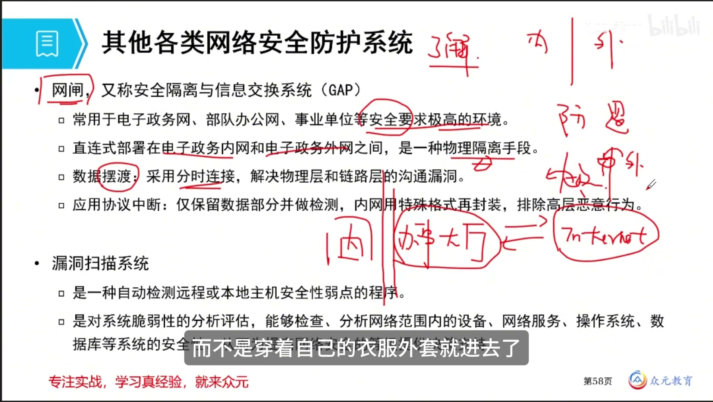

### 6.2 漏洞扫描系统

漏洞扫描系统是一种**自动检测远程或本地主机安全性弱点**的程序，是对系统脆弱性的分析评估工具。

主要功能：

- 检查网络范围内的设备、网络服务、操作系统、数据库等对象的安全配置和已知漏洞；
- 发现开放端口、弱口令、补丁缺失、服务配置不当等问题；
- 生成漏洞报告，提供修复建议；
- 可用于安全评估、合规检查、上线前检查。

漏洞扫描的两面性：

| 使用方向 | 说明 |
| -------- | ---- |
| 防御 | 管理员主动扫描自己的系统，发现漏洞后及时修补 |
| 攻击 | 攻击者扫描目标系统，寻找可利用的漏洞 |

因此，漏洞扫描本身是中性工具，关键在于使用者和授权范围。未经授权扫描他人系统可能构成违法行为。漏洞扫描常与网络监听、安全评估工具配合使用，既可发现自身系统漏洞，也可被攻击者用于攻击前的信息收集。安全工具的效果最终取决于使用者和管理制度，即“三分技术，七分管理”。

漏洞扫描与 IDS 的区别：

| 比较项 | 漏洞扫描 | IDS |
| ------ | -------- | --- |
| 目的 | 发现系统脆弱性 | 发现正在发生的入侵行为 |
| 工作方式 | 主动探测、发送探测报文 | 被动监听、分析流量或主机行为 |
| 输出 | 漏洞清单和修复建议 | 告警、日志、事件记录 |
| 时间属性 | 事前评估 | 事中检测 |
| 是否属于入侵检测技术 | 不属于 | 属于 |

### 6.3 Web 应用防火墙（WAF）

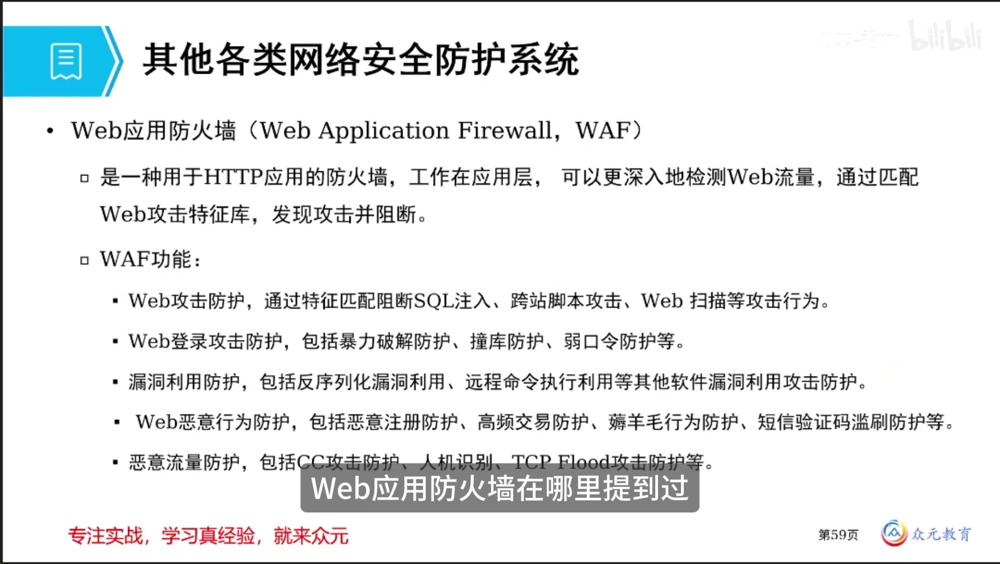

WAF（Web Application Firewall，Web 应用防火墙）是专门保护 HTTP/HTTPS 应用的防火墙，工作在**应用层**。它通过匹配 Web 攻击特征库，发现并阻断针对 Web 应用的攻击。

WAF 的主要功能：

| 功能类别 | 具体内容 |
| -------- | -------- |
| Web 攻击防护 | 通过特征匹配阻断 SQL 注入、跨站脚本（XSS）、Web 扫描等攻击 |
| Web 登录攻击防护 | 暴力破解防护、撞库防护、弱口令防护等 |
| 漏洞利用防护 | 反序列化漏洞利用、远程命令执行、其他软件漏洞利用防护 |
| Web 恶意行为防护 | 恶意注册、高频交易、薅羊毛、短信验证码滥刷等 |
| 恶意流量防护 | CC 攻击防护、人机识别、TCP Flood 攻击防护等 |

WAF 与普通防火墙的区别：

| 比较项 | 普通防火墙 | WAF |
| ------ | ---------- | --- |
| 工作层次 | 网络层、传输层为主 | 应用层 |
| 检查对象 | IP、端口、协议、连接状态 | HTTP/HTTPS 请求和响应内容 |
| 防护重点 | 网络访问控制 | SQL 注入、XSS、Web 漏洞利用等应用层攻击 |
| 典型部署 | 网络边界 | Web 服务器之前，反向代理或串联部署 |

WAF 的部署形式：

- 反向代理模式：WAF 作为 Web 服务器的前置代理，客户端不直接访问服务器；
- 透明串联模式：WAF 串接在 Web 服务器前，不改变网络结构；
- 云 WAF：由云服务商提供，流量先经过云端清洗；
- 主机型 WAF：以软件模块形式部署在 Web 服务器上。

WAF 的局限：

- 依赖规则和特征库，对未知漏洞、0day 攻击防护能力有限；
- 规则配置不当会产生误报，误阻断正常业务；
- 需要持续更新规则和调优；
- 对加密流量需要解密后才能检查；
- 不能替代安全编码、漏洞修补等根本性措施。

考试提示：案例题中只要涉及 SQL 注入、跨站脚本等 Web 攻击，部署 WAF 通常可以作为有效的防护措施，属于常见的得分点。

### 6.4 安全态势感知系统

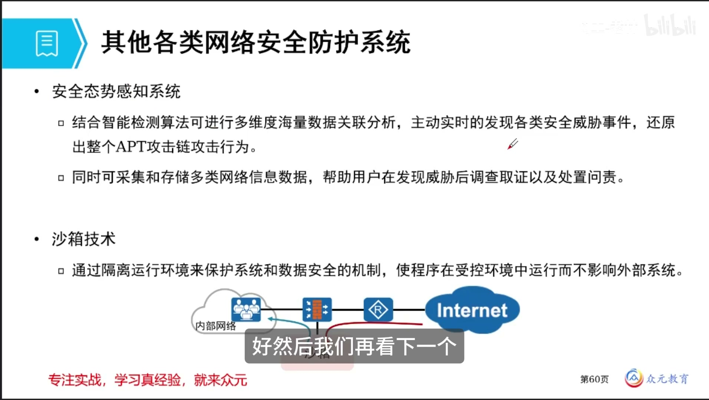

安全态势感知系统面向**针对性、有预谋、有组织、持续性的渗透攻击（APT）**，通过大数据平台采集多源数据，进行关联分析和威胁研判，全面感知网络安全状态。

主要能力：

| 能力 | 说明 |
| ---- | ---- |
| 数据采集 | 采集网络流量、日志、告警、资产、威胁情报等多类数据 |
| 关联分析 | 结合智能检测算法，进行多维度、海量数据关联分析 |
| 威胁发现 | 主动、实时发现各类安全威胁事件，还原 APT 攻击链 |
| 攻击还原 | 还原攻击路径、攻击阶段和影响范围 |
| 调查取证 | 采集和存储多类网络信息数据，为调查取证和处置问责提供依据 |
| 预警告警 | 对发现的威胁进行预警、告警和可视化展示 |

安全态势感知通常具备三类核心功能：

1. **日志采集与监测**：采集海量日志和流量数据；
2. **威胁分析**：进行多维度关联分析，数据规模和分析深度通常超过 IDS/IPS；
3. **预警与告警**：输出威胁态势、告警和处置建议。

安全态势感知不是单一设备，而是“**大数据平台 + 分析引擎 + 威胁情报 + 可视化**”的综合系统，通常部署在安全管理中心，与防火墙、IDS、IPS、WAF、终端安全等设备联动。

### 6.5 沙箱技术

沙箱（Sandbox）是一种**隔离运行环境**技术，来源于儿童在沙盒中自由玩耍而不影响外部环境的理念。它将可疑程序、文件或 URL 放入与外界隔离的虚拟环境中运行，观察其行为，确认安全后才允许进入内部网络。

工作过程：

```
可疑文件/流量 → 放入沙箱 → 隔离环境运行 → 行为监控与分析 → 判定结果 → 放行或阻断
```

主要特点：

| 特点 | 说明 |
| ---- | ---- |
| 隔离性 | 沙箱环境与真实系统隔离，恶意程序不会影响外部系统 |
| 动态分析 | 通过实际运行观察程序行为，而不仅依赖静态特征 |
| 未知威胁检测 | 能够发现尚未有特征库记录的新型恶意软件、0day 攻击 |
| 联动防护 | 通常与 NGFW、邮件网关、终端安全等设备联动，发现威胁后阻断 |
| 检测而非阻断 | 沙箱本身主要做检测，阻断由联动设备完成 |

沙箱的局限：

- 恶意软件可能检测沙箱环境并延迟发作、逃避分析；
- 分析需要时间，难以满足实时阻断要求；
- 资源消耗较大；
- 不能保证发现所有未知威胁。

华为的沙箱体系通常包括集群控制器和分布式测试访问控制点，用于集中管理和分布式检测。

### 6.6 数据库安全审计


数据库安全审计系统基于**数据库网络流量采集、数据库协议解析与还原**技术，对数据库操作进行细粒度审计。

主要功能：

| 功能 | 说明 |
| ---- | ---- |
| 流量采集 | 采集数据库访问流量，不影响数据库自身性能 |
| 协议解析与还原 | 解析数据库协议，还原 SQL 语句和操作内容 |
| 细粒度审计 | 记录谁、在什么时间、从什么地址、对什么对象、执行了什么操作 |
| 合规管理 | 满足等级保护、内部控制、行业监管等合规要求 |
| 风险告警 | 对异常访问、敏感数据操作、批量导出等风险行为实时告警 |
| 事后追溯 | 保留审计记录，为安全事件调查和责任认定提供依据 |

数据库审计属于**内防内控**手段，重点防范内部人员误操作、越权访问、恶意窃取和数据库管理员滥用权限。

### 6.7 堡垒机

堡垒机，全称**运维安全管理与审计系统**，是面向运维人员的集中安全管控平台。

核心功能可概括为“**4A**”：

| 功能 | 英文 | 说明 |
| ---- | ---- | ---- |
| 身份认证 | Authentication | 多因子认证、AD/LDAP/RADIUS 等第三方认证 |
| 账户管理 | Account | 集中管理用户账号和目标设备账号，支持密码代填、自动改密 |
| 权限控制 | Authorization | 基于用户、设备、账号、操作命令进行细粒度授权 |
| 操作审计 | Audit | 记录登录、命令、文件传输、图形操作等全过程，支持回放和追责 |

部署方式：

```
运维人员 → 堡垒机 → 服务器、网络设备、安全设备、数据库
```

- 运维人员只能先登录堡垒机，再由堡垒机代理访问目标设备；
- 目标设备的账号密码由堡垒机集中托管，运维人员无需知道真实密码；
- 所有操作经过堡垒机，便于实时监控、命令拦截和事后审计。

堡垒机的价值：

- 解决运维人员权限过大、账号共享、密码泄露等问题；
- 实现“事前授权、事中监控、事后审计”；
- 满足等级保护、SOX、PCI 等合规要求；
- 发生安全事件时可以追责、定责。

堡垒机不是防火墙或 IDS，它不负责网络边界访问控制，也不负责入侵检测，而是专注于**运维行为管控和审计**。

### 6.8 上网行为管理

上网行为管理设备用于对内部用户的上网行为进行识别、控制、审计和带宽管理。

主要功能：

| 功能 | 说明 |
| ---- | ---- |
| 用户认证 | 通过 IP/MAC、Portal、AD/LDAP、RADIUS 等方式识别上网用户身份 |
| 应用识别与控制 | 识别 QQ、微信、P2P、视频、游戏、炒股等应用，按策略放行或阻断 |
| URL 过滤 | 基于 URL 分类库、关键字过滤网页访问 |
| 带宽管理 | 限制 P2P、视频等大流量应用，保障关键业务带宽 |
| 内容审计 | 记录网页访问、邮件、论坛发帖、IM 聊天、文件传输等行为 |
| 数据防泄漏 | 对敏感内容、文件外发进行检测和阻断 |
| 行为分析 | 统计用户、应用、流量、上网时长等，生成报表 |

典型应用场景：

- 工作时间限制与工作无关的 QQ、游戏、视频、购物网站；
- 限制 P2P 下载，保障办公业务带宽；
- 审计员工上网行为，满足合规要求；
- 发现内部失陷主机和外联风险。

部署方式：

- 网关模式：作为出口网关，串接在内外网之间；
- 网桥模式：透明串接，不改变原有网络；
- 旁路模式：仅做审计，通过镜像流量分析。

上网行为管理涉及员工隐私和合规问题，企业应明确告知、制定合理策略，避免过度监控。实际部署中，大型企业通常启用较完整的行为管控和审计功能，中小企业可能仅启用轻量级的 URL 过滤或审计。

---

## 7.虚拟专用网（VPN）（教材补充）

说明：本节为教材补充内容，用于衔接 VPN 的安全考点；视频课本章未展开讲解，但考试大纲和案例背景可能涉及。

### 7.1 VPN 的分类

VPN（Virtual Private Network，虚拟专用网）利用公共网络建立加密隧道，使远程用户或分支机构能够像在专用网络中一样安全通信。

按连接拓扑分类：

| 类型 | 连接对象 | 典型场景 |
| ---- | -------- | -------- |
| 站点到站点（Site-to-Site） | 两个局域网之间 | 分支机构与总部互连、企业数据中心与云上 VPC 互连 |
| 客户端到站点（Client-to-Site） | 单个客户端到企业网络 | 员工出差、居家办公远程接入内网 |
| 客户端到客户端（Client-to-Client） | 两个终端之间 | 点对点安全通信 |

按隧道协议分类：

| 类型 | 工作层次 | 特点 |
| ---- | -------- | ---- |
| IPSec VPN | 网络层 | 安全性强，适合站点到站点；配置较复杂 |
| SSL VPN | 应用层（基于 SSL/TLS） | 部署简单，适合客户端到站点；细粒度访问控制 |
| L2TP VPN | 数据链路层 | 常与 IPSec 结合使用（L2TP over IPSec） |
| PPTP VPN | 数据链路层 | 早期协议，安全性较弱，已不推荐 |
| GRE VPN | 网络层 | 支持组播和多协议，常与 IPSec 结合 |
| MPLS VPN | 网络层 | 由运营商提供，适合企业多站点互连 |

按实现形态分类：

- 硬件 VPN 网关；
- 软件 VPN；
- 云 VPN 网关；
- 防火墙集成的 VPN 功能。

### 7.2 IPSec 的 AH 与 ESP

IPSec 是网络层的安全协议族，主要提供两类安全协议：

| 协议 | 协议号 | 机密性 | 完整性 | 数据源认证 | 抗重放 | 与 NAT 的兼容性 |
| ---- | ------ | ------ | ------ | ---------- | ------ | --------------- |
| AH（Authentication Header，认证头） | 51 | 不提供 | 提供 | 提供 | 提供 | 差，AH 保护 IP 头，NAT 修改地址后校验失败 |
| ESP（Encapsulating Security Payload，封装安全载荷） | 50 | 提供（可配置为空加密） | 提供 | 提供 | 提供 | 较好，ESP 主要保护载荷，可配合 NAT-T |

要点：

1. **AH 不加密数据**，只提供完整性、数据源认证和抗重放，因此不能保证机密性。
2. **ESP 同时提供机密性、完整性、数据源认证和抗重放**，是实际部署中最常用的 IPSec 协议。
3. AH 的完整性校验覆盖 IP 头部字段（包括源/目的地址），因此与 NAT 不兼容；ESP 的完整性校验主要覆盖载荷，配合 NAT-T 可以穿越 NAT。
4. ESP 可以设置为空加密（仅认证），用于替代 AH 的某些场景，但一般不推荐单独使用无加密的 ESP。

### 7.3 传输模式与隧道模式

IPSec 有两种工作模式：

| 模式 | 封装方式 | 保护范围 | 典型场景 |
| ---- | -------- | -------- | -------- |
| 传输模式（Transport Mode） | 原 IP 头 + AH/ESP + 传输层数据 | 主要保护传输层载荷，原 IP 头可见 | 主机到主机、端到端通信 |
| 隧道模式（Tunnel Mode） | 新 IP 头 + AH/ESP + 原 IP 包 | 保护整个原 IP 包，包括原 IP 头 | 网关到网关、主机到网关、站点到站点 VPN |

传输模式（以 ESP 为例）：

```
[原 IP 头][ESP 头][TCP/UDP 数据][ESP 尾][ESP 认证]
```

隧道模式（以 ESP 为例）：

```
[新 IP 头][ESP 头][原 IP 头][TCP/UDP 数据][ESP 尾][ESP 认证]
```

要点：

- 传输模式不增加新的 IP 头，开销小，但原始 IP 地址暴露；
- 隧道模式增加新的 IP 头，可以隐藏内部地址规划，适合跨越公网连接两个私网；
- 网关之间建立 VPN 时通常使用隧道模式；
- 主机之间的端到端加密可以使用传输模式；
- 隧道模式会增大报文长度，需要注意 MTU 和分片问题。

### 7.4 IKE 的两个阶段

IKE（Internet Key Exchange，互联网密钥交换）用于在对等体之间自动协商密钥和安全参数。IKEv1 分为两个阶段：

| 阶段 | 名称 | 作用 | 主要模式 |
| ---- | ---- | ---- | -------- |
| 第一阶段 | IKE SA / ISAKMP SA 协商 | 对对等体进行身份认证，建立安全的加密通道，保护后续协商消息 | 主模式（Main Mode）、野蛮模式（Aggressive Mode） |
| 第二阶段 | IPSec SA 协商 | 在第一阶段建立的安全通道内，协商用于数据传输的 IPSec SA，包括加密算法、完整性算法、密钥等 | 快速模式（Quick Mode） |

第一阶段：

- **主模式**：使用 6 个报文，提供身份保护，安全性较高，是推荐方式；
- **野蛮模式**：使用 3 个报文，协商速度快，但不保护身份信息，安全性较低；
- 第一阶段的结果是建立 IKE SA（也称 ISAKMP SA），为第二阶段提供受保护的协商通道。

第二阶段：

- 使用**快速模式**，通常交换 3 个报文；
- 协商 IPSec SA 的参数，包括 ESP/AH 协议、加密算法、认证算法、SA 生命周期等；
- 可选启用完美前向保密（PFS），通过额外的 Diffie-Hellman 交换生成新密钥；
- 一个第一阶段可以支持多个第二阶段的协商，从而提高效率。

IKE 使用 UDP 500 和 UDP 4500 端口；其中 UDP 4500 用于 NAT 穿越（NAT-T）。

IKEv2 对 IKEv1 进行了简化：

- 使用 IKE_SA_INIT 和 IKE_AUTH 两组交换，通常共 4 个报文；
- 不再使用“主模式/野蛮模式/快速模式”的命名；
- 支持 MOBIKE、EAP 认证、NAT-T 等特性，更适合移动接入。

### 7.5 SSL VPN

SSL VPN 基于 SSL/TLS 协议提供远程接入，工作在应用层，通常使用 TCP 443 端口。

主要特点：

| 特点 | 说明 |
| ---- | ---- |
| 部署简单 | 用户通过浏览器或轻量客户端即可接入，无需复杂配置 |
| 细粒度访问控制 | 可以按用户、角色、URL、应用分配访问权限 |
| 适合移动办公 | 出差、居家办公人员可随时接入 |
| 与 Web 应用集成好 | 适合访问 Web 系统、文件共享、远程桌面等 |
| 安全性依赖证书和认证 | 需要配置证书、用户名密码、多因子认证等 |

SSL VPN 的常见接入方式：

- Web 代理：通过浏览器访问内网 Web 资源；
- 文件共享：访问内网文件服务器；
- 端口转发：将内网 TCP 服务映射到本地端口；
- 网络扩展：为客户端分配虚拟 IP，访问整个内网 IP 资源。

SSL VPN 的局限：

- 主要面向客户端到站点，不适合大规模站点到站点互连；
- 对非 Web 应用的兼容性取决于客户端和配置；
- 加密流量同样需要端点安全配合，防止终端被控后接入内网。

### 7.6 IPSec VPN 与 SSL VPN 对比

| 比较项 | IPSec VPN | SSL VPN |
| ------ | --------- | ------- |
| 工作层次 | 网络层 | 应用层（基于 SSL/TLS） |
| 典型拓扑 | 站点到站点 | 客户端到站点 |
| 客户端要求 | 需要支持 IPSec 的网关或客户端 | 浏览器或轻量客户端 |
| 配置复杂度 | 较高 | 较低 |
| 访问控制粒度 | 以网络、子网为主 | 可按用户、应用、URL 细分 |
| 适用场景 | 分支机构互连、企业专网延伸 | 远程办公、移动接入、合作伙伴接入 |
| 安全性 | 强，协议成熟 | 强，依赖证书和认证配置 |
| 对应用的支持 | 支持所有 IP 业务 | 对 Web 应用支持最好，非 Web 应用需扩展 |

选型原则：

- 需要连接两个局域网、对网络层透明：优先 IPSec VPN；
- 需要让大量移动用户快速接入、按应用授权：优先 SSL VPN；
- 实际组网中，很多安全网关同时支持 IPSec VPN 和 SSL VPN，按场景组合使用。

---

## 8.NAT 与网络安全（教材补充）

### 8.1 NAT 的类型与作用

NAT（Network Address Translation，网络地址转换）用于在 IP 数据包转发过程中修改源地址、目的地址或端口号。

常见类型：

| 类型 | 说明 | 典型用途 |
| ---- | ---- | -------- |
| 静态 NAT | 一个私有地址固定映射为一个公网地址 | 对外提供服务的服务器 |
| 动态 NAT | 从公网地址池中动态分配地址 | 内部用户访问外网 |
| PAT/NAPT | 多个私有地址复用同一个公网地址，通过端口号区分 | 家庭、企业出口最常见的上网方式 |
| 源 NAT（SNAT） | 修改源地址 | 内部用户访问 Internet |
| 目的 NAT（DNAT） | 修改目的地址 | 外部用户访问内部服务器、端口映射 |
| 双向 NAT | 同时修改源和目的地址 | 复杂组网、地址重叠场景 |

NAT 的主要作用：

- 缓解 IPv4 地址短缺；
- 隐藏内部网络地址和拓扑；
- 提供地址灵活性，便于网络迁移和扩展；
- 与防火墙结合，实现内外网地址转换和访问控制。

### 8.2 NAT 的安全副作用

NAT 在一定程度上提高了外部攻击的难度，原因包括：

1. **隐藏内部地址**：外部主机只能看到 NAT 设备的公网地址，看不到内部主机的私有地址。
2. **默认丢弃非请求入站流量**：大多数 NAT 设备维护连接状态表，只有与内部主动发起的连接匹配的返回流量才被允许进入。
3. **减少直接暴露面**：内部服务器不直接使用公网地址，外部无法直接访问。

但这些效果是**地址转换和有状态过滤的副作用**，不是 NAT 本身提供的安全功能。

### 8.3 NAT 不是安全功能

NAT 不能替代防火墙，原因如下：

| 局限 | 说明 |
| ---- | ---- |
| 不检查内容 | NAT 只修改地址和端口，不检查载荷，无法发现恶意代码、SQL 注入等 |
| 不实施访问控制 | NAT 不根据安全策略决定允许或拒绝，只按转换规则转发 |
| 不防护出站流量 | 内部主机感染恶意软件后，NAT 仍会正常转换其外联流量 |
| 端口映射可能被滥用 | 静态端口映射、UPnP 自动映射可能把内部服务暴露到公网 |
| NAT 表可能被耗尽 | 大量连接会消耗 NAT 会话表、端口和地址资源，可能被 DoS 攻击利用 |
| 影响溯源 | 多个内部主机共享公网地址，日志需要结合端口和时间才能定位到具体主机 |
| 破坏部分协议 | 依赖 IP 地址的协议（如 AH、部分 FTP/SIP 应用）需要 ALG 或 NAT-T 配合 |

IETF 在 RFC 2993、RFC 4864 等文档中指出：NAT 带来的“安全感”主要来自有状态过滤，而不是地址转换本身；真正的安全应由防火墙、IDS/IPS、加密认证等机制提供。

因此，正确表述是：

- NAT 可以**隐藏内部地址、减少直接暴露**；
- NAT **不是访问控制设备，也不是入侵检测/防御设备**；
- 安全防护应使用“防火墙 + NAT + IDS/IPS + 其他安全机制”的组合。

### 8.4 NAT 与 IPSec 的冲突

NAT 与 IPSec 之间存在兼容性问题：

| 问题 | 原因 | 解决方式 |
| ---- | ---- | -------- |
| AH 无法穿越 NAT | AH 的完整性校验覆盖 IP 头，包括源/目的地址；NAT 修改地址后校验失败 | 使用 ESP 替代 AH，或使用 NAT-T |
| ESP 传输模式穿越 NAT 困难 | 传输模式保留原 IP 头，NAT 修改地址后影响校验和 | 使用隧道模式 + NAT-T |
| 多协议识别困难 | NAT 设备需要识别 IPSec 流量并做特殊处理 | 启用 IPSec ALG 或 NAT-T |
| 分片问题 | IPSec 封装后报文变大，可能触发分片 | 调整 MTU、启用分片处理 |

NAT-T（NAT Traversal）通过在 UDP 4500 端口中封装 ESP 报文，使 IPSec 流量能够穿越 NAT 设备。实际部署中，IPSec VPN 通常使用**隧道模式 + ESP + NAT-T**。

---

## 9.典型例题

### 9.1 防火墙例题

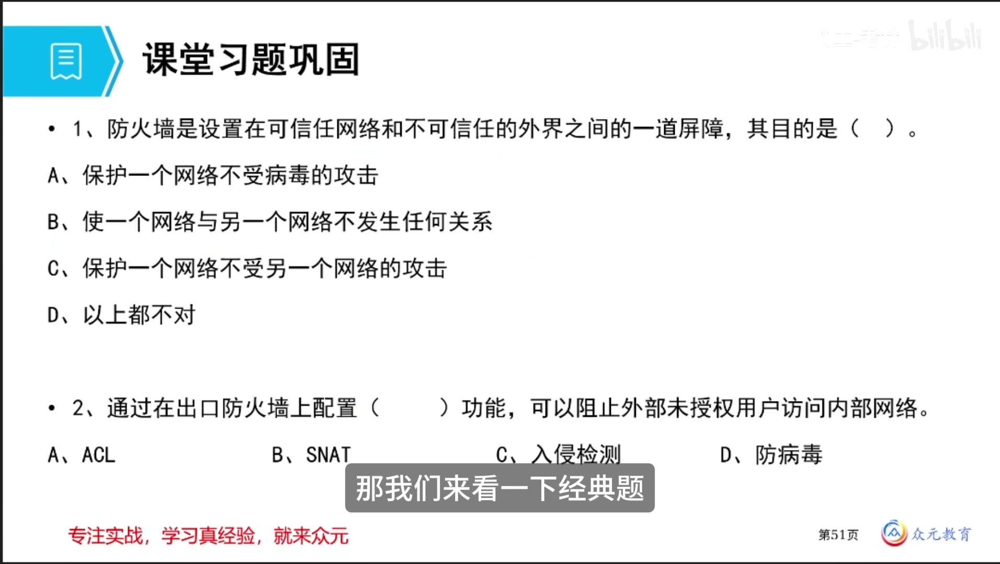

**例题 1**：防火墙是设置在可信任网络和不可信任的外界之间的一道屏障，其目的是（ ）。

A、保护一个网络不受病毒的攻击

B、使一个网络与另一个网络不发生任何关系

C、保护一个网络不受另一个网络的攻击

D、以上都不对

答案：**C**

| 选项 | 判断 | 理由 |
| ---- | ---- | ---- |
| A | [错误] | 防火墙主要做访问控制，不负责查杀病毒；防病毒需要专门的防病毒系统 |
| B | [错误] | 防火墙不是切断所有关系，而是按策略允许合法流量通过 |
| C | [正确] | 防火墙部署在可信任网络与不可信任网络之间，保护内部网络不受外部网络攻击 |
| D | [错误] | C 项正确，因此 D 项不成立 |

**例题 2**：通过在出口防火墙上配置（ ）功能，可以阻止外部未授权用户访问内部网络。

A、ACL

B、SNAT

C、入侵检测

D、防病毒

答案：**A**

| 选项 | 判断 | 理由 |
| ---- | ---- | ---- |
| A | [正确] | ACL（访问控制列表）可以根据源/目的地址、端口、协议等条件允许或拒绝流量，是防火墙实现访问控制的核心手段 |
| B | [错误] | SNAT 是源地址转换，用于内部用户访问外网，不负责阻止外部未授权访问 |
| C | [错误] | 入侵检测属于检测告警功能，不是防火墙的访问控制功能 |
| D | [错误] | 防病毒不是基本防火墙的功能，且不能替代访问控制 |

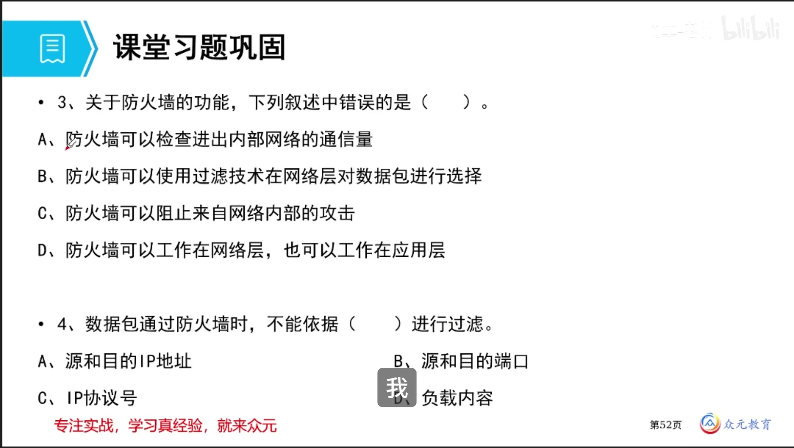

**例题 3**：关于防火墙的功能，下列叙述中错误的是（ ）。

A、防火墙可以检查进出内部网络的通信量

B、防火墙可以使用过滤技术在网络层对数据包进行选择

C、防火墙可以阻止来自网络内部的攻击

D、防火墙可以工作在网络层，也可以工作在应用层

答案：**C**

| 选项 | 判断 | 理由 |
| ---- | ---- | ---- |
| A | [正确] | 防火墙位于网络边界，可以检查进出内部网络的通信量 |
| B | [正确] | 包过滤防火墙工作在网络层，依据五元组等头部信息过滤数据包 |
| C | [错误] | 基本防火墙对内部网络高度信任，主要防范外部攻击，不能有效阻止来自内部的攻击；内部攻击需要 IDS、IPS、终端安全等配合 |
| D | [正确] | 包过滤、状态检测防火墙工作在网络层，应用代理防火墙工作在应用层 |

**例题 4**：数据包通过防火墙时，不能依据（ ）进行过滤。

A、源和目的 IP 地址

B、源和目的端口

C、IP 协议号

D、负载内容

答案：**D**

| 选项 | 判断 | 理由 |
| ---- | ---- | ---- |
| A | [正确] | 源/目的 IP 地址是包过滤的基本依据 |
| B | [正确] | 源/目的端口是传输层过滤的重要依据 |
| C | [正确] | IP 协议号用于区分 TCP、UDP、ICMP 等协议 |
| D | [错误] | 基本包过滤防火墙只检查头部，不检查负载内容；下一代防火墙、应用代理等可以检查应用层内容，但题目未强调此类设备 |

### 9.2 IDS 例题

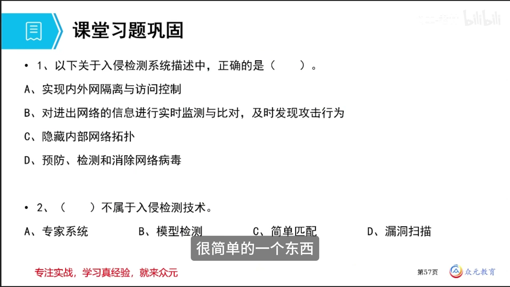

**例题 1**：以下关于入侵检测系统描述中，正确的是（ ）。

A、实现内外网隔离与访问控制

B、对进出网络的信息进行实时监测与比对，及时发现攻击行为

C、隐藏内部网络拓扑

D、预防、检测和消除网络病毒

答案：**B**

| 选项 | 判断 | 理由 |
| ---- | ---- | ---- |
| A | [错误] | 内外网隔离与访问控制是防火墙的功能 |
| B | [正确] | IDS 通过监听、采集和分析网络流量或主机行为，及时发现攻击迹象 |
| C | [错误] | 隐藏内部网络拓扑是 NAT、代理等技术的效果，不是 IDS 的主要功能 |
| D | [错误] | 预防、检测和消除病毒是防病毒系统的功能，IDS 不具备消除病毒的能力 |

**例题 2**：（ ）不属于入侵检测技术。

A、专家系统

B、模型检测

C、简单匹配

D、漏洞扫描

答案：**D**

| 选项 | 判断 | 理由 |
| ---- | ---- | ---- |
| A | [正确] | 专家系统是特征检测的典型技术 |
| B | [正确] | 模型检测可用于异常检测和行为建模 |
| C | [正确] | 简单匹配属于模式匹配，是特征检测的基础方法 |
| D | [错误] | 漏洞扫描是主动发现系统脆弱性的评估工具，不属于入侵检测技术 |

### 9.3 网闸例题

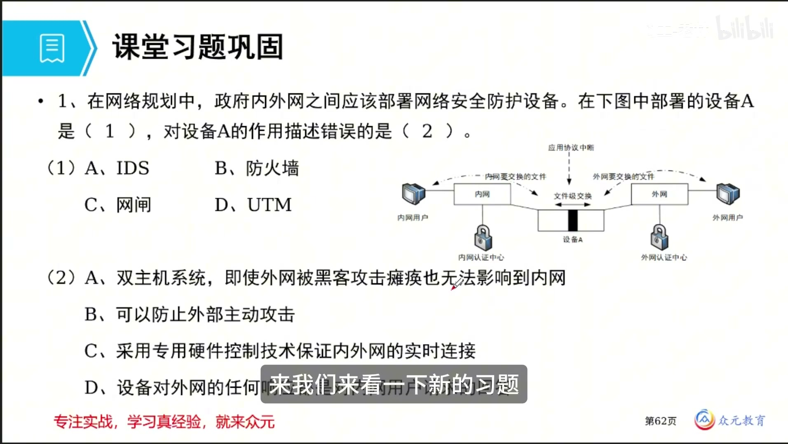

**例题**：在网络规划中，政府内外网之间应该部署网络安全防护设备。在下图中部署的设备 A 是（1），对设备 A 的作用描述错误的是（2）。

（1）

A、IDS

B、防火墙

C、网闸

D、UTM

（2）

A、双主机系统，即使外网被黑客攻击瘫痪也无法影响到内网

B、可以防止外部主动攻击

C、采用专用硬件控制技术保证内外网的实时连接

D、设备对外网的任何响应都是对内网用户请求的应答

答案：（1）**C**；（2）**C**

| 小问 | 答案 | 理由 |
| ---- | ---- | ---- |
| （1） | C | 政府内外网之间要求物理隔离，应采用网闸；IDS 只检测，防火墙是逻辑隔离，UTM 是综合安全网关，均不能满足物理隔离要求 |
| （2） | C | 网闸采用**分时连接**，内外网不在同一时刻连通，不是“实时连接”；“专用硬件控制”本身正确，但“保证实时连接”错误 |

各选项分析：

| 选项 | 判断 | 理由 |
| ---- | ---- | ---- |
| A | [正确] | 网闸采用双主机系统，外网主机被攻陷时内网主机仍可保持隔离 |
| B | [正确] | 网闸通过物理隔离和协议中断，可以防止外部主动攻击进入内网 |
| C | [错误] | 网闸是分时连接、数据摆渡，不保证内外网实时连接 |
| D | [正确] | 内网用户请求外网资源时，外网响应经网闸摆渡回内网，表现为对内网请求的应答 |

说明：截图中 D 项被字幕遮挡，完整原题为“设备对外网的任何响应都是对内网用户请求的应答”。

### 9.4 WAF 例题

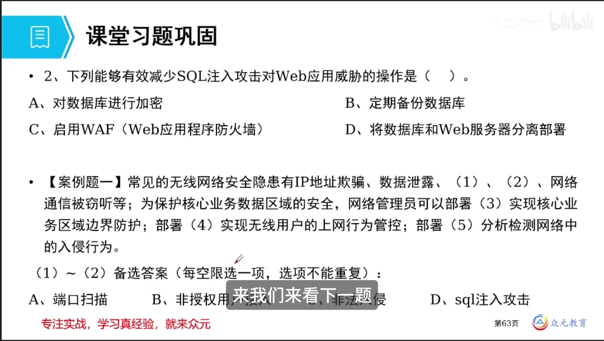

**例题**：下列能够有效减少 SQL 注入攻击对 Web 应用威胁的操作是（ ）。

A、对数据库进行加密

B、定期备份数据库

C、启用 WAF（Web 应用程序防火墙）

D、将数据库和 Web 服务器分离部署

答案：**C**

| 选项 | 判断 | 理由 |
| ---- | ---- | ---- |
| A | [错误] | 数据库加密保护的是存储数据，不能阻止 SQL 注入语句进入应用 |
| B | [错误] | 定期备份用于灾难恢复，不能减少攻击发生 |
| C | [正确] | WAF 工作在应用层，可基于特征库识别并阻断 SQL 注入、XSS 等 Web 攻击 |
| D | [错误] | 分离部署可以降低数据库直接暴露的风险，但不能识别和阻断 SQL 注入 |

### 9.5 综合案例题

**案例题**：常见的无线网络安全隐患有 IP 地址欺骗、数据泄露、（1）、（2）、网络通信被窃听等；为保护核心业务数据区域的安全，网络管理员可以部署（3）实现核心业务区域边界防护；部署（4）实现无线用户的上网行为管控；部署（5）分析检测网络中的入侵行为。

（1）～（2）备选答案（每空限选一项，选项不能重复）：

A、端口扫描

B、非授权用户接入

C、非法入侵

D、SQL 注入攻击

答案：（1）**B**；（2）**C**；（3）**防火墙**；（4）**上网行为管理**；（5）**IDS**

| 小问 | 答案 | 理由 |
| ---- | ---- | ---- |
| （1） | B | 非授权用户接入是无线网络的主要安全隐患之一 |
| （2） | C | 非法入侵是无线网络的主要安全隐患之一 |
| （3） | 防火墙 | 核心业务区域边界防护应部署防火墙，实施访问控制 |
| （4） | 上网行为管理 | 对无线用户的上网行为进行识别、控制和审计，应部署上网行为管理设备 |
| （5） | IDS | 分析检测网络中的入侵行为，应部署入侵检测系统 |

选项辨析：

| 选项 | 判断 | 理由 |
| ---- | ---- | ---- |
| A 端口扫描 | [错误] | 端口扫描是一种探测行为，可能是攻击前的侦察，也可能是正常的安全评估，不属于无线网络特有的安全隐患 |
| B 非授权用户接入 | [正确] | 未经授权的终端接入无线网络，会带来数据泄露和攻击风险 |
| C 非法入侵 | [正确] | 攻击者入侵无线网络后，可能窃取数据、植入恶意代码 |
| D SQL 注入攻击 | [错误] | SQL 注入是针对 Web 应用和数据库的攻击，不属于无线网络安全隐患 |

补充说明：

- 题目中的“边界防护”对应防火墙，“上网行为管控”对应上网行为管理，“分析检测入侵行为”对应 IDS，这是案例题中常见的“关键词—设备”对应关系。
- 设备部署位置应结合拓扑判断：防火墙通常位于核心业务区与核心交换机之间；上网行为管理通常位于无线用户接入路径上；IDS 通常旁路部署在核心交换机或关键网段。

---

## 10.本章小结

| 防护系统 | 核心作用 | 部署方式 | 关键特点 |
| -------- | -------- | -------- | -------- |
| 防火墙 | 边界访问控制 | 路由、透明、混合 | 基于安全区域和策略过滤流量；基本防火墙不防内部攻击、不查毒 |
| IDS | 检测入侵、记录告警 | 旁路（镜像、TAP） | 被动、不阻断；异常检测可发现未知攻击但误报高；特征检测对已知攻击准确但依赖特征库 |
| IPS | 检测并实时阻断入侵 | 串联（直路） | 主动防御；需高性能和高可用；误报可能阻断合法业务 |
| UTM | 多功能集成 | 边界部署 | 集成防火墙、IDS、IPS、防病毒等；单项能力较弱，性能要求高 |
| NGFW | 应用层综合防护 | 边界部署 | 基于应用、用户、内容管控；一次拆包多次检查，性能损耗小 |
| 网闸 | 物理隔离与受控数据交换 | 内外网之间 | 分时连接、数据摆渡、协议中断；适合政务、军工等高安全场景 |
| 漏洞扫描 | 发现系统脆弱性 | 主动探测 | 事前评估工具；可用于防御也可用于攻击；不属于 IDS |
| WAF | 防护 Web 应用攻击 | Web 服务器前、反向代理、云 WAF | 应用层防护；阻断 SQL 注入、XSS 等；依赖规则和特征库 |
| 态势感知 | 全局威胁感知与APT分析 | 安全管理中心 | 大数据关联分析、攻击链还原、预警告警、调查取证 |
| 沙箱 | 隔离检测未知威胁 | 与网关联动 | 动态运行、行为分析；检测为主，阻断靠联动 |
| 数据库审计 | 数据库操作审计与风险告警 | 旁路采集数据库流量 | 细粒度审计、合规管理、事后追溯 |
| 堡垒机 | 运维行为管控与审计 | 运维人员与目标设备之间 | 4A：认证、账户、授权、审计；防权限滥用，支持追责 |
| 上网行为管理 | 上网行为识别、控制与审计 | 网关、网桥、旁路 | 应用控制、URL 过滤、带宽管理、内容审计 |
| IPSec VPN | 网络层加密隧道 | 网关到网关、主机到网关 | AH/ESP；传输模式/隧道模式；IKE 两阶段协商 |
| SSL VPN | 应用层远程接入 | 客户端到站点 | 基于 SSL/TLS，浏览器或轻量客户端，细粒度授权 |
| NAT | 地址转换与地址复用 | 边界网关 | 隐藏内部地址、缓解 IPv4 短缺；不是安全功能，不能替代防火墙 |

本章考试重点：

1. **防火墙的三个常考点**：安全区域及优先级、功能与部署模式、部署位置与局限性。
2. **安全区域优先级**：Local 100 > Trust 85 > DMZ 50 > Untrust 5；Inbound 为低到高，Outbound 为高到低。
3. **防火墙类型辨析**：包过滤看五元组、状态检测看会话状态、应用代理看应用层内容；层次越高越安全，但效率越低。
4. **IDS 与 IPS 的区别**：IDS 被动、旁路、只检测告警；IPS 主动、串联、可实时阻断。
5. **检测方法**：异常检测能发现未知攻击但误报率高；特征检测对已知攻击准确但依赖特征库。
6. **其他设备的关键词**：物理隔离对应网闸，Web 攻击对应 WAF，未知文件检测对应沙箱，运维审计对应堡垒机，上网行为管控对应上网行为管理。
7. **VPN 与 NAT**：IPSec 的 AH 不加密且不兼容 NAT，ESP 提供加密并可配合 NAT-T；传输模式保护载荷，隧道模式保护整个原 IP 包；IKE 第一阶段建立 IKE SA，第二阶段建立 IPSec SA。
8. **安全体系思维**：防火墙是边界基础，但不能包打天下；实际组网需要防火墙、IDS/IPS、WAF、防病毒、审计、堡垒机等多种手段协同，形成纵深防御。

主要核实依据：华为官方文档《安全区域缺省配置》《安全区域原理描述》、NIST SP 800-41 Revision 1《Guidelines on Firewalls and Firewall Policy》、RFC 2409（IKE）、RFC 4302（AH）、RFC 4303（ESP），以及防火墙、IDS/IPS、WAF、网闸、堡垒机等厂商技术白皮书。
