# 其他安全技术应用与章节总结 · 完整笔记

---

## 1.本章知识地图与考查定位

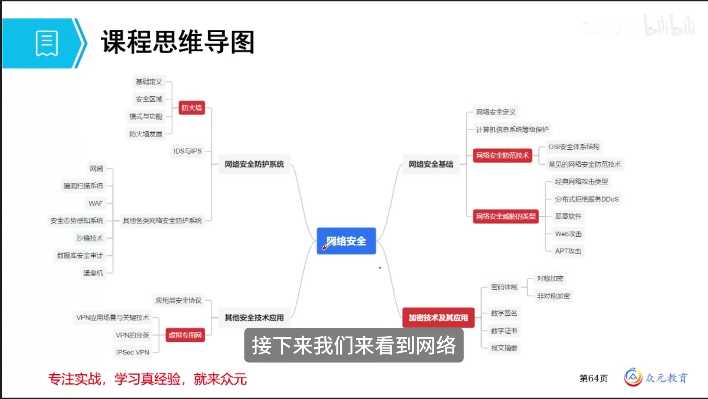

本章属于网络安全板块的收尾部分。其考查频度低于加密技术、防火墙与 IDS/IPS，主要价值在于**把前面学过的加密技术串起来**：应用层安全协议（HTTPS、SSL、SET、PGP、SSH、S/MIME）说明加密技术如何在具体协议中落地；虚拟专用网（尤其是 IPSec VPN）说明加密、认证、密钥管理如何组合成一套完整的组网方案。

全章知识地图如下：

| 一级模块 | 二级内容 | 三级要点 |
| -------- | -------- | -------- |
| 网络安全基础 | 网络安全定义 | — |
| | 计算机信息系统等级保护 | — |
| | 网络安全防范技术 | OSI 安全体系结构、常见的网络安全防范技术 |
| | 网络安全威胁的类型 | 经典网络攻击类型、分布式拒绝服务 DDoS、恶意软件、Web 攻击、APT 攻击 |
| 加密技术及其应用 | 密码体制 | 对称加密、非对称加密 |
| | 数字签名 | — |
| | 数字证书 | — |
| | 报文摘要 | — |
| 网络安全防护系统 | 防火墙 | 基础定义、安全区域、模式与功能、防火墙发展 |
| | IDS 与 IPS | — |
| | 其他各类网络安全防护系统 | 网闸、漏洞扫描系统、WAF、安全态势感知系统、沙箱技术、数据库安全审计、堡垒机 |
| 其他安全技术应用 | 应用层安全协议 | — |
| | 虚拟专用网 | VPN 应用场景与关键技术、VPN 的分类、IPSec VPN |

本节学习主线：

| 顺序 | 内容 | 与前面知识的衔接 |
| ---- | ---- | ---------------- |
| 1 | 应用层安全协议 | 对称/非对称加密、哈希、数字签名、数字证书的综合应用 |
| 2 | 虚拟专用网 | 隧道技术 + 加解密 + 密钥管理 + 身份认证的工程化组合 |
| 3 | 其他安全技术 | 安全审计、漏洞扫描、渗透测试、蜜罐、容灾备份等运维侧手段 |
| 4 | 无线与终端安全 | 接入侧与端点侧的安全防护 |
| 5 | 管理与合规 | 法律法规、等级保护、安全管理制度 |

> 说明：第 4 至第 8 节为本章考纲要求、但本节课件未展开的常考内容，按现行标准与公开资料核实后补齐，与课件内容互为补充。

---

## 2.应用层安全协议

### 2.1 SSL/TLS 协议

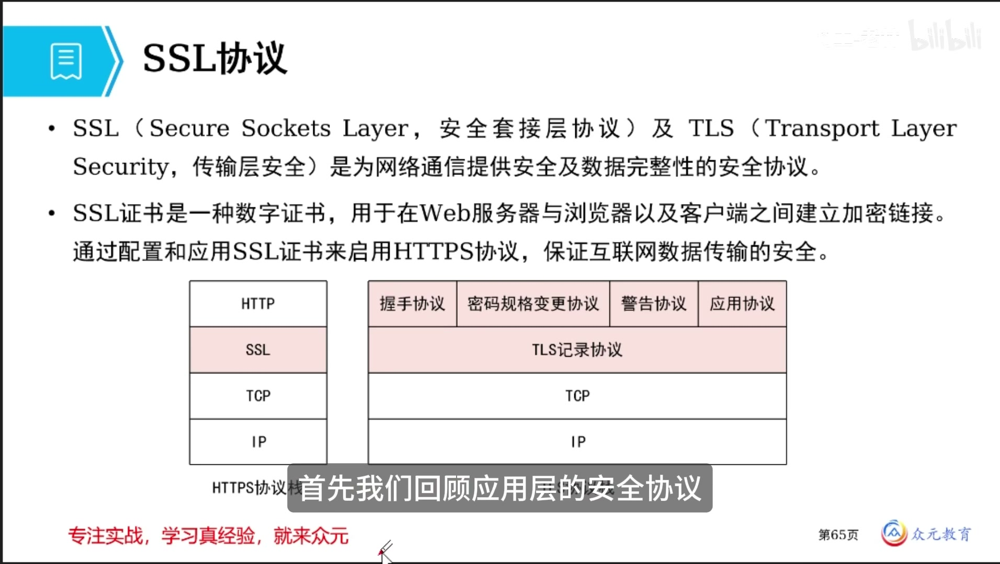

**基本定义**

- SSL（Secure Sockets Layer，安全套接层协议）及 TLS（Transport Layer Security，传输层安全协议）是为网络通信提供安全及数据完整性的安全协议。
- TLS 是 SSL 3.0 之后的升级版本，二者在概念上指同一类技术，差别在于版本与细节。考试中凡问“替代 SSL 的协议”，答案即 TLS。
- SSL 证书是一种数字证书，用于在 Web 服务器与浏览器以及客户端之间建立加密链接。通过配置和应用 SSL 证书来启用 HTTPS 协议，保证互联网数据传输的安全。

**协议栈位置**

HTTPS 即在 HTTP 与 TCP 之间插入 SSL/TLS：

| 层次 | HTTPS 协议栈 | TLS/SSL 内部结构 |
| ---- | ------------ | ---------------- |
| 应用层 | HTTP | 握手协议、密码规格变更协议、警告协议、应用协议 |
| 安全子层 | SSL | TLS 记录协议 |
| 传输层 | TCP | TCP |
| 网络层 | IP | IP |

**SSL/TLS 的协议组成（4 个上层协议 + 记录协议）**

| 协议 | 作用 |
| ---- | ---- |
| 握手协议 | 协商加密套件（加密算法、哈希算法、密钥交换算法）、认证对端身份、交换并生成共享密钥；机密性、完整性、真实性的协商均在此完成 |
| 密码规格变更协议 | 向对方传达“此后改用新协商的密码规格”的信号 |
| 警告协议 | 出现错误或异常时，将告警信息告知对方 |
| 应用协议 | 承载应用层数据，如 HTTP |
| 记录协议（下层） | 承上启下，对上层数据进行分块、压缩、加 MAC、加密，完成封装与传输 |

要点：

- 记录协议负责“封装与搬运”，握手协议负责“协商与认证”，二者是最常考的两个组成部分。
- 握手的概念在 PPP（点到点协议）中也出现过（两次握手、三次握手），但 PPP 是链路层协议，与 SSL 无关，不可混淆。
- 本部分用到的底层技术仍是**对称加密、非对称加密、哈希/报文摘要**三类。

### 2.2 SSL/TLS 的工作过程

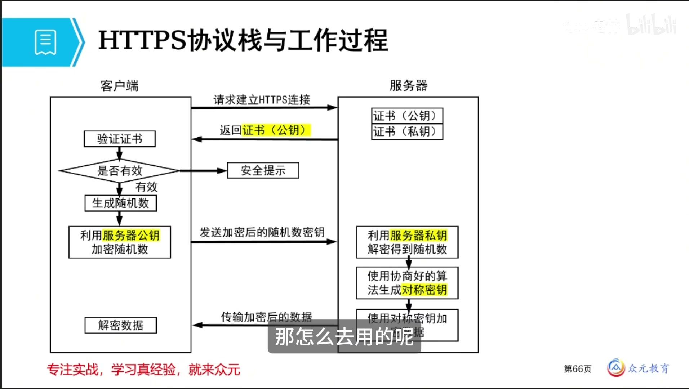

工作过程按“协商算法 → 验证证书 → 分发密钥 → 对称加密传输”四步展开：

1. 客户端向服务器**请求建立 HTTPS 连接**。
2. 服务器返回所选加密算法及**证书（含公钥）**。
3. 客户端使用签发证书的 CA 验证证书**是否有效**：
   - 无效：给出安全提示；
   - 有效：客户端**生成随机数**。
4. 客户端**利用服务器公钥加密该随机数**，发送“加密后的随机数密钥”。
5. 服务器**利用自己的私钥解密**，得到随机数。
6. 双方**使用协商好的算法与随机数生成对称密钥**。
7. 服务器与客户端此后均**使用该对称密钥加解密数据**，传输加密后的数据。

关键结论：

- 该过程同时使用了**非对称算法**与**对称算法**：非对称算法用于身份鉴别与对称密钥的安全分发，对称算法用于大量报文的加密传输。
- 单向认证只验证服务器证书；双向认证还需客户端提供证书。
- 若考题把图中的密钥位置挖空，应能判断：客户端加密随机数用**服务器公钥**，服务器解密用**服务器私钥**，最终通信使用**对称密钥**。
- 证书被撤销时，浏览器只是不再信任该证书并弹出告警，用户仍可选择继续访问；此时的风险点在后续的密钥分发环节。

### 2.3 SET 协议

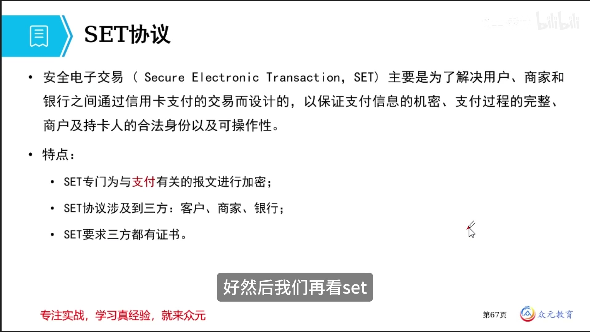

安全电子交易（Secure Electronic Transaction，SET）主要是为解决用户、商家和银行之间通过信用卡支付的交易而设计的，以保证支付信息的机密、支付过程的完整、商户及持卡人的合法身份以及可操作性。

特点：

- SET 专门为与**支付**有关的报文进行加密；
- SET 协议涉及三方：**客户、商家、银行**；
- SET 要求**三方都有证书**。

课件讲授的算法组合（课件正文未列出，属课堂补充）：

| 用途 | 算法 |
| ---- | ---- |
| 对称加密 | DES（默认） |
| 非对称加密 | RSA |
| 哈希/摘要 | SHA |

SET 随着 SSL 的普及而被边缘化：SSL 成本更低、使用更方便，二者形成竞争关系，SET 已很少实际应用。考试中 SET 多作为选项出现，通常不是正确答案，只需记住“支付、三方、三方都要证书”三个特征。

### 2.4 PGP 协议

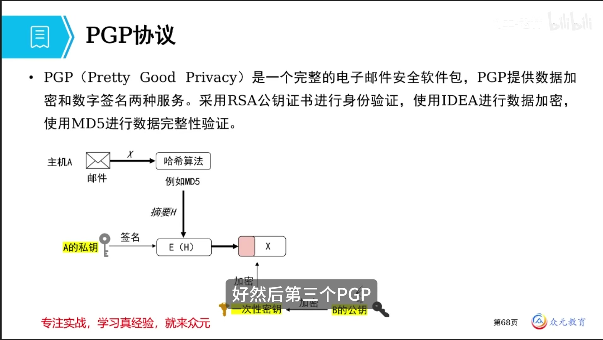

PGP（Pretty Good Privacy）是一个完整的**电子邮件安全软件包**，提供**数据加密**和**数字签名**两种服务：

| 功能 | 采用的技术 |
| ---- | ---------- |
| 身份验证 | RSA 公钥证书 |
| 数据加密 | IDEA（对称加密算法） |
| 数据完整性验证 | MD5（哈希算法） |

**发送方处理流程（主机 A）**

1. 对邮件原文 X 施以哈希算法（例如 MD5），得到**摘要 H**；
2. 用 **A 的私钥**对摘要签名，得到 E(H)；
3. 将摘要签名 E(H) 与原文 X 组合；
4. 用**一次性密钥**（随机生成的对称密钥）对“原文 + 签名”加密；
5. 用 **B 的公钥**加密该一次性密钥；
6. 将“处理后的邮件”与“加密后的一次性密钥”一起传输。

**接收方处理流程（主机 B）**

1. 用 **B 的私钥**解密，取得一次性密钥；
2. 用一次性密钥解密邮件，还原出原文 X 与 E(H)；
3. 用 **A 的公钥**验证签名，得到摘要 H；
4. 对还原出的原文重新做相同的 Hash，得到摘要 H'；
5. **比较 H 与 H'**：一致则说明数据完整、来源真实且不可抵赖。

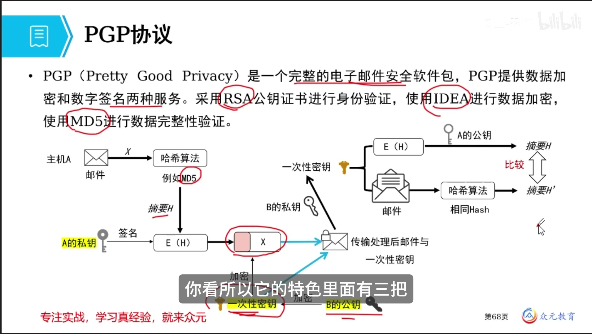

PGP 的特色是“**三把钥匙**”，分别承担三种不同职能：

| 密钥 | 所属 | 作用 |
| ---- | ---- | ---- |
| A 的私钥 | 发送方 | 对摘要签名，提供真实性与不可抵赖 |
| 一次性密钥 | 本次会话随机生成 | 对称加密邮件正文，提供机密性 |
| B 的公钥 | 接收方 | 加密一次性密钥，实现对称密钥的安全分发 |

课件手写批注：

- [手写批注] “电子邮件安全软件包”下加红色下划线。
- [手写批注] “RSA 公钥证书”“IDEA”“MD5”三处分别用红圈圈出。
- [手写批注] 流程图底部用红圈圈出“一次性密钥”“加密”“B 的公钥”三处，并在“比较”处标红，提示三把密钥的配合关系。

### 2.5 更多应用层安全协议

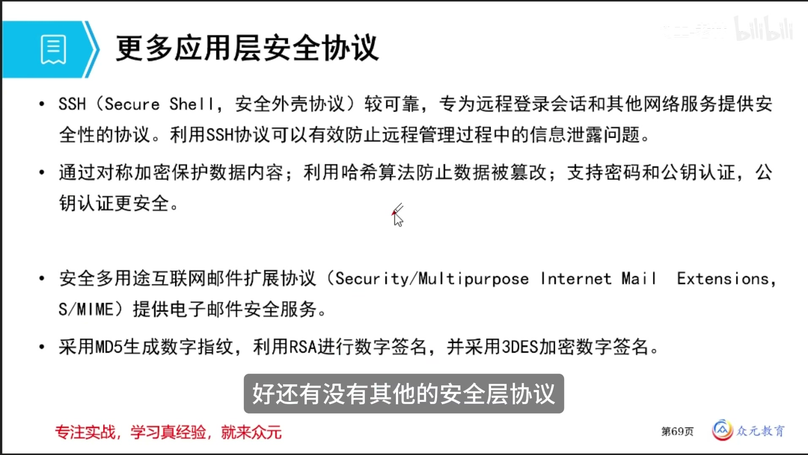

**SSH（Secure Shell，安全外壳协议）**

- 较可靠，专为远程登录会话和其他网络服务提供安全性的协议；
- 利用 SSH 协议可以有效防止远程管理过程中的信息泄露问题；
- 通过**对称加密**保护数据内容；利用**哈希算法**防止数据被篡改；支持**密码认证**和**公钥认证**，其中公钥认证更安全。

**S/MIME（Secure/Multipurpose Internet Mail Extensions，安全多用途互联网邮件扩展协议）**

- 提供电子邮件安全服务；
- 采用 **MD5** 生成数字指纹，利用 **RSA** 进行数字签名，并采用 **3DES** 加密数字签名。

对比记忆：

| 协议 | 层次/用途 | 对称算法 | 非对称算法 | 哈希算法 |
| ---- | --------- | -------- | ---------- | -------- |
| HTTPS（SSL/TLS） | 应用层，Web 访问 | 协商产生的会话密钥 | RSA 等，用于密钥分发与身份鉴别 | 协商确定 |
| SET | 应用层，电子支付 | DES | RSA | SHA |
| PGP | 应用层，电子邮件 | IDEA | RSA | MD5 |
| S/MIME | 应用层，电子邮件 | 3DES | RSA | MD5 |
| SSH | 应用层，远程登录 | 对称加密保护数据 | 公钥认证 | 哈希算法防篡改 |

结论：应用层安全协议题很少直接考“协议概念”，通常**结合加密技术的特点一起考**。判断某算法属于对称、非对称还是哈希，是解题的第一步。

### 2.6 例题

#### 例题1：PKI 体系与 HTTPS（填空三问）

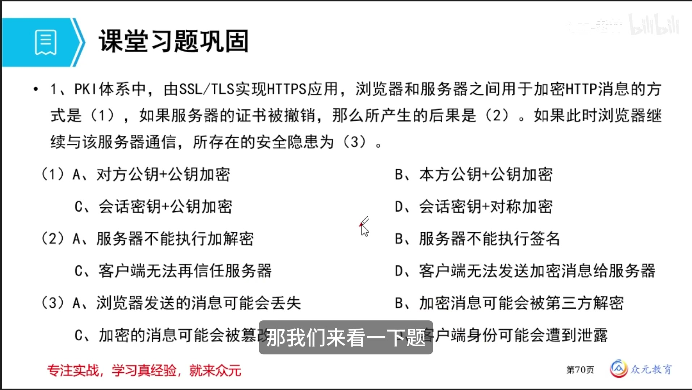

在 PKI 体系中，由 SSL/TLS 实现 HTTPS 应用，浏览器和服务器之间用于加密 HTTP 消息的方式是（1），如果服务器的证书被撤销，那么所产生的后果是（2）。如果此时浏览器继续与该服务器通信，所存在的安全隐患为（3）。

（1）

- A、对方公钥 + 公钥加密
- B、本方公钥 + 公钥加密
- C、会话密钥 + 公钥加密
- D、会话密钥 + 对称加密

（2）

- A、服务器不能执行加解密
- B、服务器不能执行签名
- C、客户端无法再信任服务器
- D、客户端无法发送加密消息给服务器

（3）

- A、浏览器发送的消息可能会丢失
- B、加密消息可能会被第三方解密
- C、加密的消息可能会被篡改
- D、客户端身份可能会遭到泄露

| 空 | 答案 | 解析 |
| -- | ---- | ---- |
| （1） | D | 握手完成后，HTTP 消息由**会话密钥**以**对称加密**方式保护；非对称算法只用于密钥分发与身份鉴别 |
| （2） | C | 证书被撤销即不再被信任，浏览器验证后发出告警信息；服务器本身仍能加解密、签名，只是信任关系失效 |
| （3） | B | 证书告警被忽略后，流程继续走到密钥分发环节：客户端把用服务器公钥加密的随机数发给服务器，此环节若被第三方破解，对称密钥即暴露，加密消息可被解密 |

要点：第（3）空容易误选 C。报文被篡改由完整性校验（MAC/摘要）防护，而证书失效直接破坏的是**密钥分发的可信前提**，因此“被第三方解密”的正确度更高。

#### 例题2：替代 SSL 的协议与 PGP 算法

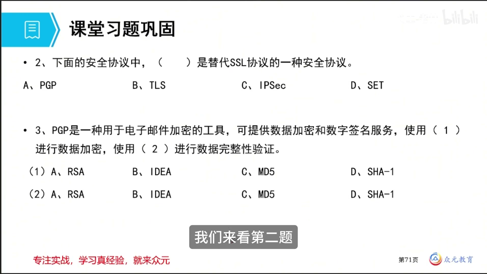

**第 2 题** 下面的安全协议中，（ ）是替代 SSL 协议的一种安全协议。

- A、PGP
- B、TLS
- C、IPSec
- D、SET

答案：**B**。TLS 是 SSL 3.0 的后续版本，二者为同一技术路线的不同版本。

**第 3 题** PGP 是一种用于电子邮件加密的工具，可提供数据加密和数字签名服务，使用（1）进行数据加密，使用（2）进行数据完整性验证。

（1）A、RSA　B、IDEA　C、MD5　D、SHA-1

（2）A、RSA　B、IDEA　C、MD5　D、SHA-1

答案：（1）**B**；（2）**C**。

解答思路：

- 数据加密必然用**对称算法**，四个选项中只有 IDEA 是对称算法；RSA 是非对称算法，MD5、SHA-1 是哈希算法。
- 完整性验证用**哈希算法**；PGP 采用 MD5。

#### 例题3：SSL VPN 配置案例

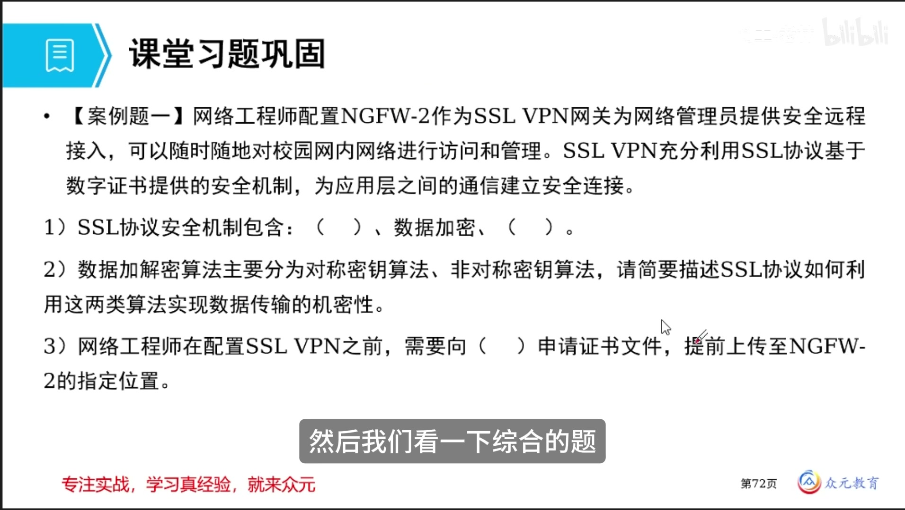

【案例题一】网络工程师配置 NGFW-2 作为 SSL VPN 网关为网络管理员提供安全远程接入，可以随时随地对校园网内网络进行访问和管理。SSL VPN 充分利用 SSL 协议基于数字证书提供的安全机制，为应用层之间的通信建立安全连接。

1）SSL 协议安全机制包含：（ ）、数据加密、（ ）。
2）数据加解密算法主要分为对称密钥算法、非对称密钥算法，请简要描述 SSL 协议如何利用这两类算法实现数据传输的机密性。
3）网络工程师在配置 SSL VPN 之前，需要向（ ）申请证书文件，提前上传至 NGFW-2 的指定位置。

**解答**

1）第一空填**身份认证（真实性验证）**，第二空填**数据完整性校验**。若题目给两空而要求答三项，可答“身份认证、数据加密、完整性保护”；密钥的安全分配、数字签名与数字证书属于实现这些机制的手段，可一并写出。

2）**用非对称算法实现对称密钥的安全分发，用对称密钥实现数据的加密传输。** 展开表述：客户端生成随机数，用服务器公钥加密后发送；服务器用私钥解密得到随机数，双方据此协商生成对称密钥；此后所有应用数据均用该对称密钥加密。非对称算法还可配合数字签名、数字证书提供身份真实性与数据完整性。

3）向 **CA（证书授权中心，数字证书认证机构）** 申请证书文件。

答题提示：本题为送分题，失分点多在“答成过程叙述”而非“点明两类算法各自的作用”。抓住两句话即可：非对称管分发，对称管加密。

---

## 3.虚拟专用网（VPN）

### 3.1 VPN 的应用背景

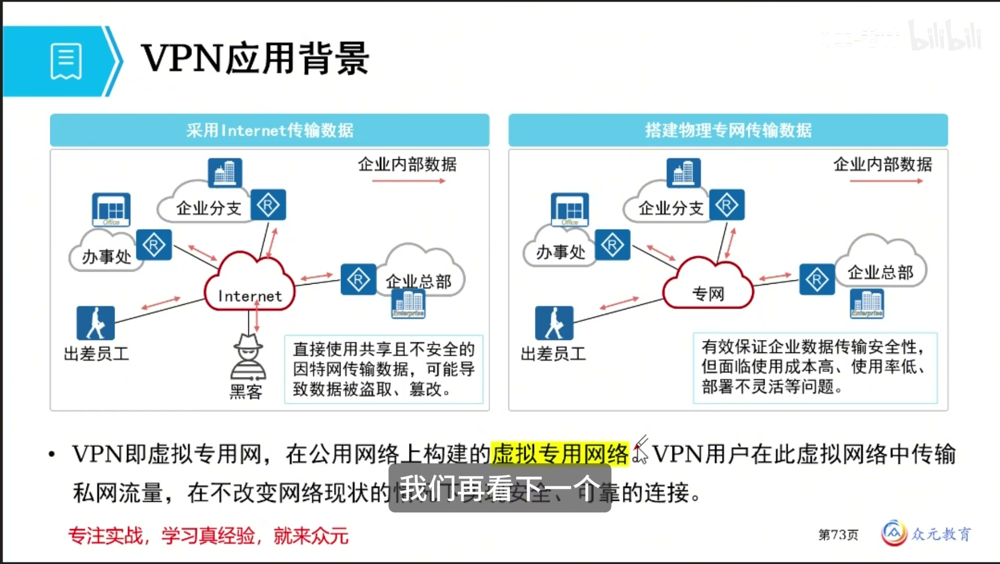

企业规模扩大后，会出现分支机构、办事处以及出差员工远程接入总部数据的需求。此时有两种传输方式：

| 方式 | 做法 | 问题 |
| ---- | ---- | ---- |
| 采用 Internet 传输数据 | 各分支、办事处、出差员工、总部均直接接入 Internet | 直接使用共享且不安全的因特网传输数据，可能导致数据被盗取、篡改；公网上随时可能被截取或破坏 |
| 搭建物理专网传输数据 | 向运营商申请专线，仅供本单位使用 | 能有效保证传输安全，但使用成本高、使用率低、部署不灵活 |

物理专线“贵且利用率低”——分支机构可能一年只在年会时做一次数据交互，为此长期租用专线并不经济。虚拟专用网即在此背景下产生：在公共网络上构建一条逻辑的虚拟专用通道，在不改变网络现状的情况下实现安全可靠的连接。

### 3.2 定义、应用场景与关键技术

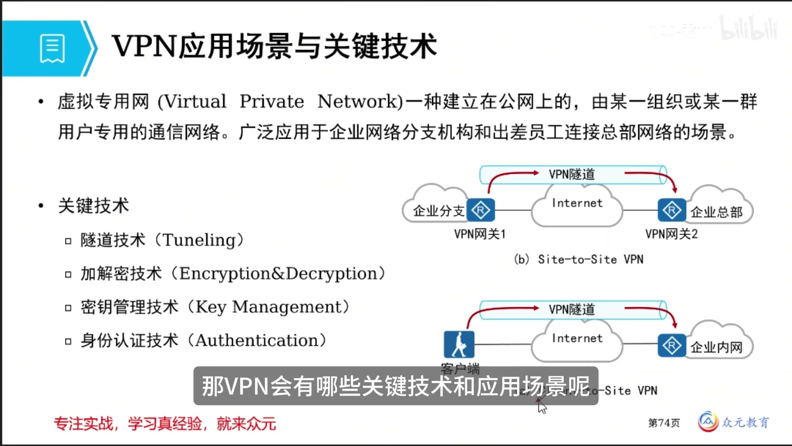

**定义**

虚拟专用网（Virtual Private Network）是一种建立在公网上的、由某一组织或某一群用户专用的通信网络。VPN 用户在此虚拟网络中传输私网流量，在不改变网络现状的情况下实现安全可靠的连接。

**两类应用场景**

| 场景 | 图形特征 | 说明 |
| ---- | -------- | ---- |
| Site-to-Site VPN（站点到站点） | 企业分支—VPN 网关 1—Internet—VPN 网关 2—企业总部 | 分支与总部之间通过网关建立隧道，两端网络整体互通 |
| 远程接入 VPN（客户端到站点） | 客户端—Internet—企业内网（VPN 网关） | 出差员工、移动用户以客户端方式接入总部 |

不同类别、不同层次的 VPN 技术对这两类场景的支持能力不同，这是分类比较时的重要维度。

**四项关键技术**

| 关键技术 | 作用 |
| -------- | ---- |
| 隧道技术（Tunneling，课件拼写为 “Tuneling”） | 在公网上打通逻辑通道，通常与网络边界设备建立连接 |
| 加解密技术 | 对隧道内数据进行加密，通常使用对称密钥 |
| 密钥管理技术 | 对称密钥的管理与安全分发 |
| 身份认证技术 | 保证只有合法用户才能使用隧道 |

评价一种 VPN 实现手段时，应看它：支持哪种场景、是否支持加解密、是否支持身份认证；不具备的能力需要由其他技术配合补齐（如 GRE、L2TP 与 IPSec 配合）。

### 3.3 VPN 的分类

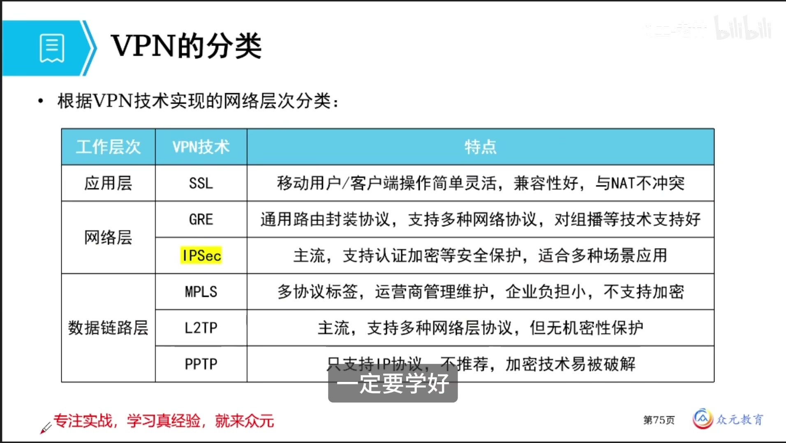

按 VPN 技术实现的网络层次分类：

| 工作层次 | VPN 技术 | 特点 |
| -------- | -------- | ---- |
| 应用层 | SSL | 移动用户/客户端操作简单灵活，兼容性好，与 NAT 不冲突 |
| 网络层 | GRE | 通用路由封装协议，支持多种网络协议，对组播等技术支持好 |
| 网络层 | IPSec | 主流，支持认证加密等安全保护，适合多种场景应用 |
| 数据链路层 | MPLS | 多协议标签，运营商管理维护，企业负担小，不支持加密 |
| 数据链路层 | L2TP | 主流，支持多种网络层协议，但无机密性保护 |
| 数据链路层 | PPTP | 只支持 IP 协议，不推荐，加密技术易被破解 |

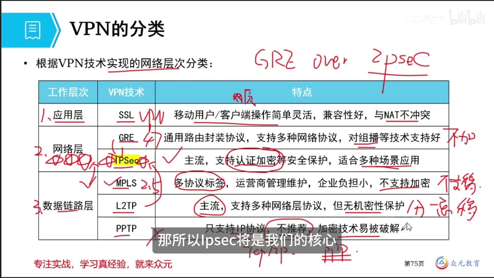

各技术的补充说明：

- **SSL VPN（应用层）**：只要有浏览器即可访问，无需专门客户端，移动用户操作简单、兼容性好；由于作用于应用数据部分，下层封装变化（如 NAT 地址转换）不会造成冲突。
- **GRE（网络层）**：通用路由封装协议，协议号 **47**，支持多种网络协议，对组播、语音、视频等业务适配性好；**本身不加密**，安全保障需配合 IPSec，形成 **GRE over IPSec**。
- **IPSec（网络层）**：主流方案，支持认证、加密等安全保护，适用多种场景，是学习与配置的核心；很多不具备加密能力的协议都通过 “×× over IPSec” 与之配合。
- **MPLS（数据链路层）**：早期用于提高路由转发效率，以标签替代逐跳查表，被称为“2.5 层协议”；可用于业务区分与 QoS，**不支持加密**，**不支持单个移动用户接入**，只适合子网与子网之间传输；一般由运营商维护，企业负担小。路由器性能提升后其转发优势减弱，但在运营商网络中仍有应用。
- **L2TP（数据链路层）**：第二层隧道协议，结合了 PPTP 与 L2F 的优点，被广泛接受；适用于单个、少数远程终端通过公共网络接入企业网，既支持分支组网也支持移动办公；**不加密**，需与 IPSec 配合，形成 **L2TP over IPSec**。
- **PPTP（数据链路层）**：基于 PPP 的点到点传输，只支持 IP 协议，加密技术非常容易被破解，已基本淘汰，不推荐使用。

课件手写批注：

- [手写批注] 表头右侧写有 “GRE over IPsec” 并长下划线标注 “IPsec”。
- [手写批注] 三个工作层次前的序号 1、2、3 被红圈圈出，“应用层”“网络层”“数据链路层”分别加下划线，提示按层次记忆。
- [手写批注] IPsec 一行为黄色高亮并红圈，旁注“重点”，其“支持认证加密等安全保护”处打勾。
- [手写批注] GRE 行旁注“不加”（指不加密），MPLS 行旁注“不支持”（指不支持加密）。
- [手写批注] SSL 行的“移动用户”“简单灵活”“兼容性好”“与 NAT 不冲突”分别加下划线。
- [手写批注] 底部字幕位置标注“那所以 Ipsec 将是我们的核心”，并在 IPsec 处打勾。

### 3.4 IPSec VPN 基本概念

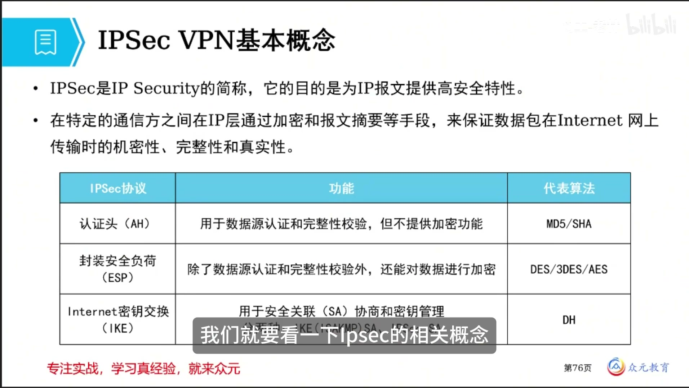

IPSec 是 IP Security 的简称，目的是为 IP 报文提供高安全特性；在特定的通信方之间、在 IP 层通过加密和报文摘要等手段，保证数据包在 Internet 上传输时的**机密性、完整性和真实性**。

| IPSec 协议 | 功能 | 代表算法 |
| ---------- | ---- | -------- |
| 认证头（AH） | 用于数据源认证和完整性校验，但**不提供加密功能** | MD5/SHA（国密对应 SM3） |
| 封装安全负荷（ESP） | 除了数据源认证和完整性校验外，还能对数据进行**加密** | DES/3DES/AES |
| Internet 密钥交换（IKE） | 用于安全关联（SA）协商和密钥管理 | DH |

要点：

- **AH 只认证不加密，ESP 既认证又加密**。问“哪个协议可同时用于数据加密和认证”，答 ESP。
- IPSec 的加密使用**对称加密算法**；非对称与 DH 算法用于数字签名和密钥的安全分发。
- IKE 负责 SA 的协商与密钥管理，可理解为“算法协商与密钥管理机构”；相比手工配置 SA，其效率更高、更稳妥，具体报文交互了解即可。
- 协议号：AH 为 51，ESP 为 50，IKE 使用 UDP 500。

### 3.5 数据封装与 NAT 穿越

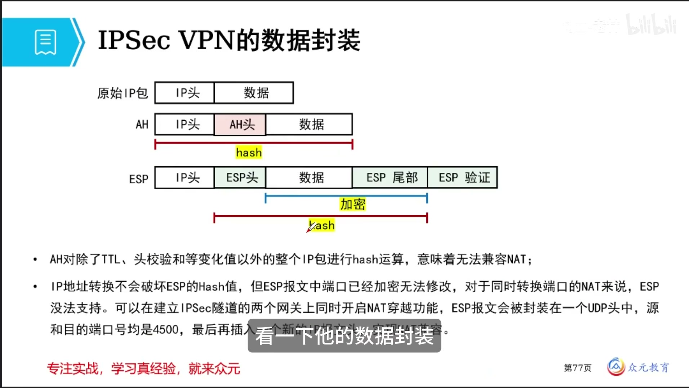

**原始 IP 包**：IP 头 + 数据。

**AH 封装**：IP 头 + AH 头 + 数据。AH 对除了 TTL、头校验和等变化值以外的整个 IP 包进行 hash 运算，这意味着**无法兼容 NAT**——NAT 改写 IP 地址后，接收方重新计算 hash 必然不一致。

**ESP 封装**：IP 头 + ESP 头 + 数据 + ESP 尾部 + ESP 验证。

- 加密范围：ESP 头、数据、ESP 尾部；
- 认证范围：ESP 头至 ESP 验证字段，**不覆盖可被 NAT 改写的 IP 地址**；
- 因此：IP 地址转换不会破坏 ESP 的 Hash 值，但 ESP 报文中的**端口已被加密、无法修改**，对于同时转换端口的 NAT 来说，ESP 无法支持。

**NAT 穿越（NAT-T）**

在建立 IPSec 隧道的两个网关上**同时开启 NAT 穿越功能**：ESP 报文被封装在一个 **UDP 头**中，源和目的端口号均为 **4500**，最后再插入一个新的 IP 头。相当于在 ESP 之外再套一层 UDP/IP“外壳”，NAT 设备只改写外层，内部 ESP 不受影响，到达对端后拆掉外壳即可。

典型故障场景：完成 IPSec 部署后发现 NAT 功能不可用，原因即未开启 NAT 穿越；配置时需在两端网关上启用该功能。

### 3.6 IPSec 的工作模式

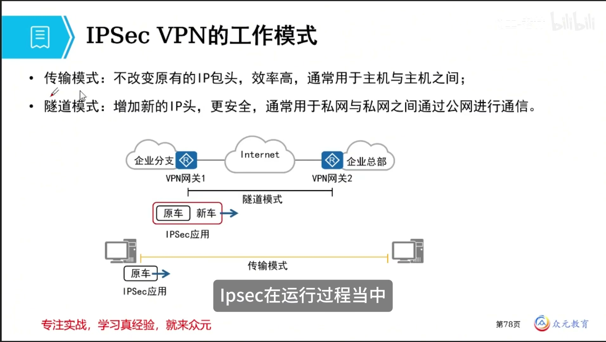

| 模式 | 封装特点 | 安全性 | 典型场景 |
| ---- | -------- | ------ | -------- |
| 传输模式（Transport） | 不改变原有 IP 包头，只在原 IP 头与数据之间插入 IPSec 头 | 效率高 | 主机与主机之间、端点到端点 |
| 隧道模式（Tunnel） | 增加新的 IP 头，将整个原 IP 包封装为载荷 | 更安全 | 私网与私网之间通过公网通信，网关到网关 |

要点：

- 隧道模式是最常见的部署方式，在网关上打通隧道，同时对内网地址起到隐藏作用；
- 传输模式不改变原包头、开销小，适合主机之间的保护；
- 隧道模式适配 NAT，灵活性更好；
- 两种模式与“AH/ESP”是两个独立维度，可组合使用（如隧道模式 + ESP）。

### 3.7 例题

#### 例题1：隧道协议的工作层次与 VPN 关键技术

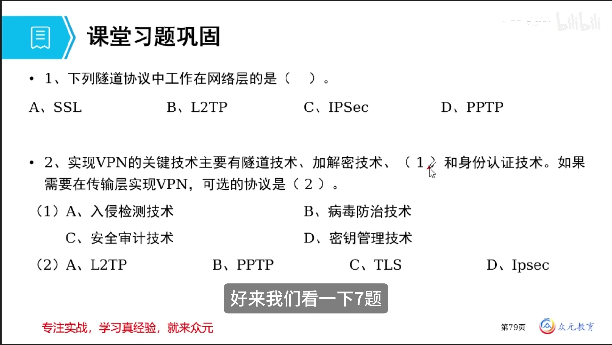

**第 1 题** 下列隧道协议中工作在网络层的是（ ）。

- A、SSL
- B、L2TP
- C、IPSec
- D、PPTP

答案：**C**。SSL 属应用层，L2TP、PPTP 属数据链路层。

**第 2 题** 实现 VPN 的关键技术主要有隧道技术、加解密技术、（1）和身份认证技术。如果需要在传输层实现 VPN，可选的协议是（2）。

（1）

- A、入侵检测技术
- B、病毒防治技术
- C、安全审计技术
- D、密钥管理技术

（2）

- A、L2TP
- B、PPTP
- C、TLS
- D、IPsec

答案：（1）**D**；（2）**C**。

解析：VPN 四项关键技术为隧道、加解密、密钥管理、身份认证；TLS 位于 TCP 之上、应用之下，介于传输层与应用层之间，可满足“在传输层实现 VPN”的表述。

#### 例题2：IP 报文加密与 IPSec 特性

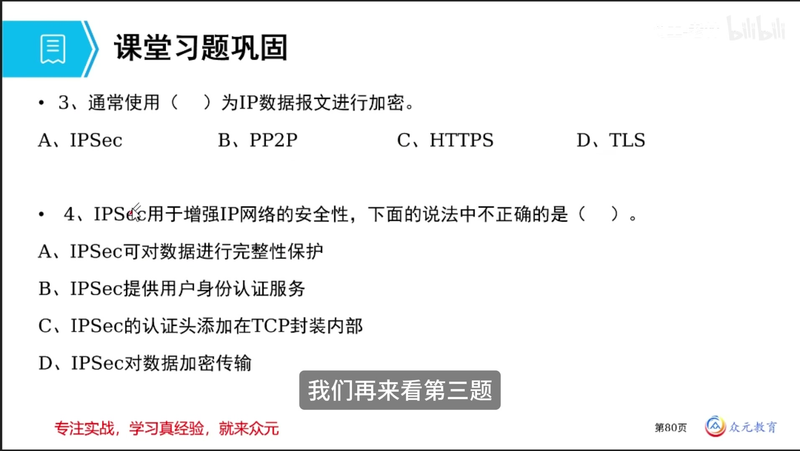

**第 3 题** 通常使用（ ）为 IP 数据报文进行加密。

- A、IPSec
- B、PP2P（原文如此，应为 PPTP）
- C、HTTPS
- D、TLS

答案：**A**。

**第 4 题** IPSec 用于增强 IP 网络的安全性，下面的说法中不正确的是（ ）。

- A、IPSec 可对数据进行完整性保护
- B、IPSec 提供用户身份认证服务
- C、IPSec 的认证头添加在 TCP 封装内部
- D、IPSec 对数据加密传输

答案：**C**。

解析：IPSec 工作在 IP 层，AH/ESP 头封装在 IP 头之后、TCP/UDP 之前，并非“添加在 TCP 封装内部”。TCP 报文本身属于被保护的数据部分。

#### 例题3：AH 的 ICV 计算范围

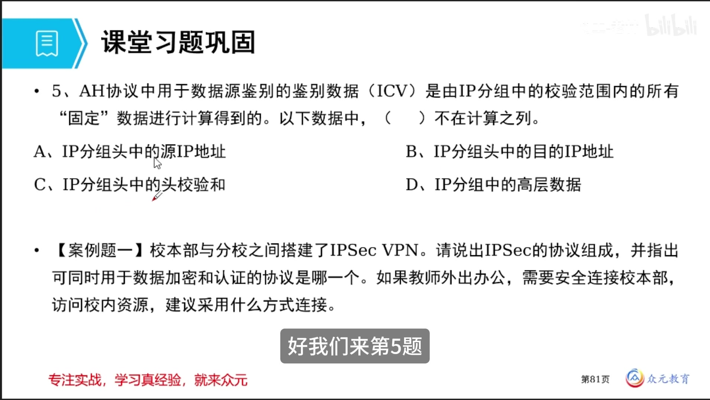

**第 5 题** AH 协议中用于数据源鉴别的鉴别数据（ICV）是由 IP 分组中的校验范围内的所有“固定”数据进行计算得到的。以下数据中，（ ）不在计算之列。

- A、IP 分组头中的源 IP 地址
- B、IP 分组头中的目的 IP 地址
- C、IP 分组头中的头校验和
- D、IP 分组中的高层数据

答案：**C**。

解析：AH 的 ICV 只对传输过程中**不会改变**的字段计算。源 IP、目的 IP、高层数据在传输中保持不变，均参与计算；**头校验和**会随 TTL 等字段变化而重新计算，属于变化值，必须排除，否则接收方无法得到一致的校验结果。**TTL** 同理不在计算之列。这也正是 AH 不能兼容 NAT 的根本原因。

#### 例题4：IPSec VPN 组网案例

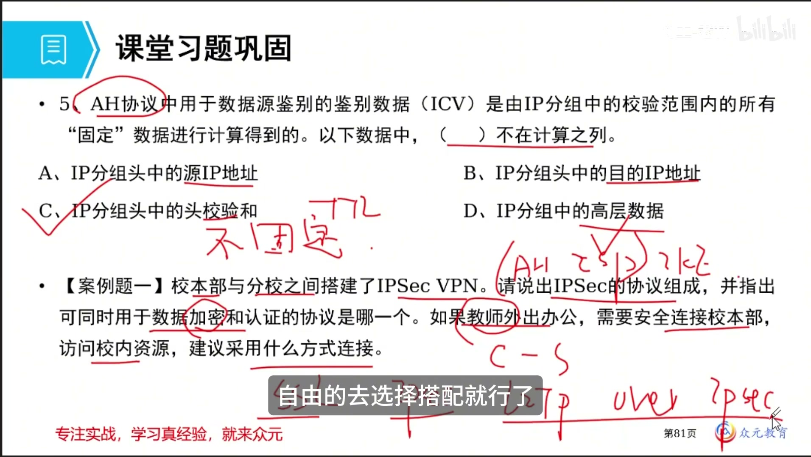

【案例题一】校本部与分校之间搭建了 IPSec VPN。请说出 IPSec 的协议组成，并指出可同时用于数据加密和认证的协议是哪一个。如果教师外出办公，需要安全连接校本部，访问校内资源，建议采用什么方式连接。

**解答**

1）IPSec 由 **AH（认证头）、ESP（封装安全负荷）、IKE（Internet 密钥交换）** 组成。其中 AH 提供数据源认证与完整性校验，ESP 提供加密与认证，IKE 负责 SA 协商与密钥管理。

2）可同时用于数据加密和认证的是 **ESP**。

3）教师为单个移动用户，应采用**客户端到站点**的远程接入方式，可选：

- **SSL VPN**：只需浏览器，部署与使用最方便，首选；
- **IPSec VPN**：客户端安装客户端软件，安全性强；
- **L2TP over IPSec**：以 L2TP 建立隧道、由 IPSec 提供加密认证。

三种方式均可，答题时说明“客户端—网关”的接入形态即可。

课件手写批注：

- [手写批注] “AH 协议”被红圈圈出，“固定”加下划线。
- [手写批注] 选项 C 加下划线并打勾，其上方写 “TTL”，下方写 “不固定”，说明头校验和与 TTL 均为变化字段。
- [手写批注] 选项 B（目的 IP 地址）加下划线，表示其属于固定字段、参与计算。
- [手写批注] 案例题干中“可同时用于数据加密和认证”“采用什么方式连接”分别加下划线；右侧写 “AH、ESP”（均加圈），下方写 “IKE”，另注 “C-S”（客户端到服务器）与 “IP over IPsec”，字迹疑为 “L2TP over IPsec”。

---

## 4.常见安全技术

### 4.1 安全审计与日志

**安全审计**是指对信息系统的活动进行独立记录、分析与稽核，以发现违规行为、追溯安全事件、提供取证依据。其核心是“**谁、在什么时间、从哪里、做了什么、结果如何**”五个要素。

| 项目 | 内容 |
| ---- | ---- |
| 审计对象 | 操作系统、数据库、网络设备、安全设备、应用系统、业务操作 |
| 日志类型 | 系统日志、安全日志、应用日志、网络流量日志、操作审计日志 |
| 关键技术 | 时间同步（NTP）、集中采集（Syslog，UDP 514）、日志防篡改、关联分析、留存与归档 |
| 主要作用 | 事后追溯与取证、责任认定、异常行为发现、合规审计 |

**日志留存要求**

《中华人民共和国网络安全法》（2025 年修正）第二十三条规定，网络运营者应当按照网络安全等级保护制度的要求采取监测、记录网络运行状态、网络安全事件的技术措施，并按照规定**留存相关的网络日志不少于六个月**。

配套要求：

- 日志服务器应独立于被审计系统，避免“自己审自己”；
- 采用只写一次（WORM）、哈希链、日志签名等手段防止篡改；
- 全网设备统一时间源，否则关联分析失效；
- 审计记录本身也属于敏感数据，需控制访问权限。

与 IDS/IPS 的区别：IDS/IPS 侧重**实时检测与阻断**，安全审计侧重**完整记录与事后稽核**；前者回答“现在有没有攻击”，后者回答“过去发生了什么、谁做的”。

### 4.2 漏洞扫描

**基本原理**：基于漏洞数据库（如 CVE、CNVD、CNNVD），通过指纹识别判断目标的操作系统、服务、版本与配置，再调用对应插件或 POC 进行探测，比对结果判定是否存在已知漏洞。

| 分类维度 | 类型 | 说明 |
| -------- | ---- | ---- |
| 扫描对象 | 网络扫描 | 存活主机、开放端口、服务与操作系统识别 |
| | 主机扫描 | 补丁缺失、配置缺陷、弱口令、注册表与账号 |
| | Web 应用扫描 | SQL 注入、XSS、文件包含、目录遍历等 |
| | 数据库扫描 | 账号权限、默认配置、弱口令 |
| 是否登录 | 非认证扫描 | 从外部视角模拟攻击者 |
| | 认证扫描 | 登录后深度检查补丁与配置，结果更准确 |
| 工作方式 | 主动扫描 | 发送探测报文，覆盖面广 |
| | 被动识别 | 分析流量，不打扰业务 |

**特点与局限**

- 效率高、覆盖面广，适合定期自查与合规检查；
- 只能发现**已知漏洞**，对 0day、业务逻辑缺陷无能为力；
- 存在误报与漏报，需要人工复核；
- 扫描会产生较大流量，可能影响业务，须**事先授权**、限速并避开业务高峰。

### 4.3 渗透测试

**定义**：通过模拟恶意黑客的攻击方法，来评估计算机网络系统安全的一种评估方法。与漏洞扫描“发现可能存在的问题”不同，渗透测试重在**验证漏洞是否真正可利用**及其危害程度。

**前提：书面授权**

必须取得书面授权委托书，明确测试范围（IP、域名、内外网、模块）、时间窗口、允许使用的手段、是否允许提权与数据修改。未经授权对他人系统进行渗透测试属于违法行为。

| 类型 | 已知信息 | 模拟对象 |
| ---- | -------- | -------- |
| 黑盒测试 | 无任何信息（Zero-Knowledge） | 外部攻击者 |
| 白盒测试 | 网络拓扑、源码、账号等全部信息 | 内部人员越权 |
| 灰盒测试 | 部分信息（如 IP 段） | 介于两者之间 |

**一般流程**

1. 明确目标与授权，确定范围与规则；
2. 信息收集（主动探测与被动 OSINT）；
3. 漏洞挖掘与扫描；
4. 漏洞验证；
5. 漏洞利用；
6. 权限提升；
7. 内网横向移动；
8. 痕迹清理；
9. 撰写报告并提出修复建议。

常用标准与框架：PTES（渗透测试执行标准）、OWASP 测试指南、NIST SP 800-115。部分地方标准要求等级保护三级及以上系统每年至少开展 1 次渗透测试、每年不少于 4 次漏洞扫描，具体以属地与行业要求为准。

### 4.4 蜜罐与蜜网

**定义**：蜜罐是一种主动防御技术，通过部署**没有真实业务数据**的系统来诱骗攻击者实施攻击，记录其攻击行为，从而掌握攻击目的与手段，提升真实系统的防护能力。

| 分类维度 | 类型 | 特点 |
| -------- | ---- | ---- |
| 交互程度 | 低交互蜜罐 | 模拟少量协议与服务，部署简单、风险低，获取信息有限 |
| | 高交互蜜罐 | 提供接近真实的系统，可捕获更多行为，维护成本与风险较高 |
| | 纯蜜罐 | 由真实系统脱敏改造，外观与功能一致，外部加监测记录 |
| 用途 | 生产蜜罐 | 用于企业诱捕与告警 |
| | 研究蜜罐 | 用于研究攻击组织与手法 |
| 形态 | 蜜网 | 多个蜜罐互联组成网络，可观察横向移动与攻击链路 |

**价值与风险**

- 价值：蜜罐的任何访问都可视为可疑流量，**误报率极低**；可捕获 0day、APT 与攻击工具，延缓攻击进程，为应急响应争取时间；
- 风险：高交互蜜罐一旦被攻陷可能成为跳板，必须与其他网络隔离、加强监控，并禁止存放真实数据。

### 4.5 四类技术对比

| 技术 | 时机 | 手段 | 产出 | 局限 |
| ---- | ---- | ---- | ---- | ---- |
| 安全审计 | 事后 | 日志记录与关联分析 | 审计报告、证据链 | 依赖日志完整性 |
| 漏洞扫描 | 事前/定期 | 自动化扫描器 | 漏洞清单与修复建议 | 只覆盖已知漏洞，有误报 |
| 渗透测试 | 事前/定期 | 人工模拟攻击 | 可利用漏洞与危害评估 | 成本高、有业务风险 |
| 蜜罐 | 事中 | 诱骗与监测 | 攻击情报、告警 | 维护成本高，需隔离 |

---

## 5.容灾备份与高可用

### 5.1 两个核心指标：RTO 与 RPO

| 指标 | 全称 | 含义 | 决定因素 |
| ---- | ---- | ---- | -------- |
| RTO | 恢复时间目标（Recovery Time Objective） | 灾难发生后，业务可容忍的**最长不可用时间** | 恢复流程的自动化程度、备用系统就绪程度 |
| RPO | 恢复点目标（Recovery Point Objective） | 灾难发生时，可容忍的**最大数据丢失时间跨度** | 备份频率、复制方式（同步/异步） |

- RTO 越小，要求切换越快，成本越高；
- RPO 越小，要求备份越频繁；采用**同步复制**时 RPO 可接近 0；
- 二者共同决定容灾方案的整体架构，是方案设计的第一组输入参数。

### 5.2 备份方式与 3-2-1 原则

| 分类 | 类型 | 说明 |
| ---- | ---- | ---- |
| 备份内容 | 完全备份 | 每次备份全部数据，恢复最快，占用空间最大 |
| | 增量备份 | 只备份上次备份后变化的数据，备份快、恢复链长 |
| | 差异备份 | 备份上次完全备份后变化的数据，介于两者之间 |
| 备份状态 | 冷备份 | 系统停机后备份，一致性最好 |
| | 温备份 | 系统运行但业务暂停 |
| | 热备份 | 系统运行中在线备份，对业务影响小 |
| 存放位置 | 本地备份 | 恢复快，无法应对站点级灾难 |
| | 同城灾备 | 距离数十公里，可应对区域性灾害 |
| | 异地灾备 | 距离数百公里以上，应对大范围灾难 |

**3-2-1 备份原则**：至少保留 **3** 份数据（1 份原件 + 2 份副本），存放在 **2** 种不同介质上，其中 **1** 份放在异地。

**备份不等于容灾**：备份解决“数据还能不能找回来”，容灾解决“业务能不能继续运行”。仅有备份而无备用系统，RTO 往往以小时甚至天计。

### 5.3 灾难恢复能力等级

国家标准《信息安全技术 信息系统灾难恢复规范》（GB/T 20988—2007）将灾难恢复能力划分为 6 级，并与 RTO/RPO 存在指导性对应关系：

| 等级 | 名称 | RTO | RPO |
| ---- | ---- | --- | --- |
| 1 | 基本支持 | 2 天以上 | 1 天至 7 天 |
| 2 | 备用场地支持 | 24 小时以上 | 1 天至 7 天 |
| 3 | 电子传输和部分设备支持 | 12 小时以上 | 数小时至 1 天 |
| 4 | 电子传输及完整设备支持 | 数小时至 2 天 | 数小时至 1 天 |
| 5 | 实时数据传输及完整设备支持 | 数分钟至 2 天 | 0 至 30 分钟 |
| 6 | 数据零丢失和远程集群支持 | 数分钟 | 0 |

要点：第 1 级仅要求每周完全备份并场外存放；第 6 级要求远程实时备份、应用集群化、可实时无缝切换，实现数据零丢失。等级越高，投入越大。

“两地三中心”是常见的工程化表述：生产中心 + 同城灾备中心 + 异地灾备中心，兼顾 RTO 与 RPO。

### 5.4 双机热备

**定义**：双机热备是通过两台（或多台）配置一致的设备组成冗余系统，主设备故障时备用设备自动接管，使业务中断时间极短的高可用技术。

| 模式 | 工作方式 | 资源利用率 |
| ---- | -------- | ---------- |
| 主备模式（Active-Standby） | 同一时刻只有主设备转发，备设备同步状态、随时待命 | 较低 |
| 双活/负载均衡模式（Active-Active） | 多台设备同时转发并互为备份 | 较高 |

**工作原理**

1. **状态同步**：主备之间实时同步配置、会话表、路由表等；
2. **心跳检测**：通过专用心跳链路周期性发送心跳报文；
3. **故障检测**：连续多个周期收不到心跳即判定对端故障；
4. **故障切换**：备设备升为主设备，虚拟 IP 漂移，业务接管；
5. **恢复与回切**：原主设备恢复后按抢占策略决定是否回切。

**相关技术**

- **VRRP**（虚拟路由冗余协议）：多台路由器组成一个虚拟路由器，共用一个虚拟 IP；优先级高者（默认 100，取值 0—255，255 保留给 IP 地址拥有者）为 Master，Master 周期性发送通告，Backup 收不到通告即接管。华为防火墙的双机热备即基于 VRRP，并以 VGMP 统一管理多个备份组、以 HRP 同步会话表。
- **脑裂**：心跳链路中断导致双主，需通过冗余心跳、仲裁机制避免。

**与备份的区别**：双机热备只解决设备、链路等**物理单点故障**；对于误删除、病毒加密、逻辑损坏等“两台设备会同时出错”的场景无效，仍必须依赖离线备份与容灾。此外，主备之间的实时同步会把勒索加密的结果同步到备机，这一点常被忽视。

### 5.5 RAID 与安全的关系

| RAID 级别 | 最少磁盘 | 可用容量 | 可容忍故障 | 特点 |
| --------- | -------- | -------- | ---------- | ---- |
| RAID 0 | 2 | 100% | 0 块 | 条带化，性能最高，无任何冗余 |
| RAID 1 | 2 | 50% | 1 块 | 镜像，读性能好，写性能略降 |
| RAID 5 | 3 | 损失 1 块盘 | 1 块 | 分布式单校验，兼顾容量与安全 |
| RAID 6 | 4 | 损失 2 块盘 | 2 块 | 双校验，大容量阵列更安全，写惩罚更大 |
| RAID 10 | 4（偶数） | 50% | 每个镜像对 1 块 | 先镜像再条带，性能与容错兼顾 |

**RAID 与安全的关系（考试易错点）**

- RAID 提供的是**可用性/冗余**，不是**备份**；
- RAID 只能应对磁盘物理故障，不能防范误删除、病毒与勒索加密、逻辑损坏、火灾水灾、人为破坏；
- RAID 5 在重建期间处于“无冗余”状态，大容量盘重建时间长，二次故障风险高，RAID 6 因此更适用于大容量阵列；
- 正确的做法是：RAID + 定期离线备份 + 异地容灾，三者互补，不可相互替代。

---

## 6.无线局域网安全

### 6.1 无线环境的主要威胁

| 威胁 | 说明 |
| ---- | ---- |
| 窃听/嗅探 | 无线信号在开放空间传播，攻击者可被动抓包 |
| 伪造 AP（邪恶双胞胎） | 搭建同名 SSID 的钓鱼热点，诱导终端接入 |
| 弱口令与离线破解 | 抓取握手报文后离线跑字典 |
| 重放与去认证攻击 | 伪造管理帧强制终端掉线，配合钓鱼 |
| 私接与非法接入 | 未经审批的 AP 接入内网 |

### 6.2 WEP

| 项目 | 内容 |
| ---- | ---- |
| 加密算法 | RC4 流密码 |
| 密钥 | 40 位或 104 位基础密钥 + 24 位 IV，构成 64/128 位 RC4 密钥 |
| 完整性 | CRC-32 校验值 ICV |
| 认证 | 开放系统认证、共享密钥认证 |

缺陷：

- **IV 仅 24 位且明文传输**，空间过小，繁忙网络中很快重复；
- RC4 密钥调度存在弱密钥，IV 与密钥直接拼接易被 FMS 类攻击利用；
- ICV 为线性校验，无法防止比特翻转与篡改；
- 共享密钥认证的挑战—响应机制本身可被利用。

结论：抓取少量报文即可在数分钟内恢复密钥，**WEP 已完全不安全，应禁用**。

### 6.3 WPA

| 项目 | 内容 |
| ---- | ---- |
| 标准背景 | 802.11i 定稿前的过渡方案，兼容既有硬件 |
| 加密算法 | TKIP：仍用 RC4，但增加每包密钥混合、48 位 IV/序列号、Michael MIC 与计数器 |
| 认证 | 802.1X/EAP 或 PSK（预共享密钥） |
| 完整性 | Michael MIC |

缺陷：TKIP 本质仍是 RC4 的补丁方案，已被证明存在实际攻击；WPA-PSK 的四次握手可被抓包后离线字典攻击。现已不推荐。

### 6.4 WPA2

| 项目 | 内容 |
| ---- | ---- |
| 标准 | IEEE 802.11i（RSN） |
| 加密算法 | AES-CCMP（CCM 模式），128 位密钥 |
| 完整性 | CCM 同时提供加密与完整性 |
| 认证 | 802.1X/EAP（企业模式）或 PSK（个人模式） |
| 抗重放 | 48 位分组号 PN |

要点：

- WPA2 强制使用 AES，安全性较 WPA 有质的提升，是目前部署最广的方案；
- 2017 年披露的 **KRACK** 攻击针对四次握手的密钥重装过程，可通过补丁修复；
- WPA2-PSK 仍无法抵御离线字典攻击，口令强度是关键。

### 6.5 WPA3

Wi-Fi 联盟于 2018 年发布 WPA3，主要改进如下：

| 特性 | 说明 |
| ---- | ---- |
| SAE（对等实体同时认证） | 以 Dragonfly 握手替代 WPA2-PSK 的四次握手，抵抗**离线字典攻击**，并提供**前向保密** |
| 192 位安全模式 | WPA3-Enterprise 可选 192 位套件，使用 GCMP-256、SHA-384，满足高安全行业要求 |
| OWE（机会无线加密） | 开放网络中自动加密，无需口令，改善公共 Wi-Fi 的明文风险 |
| PMF（管理帧保护） | 强制启用，防止伪造去认证/解除关联帧 |
| SAE-PK | WPA3 3.0 引入，通过 AP 签名密钥抵御邪恶双胞胎 |

局限与部署注意：

- SAE 不能防口令猜测的**在线**攻击，弱口令依然危险，只是把攻击成本从离线变为在线；
- SAE 的 Hunting-and-Pecking 计算量大，存在资源耗尽型 DoS 风险；
- **过渡模式**（同时开启 WPA2-PSK 与 WPA3-SAE）会被降级到 WPA2-PSK 攻击，安全性取决于配置；
- 大量旧终端不支持 WPA3，实际部署多为混合模式。

### 6.6 四代无线安全对比

| 项目 | WEP | WPA | WPA2 | WPA3 |
| ---- | --- | --- | ---- | ---- |
| 加密算法 | RC4 | TKIP（RC4） | AES-CCMP | AES-CCMP / GCMP-256 |
| 密钥长度 | 40/104 位 | 128 位 | 128 位 | 128 位 / 192 位 |
| 完整性 | CRC-32 ICV | Michael MIC | CCM | CCM / GCMP |
| IV/序列号 | 24 位 | 48 位 | 48 位 | 48 位 |
| 认证 | 开放/共享密钥 | 802.1X 或 PSK | 802.1X 或 PSK | 802.1X 或 SAE |
| 抗离线字典 | 不适用（可直接破密钥） | 否 | 否 | 是 |
| 现状 | 禁用 | 淘汰 | 广泛部署 | 逐步推广 |

### 6.7 802.1X 认证

IEEE 802.1X 是基于端口的网络接入控制协议，属于链路层认证，也是 WPA/WPA2/WPA3 企业模式的认证基础。

**三个角色**

| 角色 | 位置 | 作用 |
| ---- | ---- | ---- |
| 客户端（Supplicant） | 终端 | 发起认证，提供凭据 |
| 认证者（Authenticator） | 交换机/AP/AC | 控制端口通断，转发 EAP 报文 |
| 认证服务器（Authentication Server） | 通常为 RADIUS | 校验凭据、下发授权 |

**两个逻辑端口**

- **受控端口**：承载业务数据，认证通过前保持关闭；
- **非受控端口**：只放行 EAPOL 认证报文。

**协议与流程**

1. 终端发送 EAPOL-Start，认证者请求身份；
2. 终端回复身份，认证者封装为 RADIUS Access-Request 送认证服务器；
3. 服务器与终端通过认证者进行 EAP 挑战—响应交互；
4. 认证成功，服务器下发授权，受控端口打开；
5. 可配置定期重认证；终端下线或链路断开时端口回到未授权状态。

要点：EAPOL 的以太网类型为 **0x888E**。

**常见 EAP 方法**

| 方法 | 服务器证书 | 特点 |
| ---- | ---------- | ---- |
| EAP-TLS | 需要 | 双向证书认证，安全性最高，部署成本高 |
| PEAP | 需要 | 先用 TLS 建隧道，再以账号口令认证，最常用 |
| EAP-TTLS | 需要 | 与 PEAP 类似，隧道内可用多种认证方式 |
| EAP-FAST | 可选 | 以 PAC 替代证书，适合大规模部署 |
| EAP-MD5 | 不需要 | 仅单向认证，无密钥派生，安全性低，不推荐 |

### 6.8 Portal 认证

Portal 认证又称 Web 认证，未认证用户上网时被强制重定向到门户网站，完成认证后才能访问互联网资源。

**四个基本要素**

| 要素 | 作用 |
| ---- | ---- |
| 认证客户端 | 浏览器或 Portal 客户端软件 |
| 接入设备（BAS/NAS） | 交换机、路由器、AC 等，负责重定向与认证交互 |
| Portal 服务器 | 提供门户页面，与接入设备交互认证信息 |
| 认证/计费服务器 | 通常为 RADIUS，完成认证、授权与计费 |

**两种发起方式**

- **主动认证**：用户主动访问已知的 Portal 网站并输入账号口令；
- **强制认证**：用户访问其他外网地址时被重定向到 Portal 页面。

**两种认证层次**

| 方式 | 用户标识 | 特点 |
| ---- | -------- | ---- |
| 二层认证 | IP + MAC | 客户端与接入设备直连，安全性高，组网灵活性低 |
| 三层认证 | IP | 可跨三层设备，组网灵活，安全性相对较低 |

Portal 服务器与接入设备之间可采用 **CHAP**（质询握手）或 **PAP**（明文口令）交互，CHAP 更安全。

**与 802.1X 的比较**

| 项目 | 802.1X | Portal |
| ---- | ------ | ------ |
| 层次 | 链路层 | 应用层（Web） |
| 客户端 | 需要 supplicant | 只需浏览器 |
| 认证时机 | 接入即认证 | 首次访问外网时认证 |
| 适用对象 | 员工、固定终端 | 访客、学生、酒店与公共热点 |
| 优点 | 安全性高、可控性强 | 免客户端、易计费、易推广 |
| 缺点 | 部署与运维成本高 | 认证前可访问部分资源，需配合 HTTPS |

典型做法：**员工用 802.1X，访客用 Portal**，二者互补。

### 6.9 无线安全部署建议

- 禁用 WEP 与 WPA/TKIP，最低使用 WPA2-CCMP，条件具备时启用 WPA3；
- 企业场景采用 802.1X + RADIUS，个人/小微场景使用强口令 PSK；
- 关闭 WPS，修改默认管理口令，及时升级 AP 固件；
- 启用 PMF、关闭广播探测响应、划分访客 VLAN 并做横向隔离；
- 部署无线入侵检测（WIDS），发现非法 AP 与钓鱼热点；
- 公共区域优先使用 Portal 或 OWE，避免完全开放的明文网络。

---

## 7.终端安全

### 7.1 终端安全的范围与威胁

终端包括 PC、服务器、移动终端以及各类物联网设备。随着远程办公、BYOD 与云化普及，边界防护被不断绕过，终端成为事实上的“新边界”。

| 威胁 | 典型表现 |
| ---- | -------- |
| 恶意代码 | 病毒、蠕虫、木马、勒索软件、挖矿程序 |
| 社会工程 | 钓鱼邮件、恶意二维码、伪装软件 |
| 漏洞利用 | 未打补丁的操作系统与应用 |
| 违规操作 | 私接外网、随意使用 U 盘、弱口令 |
| 数据泄露 | 明文存储、随意外发、终端丢失 |

### 7.2 主要技术手段

| 手段 | 作用 |
| ---- | ---- |
| 防病毒/EPP | 特征库查杀与基础防护 |
| EDR（终端检测与响应） | 采集终端行为，检测、分析、阻断并溯源攻击链路 |
| 补丁与漏洞管理 | 及时修复系统与应用漏洞 |
| 主机防火墙与 HIDS | 限制端口与服务，监测主机异常 |
| 终端准入（NAC） | 检查合规性后再放行入网 |
| 外设与移动介质管控 | 禁用或审计 USB、光驱、蓝牙 |
| 磁盘/文件加密 | 防止终端丢失导致数据泄露 |
| 应用白名单 | 只允许授权程序运行 |
| 桌面管控与基线核查 | 统一策略、强制合规 |

### 7.3 管理措施

- 建立终端资产台账，明确责任人与使用范围；
- 推行安全基线：口令策略、屏保锁屏、自动更新、关闭多余服务与端口；
- 最小权限原则，普通用户不使用管理员账号日常办公；
- 定期培训与钓鱼演练，提高人员安全意识；
- 终端日志统一上报至审计平台，满足留存要求；
- 离职、调岗时及时回收账号与设备权限。

---

## 8.安全管理制度与等级保护

### 8.1 法律法规体系

| 法律法规/标准 | 通过/发布 | 施行 | 核心内容 |
| ------------- | --------- | ---- | -------- |
| 《中华人民共和国网络安全法》 | 2016-11-07 通过 | 2017-06-01 | 网络安全基础性法律；确立等级保护、关键信息基础设施保护、网络运营者义务 |
| 《网络安全法》2025 年修正 | 2025-10-28 | 2026-01-01 | 强化法律责任，增加人工智能治理条款，条文序号调整 |
| 《中华人民共和国密码法》 | 2019-10-26 | 2020-01-01 | 密码分类管理：核心密码、普通密码、商用密码 |
| 《中华人民共和国数据安全法》 | 2021-06-10 | 2021-09-01 | 数据分类分级、重要数据保护、数据出境 |
| 《中华人民共和国个人信息保护法》 | 2021-08-20 | 2021-11-01 | 个人信息处理规则、敏感信息单独同意 |
| 《关键信息基础设施安全保护条例》 | 2021-07-30 公布 | 2021-09-01 | CII 认定、保护义务与监测预警 |
| GB/T 22239—2019《网络安全等级保护基本要求》 | 2019-05-10 | 2019-12-01 | 等保 2.0 核心标准，代替 GB/T 22239—2008 |

《网络安全法》（2025 年修正）第二十三条规定的网络运营者义务：

1. 制定内部安全管理制度和操作规程，确定网络安全负责人，落实网络安全保护责任；
2. 采取防范计算机病毒和网络攻击、网络侵入等危害网络安全行为的技术措施；
3. 采取监测、记录网络运行状态、网络安全事件的技术措施，并按照规定留存相关的网络日志**不少于六个月**；
4. 采取数据分类、重要数据备份和加密等措施；
5. 法律、行政法规规定的其他义务。

### 8.2 网络安全等级保护

**五个等级**（依据《信息安全等级保护管理办法》）：

| 等级 | 受破坏后的危害程度 |
| ---- | ------------------ |
| 第一级 | 对公民、法人和其他组织的合法权益造成损害，但不损害国家安全、社会秩序和公共利益 |
| 第二级 | 对合法权益产生严重损害，或对社会秩序和公共利益造成损害，但不损害国家安全 |
| 第三级 | 对社会秩序和公共利益造成严重损害，或对国家安全造成损害 |
| 第四级 | 对社会秩序和公共利益造成特别严重损害，或对国家安全造成严重损害 |
| 第五级 | 对国家安全造成特别严重损害 |

**五个规定动作**

| 步骤 | 主要工作 | 产出 |
| ---- | -------- | ---- |
| 定级 | 确定定级对象、初步定级、专家评审、主管部门审核 | 定级报告、专家评审意见 |
| 备案 | 第二级以上到县级以上公安机关备案 | 备案证明 |
| 建设整改 | 按对应等级要求建设安全设施、落实技术与管理措施 | 整改方案、管理制度 |
| 等级测评 | 由测评机构依据标准测评 | 等级测评报告 |
| 监督检查 | 公安机关监督检查，单位持续整改 | 检查结论 |

**等保 2.0 的主要变化**

- 标准名称由“信息安全技术 信息系统安全等级保护”调整为“网络安全等级保护”；
- 保护对象扩展至云计算、移动互联、物联网、工业控制系统、大数据，形成“安全通用要求 + 安全扩展要求”的结构；
- 管理要求分为安全管理制度、安全管理机构、安全管理人员、安全建设管理、安全运维管理五方面；
- 定级需经专家评审与主管部门审核后方可备案。

### 8.3 安全管理制度体系

业界通常采用四级文件体系：

| 层级 | 文件类型 | 内容示例 |
| ---- | -------- | -------- |
| 一级 | 安全方针、总纲 | 总体目标、原则、组织架构、责任划分 |
| 二级 | 管理制度 | 账号管理、密码管理、变更管理、应急管理、介质管理 |
| 三级 | 操作规程、作业指导书 | 具体设备配置规范、巡检流程、备份恢复步骤 |
| 四级 | 记录与表单 | 巡检记录、变更单、审批单、演练记录 |

制度落地的关键点：

- **三分技术、七分管理**：再好的设备也需制度约束人的行为；
- 人员安全：背景审查、保密协议、权限最小化、离岗即时回收；
- 变更与应急：变更审批、预案演练、事件报告与复盘；
- 制度必须可执行、可检查、可追溯，避免“挂在墙上”。

---

## 9.网络安全章节知识总结

本节对整章作系统复盘。整章围绕三个问题展开：

1. **什么是安全、有哪些法律法规与防护手段**；
2. **面临哪些攻击行为、对应的防护手段是什么**；
3. **各类防护手段的具体功能与特点**（防火墙、IDS/IPS、应用层防护、堡垒机等）。

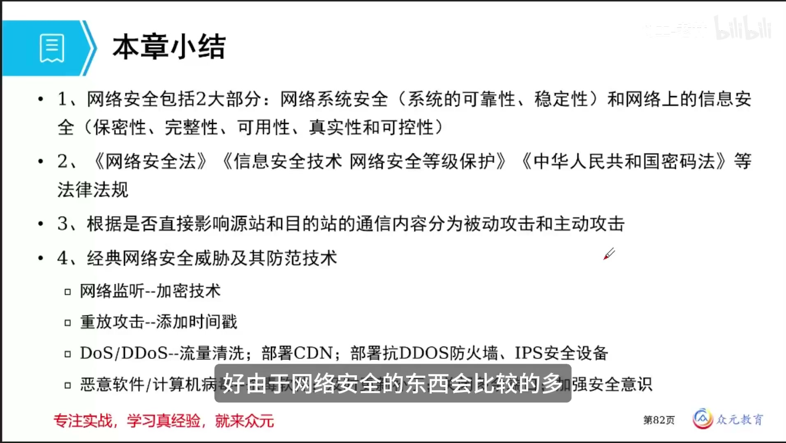

### 9.1 网络安全的两大部分

网络安全包括两大部分：

| 部分 | 关注点 | 对应属性 |
| ---- | ------ | -------- |
| 网络系统安全 | 系统可靠、稳定运行 | 可靠性、稳定性 |
| 网络上的信息安全 | 信息不被泄露、篡改、否认 | 保密性、完整性、可用性、真实性、可控性 |

上述五项属性中，加密技术部分最强调的是**保密性、完整性、真实性**三项。

### 9.2 本章十二条要点

| 序号 | 要点 |
| ---- | ---- |
| 1 | 网络安全包括 2 大部分：网络系统安全（系统的可靠性、稳定性）和网络上的信息安全（保密性、完整性、可用性、真实性和可控性） |
| 2 | 《网络安全法》《信息安全技术 网络安全等级保护》《中华人民共和国密码法》等法律法规 |
| 3 | 根据是否直接影响源站和目的站的通信内容，分为被动攻击和主动攻击 |
| 4 | 经典网络安全威胁及其防范技术（见 9.3 表） |
| — | Web 攻击（SQL 注入、XSS）——使用参数化的过滤性语句；部署 WAF、数据库防火墙、IPS |
| — | APT 攻击——沙箱技术；态势感知系统 |
| 5 | 对称加密和非对称加密的特点、作用及其经典算法 |
| 6 | 数字签名基于非对称加密体制实现，保护数据的真实性、完整性和不可抵赖 |
| 7 | 数字证书由 CA 签发的对用户的公钥认证 |
| 8 | 报文摘要的 Hash 算法：MD5/SHA/SM3 |
| 9 | 基本防火墙功能、部署模式、发展（包过滤、状态检测型、代理型、UTM、NGFW） |
| 10 | IDS 与 IPS 工作特点、部署方式 |
| 11 | 安全协议：SSL、SET、PGP、HTTPS、SSH、S/MIME 等 |
| 12 | 虚拟专用网：IPSec 以及其他都是可以 over IPSec 等 |

说明：第 12 条末尾在原图中被字幕条遮挡，按讲授内容补全为“其他隧道协议均可 over IPSec”。

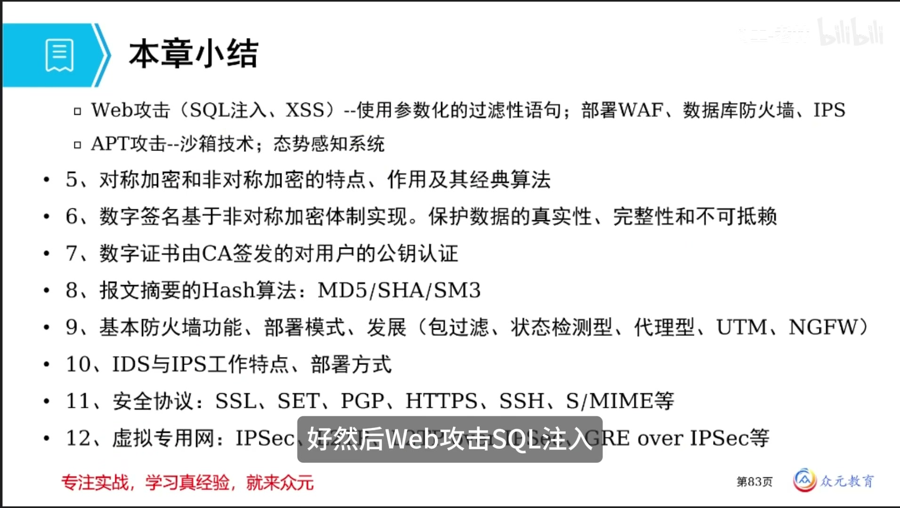

### 9.3 经典威胁与防范技术对应表

| 攻击/威胁 | 原理 | 防范手段 |
| --------- | ---- | -------- |
| 被动攻击（监听、流量分析） | 不影响通信内容，只窃取信息 | 加密技术，保证机密性 |
| 主动攻击（中断、修改、伪造、重放） | 影响通信内容或通信过程 | 完整性校验、认证、时间戳、序列号 |
| 网络监听 | 抓取链路或广播域内的报文 | 数据加密、划分 VLAN、端口安全 |
| 重放攻击 | 截获合法报文后重复发送 | 添加时间戳、使用一次性随机数/序列号 |
| DoS/DDoS | 耗尽带宽、连接数或计算资源 | 流量清洗、部署 CDN、抗 DDoS 设备、IPS 监测阻断 |
| 恶意软件/计算机病毒 | 自我复制、破坏或窃取数据 | 杀毒软件、及时更新补丁、关闭多余端口、备份恢复、加强安全意识（不下载来历不明的软件、不点击来历不明的邮件与链接、不扫描来历不明的二维码） |
| 木马/勒索病毒/蠕虫 | 远程控制、加密勒索、自动传播 | 终端防护、最小权限、离线备份、网络隔离 |
| Web 攻击（SQL 注入、XSS） | 利用输入校验缺陷执行恶意语句或脚本 | 参数化过滤语句、输入输出校验、部署 WAF、数据库防火墙、IPS |
| APT 攻击 | 针对特定目标的长期、持续性渗透 | 沙箱技术、态势感知系统、威胁情报、流量分析 |

被动攻击与主动攻击的区分标准：**是否直接影响源站和目的站的通信内容**。被动攻击难被发现但一般不破坏数据；主动攻击易于被发现但危害直接。

### 9.4 加密与防护技术复盘

| 技术 | 关键结论 |
| ---- | -------- |
| 对称加密 | 用于大量明文的加密解密，效率高；算法如 DES/3DES/AES/IDEA/国密 SM1、SM4 |
| 非对称加密 | 不用于明文加密，而用于数字签名、数字证书、对称密钥的安全分发；算法如 RSA、ECC、国密 SM2 |
| 数字签名 | 基于非对称体制，保护真实性、完整性与不可抵赖 |
| 数字证书 | 由第三方 CA 签发，绑定身份与公钥，提升信任度 |
| 报文摘要 | 将任意长度报文映射为固定长度输出，用于完整性校验；MD5、SHA、国密 SM3 |
| 防火墙 | 包过滤 → 状态检测 → 代理型 → UTM → NGFW；层次越高功能越强，处理效率相对下降 |
| IDS | 被动监测、分析告警，旁路部署，常与防火墙联动 |
| IPS | 主动阻断，串行（直路）部署 |
| 安全协议 | 本质是加密技术的综合应用，需能判断何时用私钥、何时用公钥、用谁的私钥与谁的公钥 |
| 虚拟专用网 | IPSec 是核心，具备认证与加密能力；其余隧道协议多需 over IPSec |

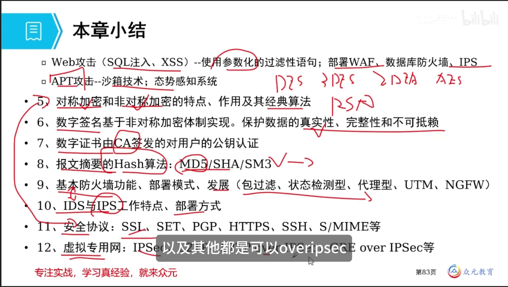

课件手写批注：

- [手写批注] “Web 攻击”条中“使用参数化的过滤性语句”“部署 WAF、数据库防火墙、IPS”加下划线。
- [手写批注] “APT 攻击”被红圈圈出，其上方有含义不明的红色字迹（形如 “D2S 3D2S 2D2A A2S”），字迹不清。
- [手写批注] 第 5—12 条左侧用大括号括起，表示这一组属于“加密技术及其应用 + 防护系统 + 安全协议 + VPN”的整体框架。
- [手写批注] “对称加密和非对称加密”加圈，“特点、作用及其经典算法”加下划线，右侧写 “RSA”。
- [手写批注] 第 6 条中“真实”“不可抵赖”加下划线。
- [手写批注] “CA 签发”加圈，右侧写 “RSA”。
- [手写批注] “MD5/SHA/SM3”加圈，SM3 后打勾。
- [手写批注] 第 8、9、10 条之间用红色箭头依次向下连接，提示按顺序复盘。
- [手写批注] 第 10 条“IDS 与 IPS”“部署方式”加下划线。
- [手写批注] 第 11 条协议列表整行加下划线。
- [手写批注] 第 12 条“IPSec 以及其他都是可以 over”加下划线，句末被遮挡。

网络安全章节至此结束。复盘顺序建议：**法律与等级保护 → 攻击类型与防范对应 → 加密技术 → 防护系统 → 安全协议 → VPN**。

---

## 10.知识脉络梳理与下一章导览

> 本集为下一章（网络操作系统与应用服务器）的导入，内容不属于网络安全范畴，为保持转写稿完整而收录。

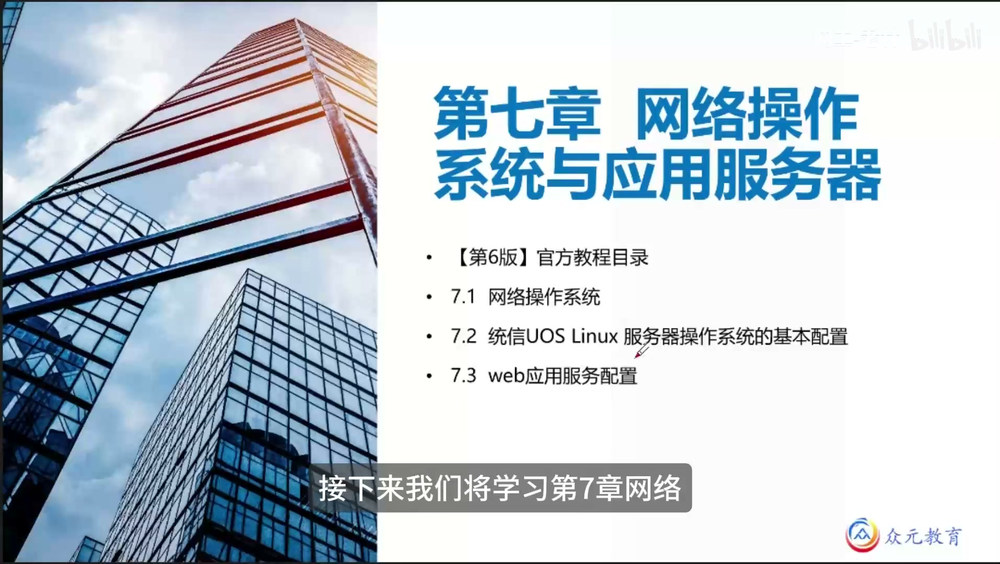

第七章 网络操作系统与应用服务器，按第 6 版官方教程目录包括：

| 小节 | 内容 |
| ---- | ---- |
| 7.1 | 网络操作系统 |
| 7.2 | 统信 UOS Linux 服务器操作系统的基本配置 |
| 7.3 | Web 应用服务配置 |

与旧版教程相比有三点变化：

1. **内容大幅删减**：整体篇幅明显压缩；
2. **Linux 版本调整**：由原来的红帽（国外开源发行版）转向**统信 UOS**（国产操作系统），因此需要花时间认识国产操作系统的发展；
3. **应用服务配置大幅精简**：原有 DHCP、DNS 及三类 Web 服务仅保留 Web 应用，侧重点降低。

学习定位：本章难度不高，可花费较少时间，简单过一遍、形成印象即可。

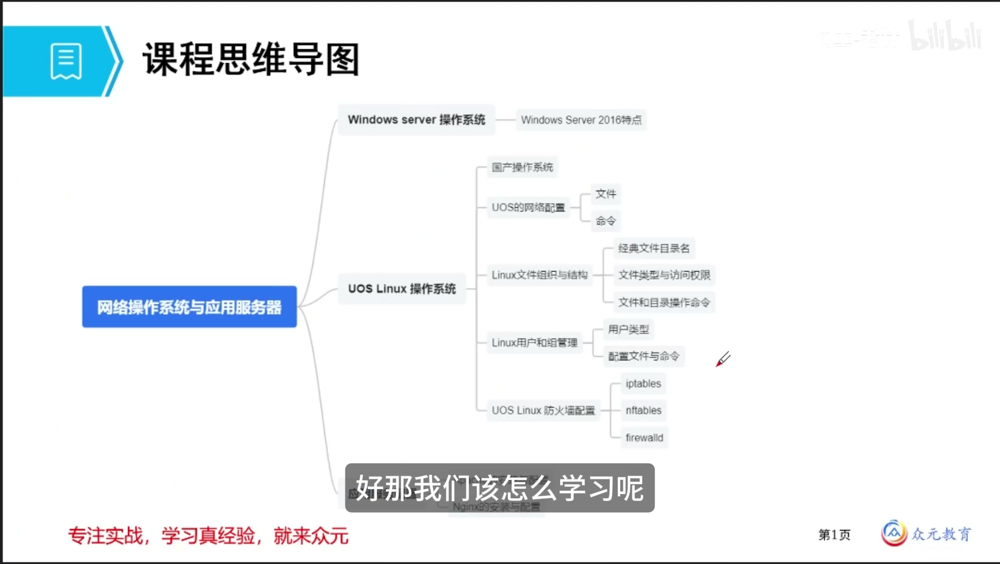

本章分三个板块：

| 板块 | 主要内容 | 学习要求 |
| ---- | -------- | -------- |
| Windows Server | 以 Windows Server 2016 为主（早期为 2008 R2），特点、部署方式与关键配置 | 与 2008 R2 差别不大，简单回顾特点即可，占比下降 |
| UOS Linux 操作系统 | 国产操作系统、UOS 的网络配置（文件与命令）、Linux 文件组织与结构（经典目录名、文件类型与访问权限、文件与目录操作命令）、用户和组管理（用户类型、配置文件与命令）、防火墙配置（iptables、nftables、firewalld） | 重点板块，命令与英文单词记忆较多 |
| 应用服务配置 | Apache 与 Nginx 两类经典 Web 应用的特点 | 只考特点，不深究具体配置 |

说明：早期 Linux 网络管理内容放在网络管理章节，本版统一并入操作系统章节讲授。相同之处可直接沿用旧知识，重点掌握不同点。

---

## 11.本章小结

### 11.1 知识体系复盘

| 模块 | 核心内容 | 考试权重 |
| ---- | -------- | -------- |
| 应用层安全协议 | SSL/TLS 的结构与握手过程；SET 三方证书；PGP 三把钥匙；SSH、S/MIME 的算法组合 | 高（选择题 + 案例填空） |
| 虚拟专用网 | VPN 定义与两类场景；四项关键技术；按层次分类；IPSec 的 AH/ESP/IKE；NAT 穿越；两种工作模式 | 高（选择题 + 案例） |
| 其他安全技术 | 安全审计与日志留存；漏洞扫描；渗透测试流程与授权；蜜罐分类 | 中 |
| 容灾备份 | RTO/RPO；备份方式与 3-2-1；灾难恢复六级；双机热备；RAID 不是备份 | 中 |
| 无线安全 | WEP/WPA/WPA2/WPA3 演进；802.1X 三角色；Portal 四要素 | 中 |
| 终端安全 | EPP/EDR、准入、补丁、外设管控 | 低 |
| 管理制度 | 法律法规时间节点；等保五级与五个动作；制度四级文件 | 中 |

### 11.2 必须记牢的对应关系

| 问题 | 答案 |
| ---- | ---- |
| 替代 SSL 的协议 | TLS |
| PGP 的数据加密/完整性算法 | IDEA / MD5 |
| SET 涉及几方、是否都要证书 | 三方（客户、商家、银行），都要证书 |
| HTTPS 用什么加密 HTTP 消息 | 会话密钥 + 对称加密 |
| 证书被撤销的后果 | 客户端不再信任服务器（仅告警，可继续访问） |
| 证书撤销后继续通信的最大隐患 | 密钥分发环节可被第三方破解，导致消息被解密 |
| 工作在网络层的隧道协议 | IPSec（GRE 亦为网络层） |
| 其余协议的层次 | SSL 属应用层；L2TP、PPTP、MPLS 属数据链路层 |
| 同时提供加密与认证的 IPSec 协议 | ESP |
| AH 为何不兼容 NAT | ICV 覆盖整个 IP 包（除 TTL、头校验和等变化字段），地址一改即校验失败 |
| NAT 穿越的封装与端口 | ESP 外套 UDP，源/目的端口均为 4500 |
| IPSec 两种模式 | 传输模式（不改包头、效率高、主机到主机）、隧道模式（新增 IP 头、更安全、网关到网关） |
| VPN 四项关键技术 | 隧道、加解密、密钥管理、身份认证 |
| 无线四代加密算法 | WEP-RC4、WPA-TKIP、WPA2-CCMP(AES)、WPA3-SAE/CCMP 或 GCMP-256 |
| 抗离线字典攻击的无线认证 | WPA3 的 SAE |
| 802.1X 三要素 | Supplicant、Authenticator、RADIUS 认证服务器 |
| Portal 四要素 | 客户端、接入设备、Portal 服务器、认证/计费服务器 |
| 日志留存期限 | 不少于六个月 |
| 等保五个动作 | 定级、备案、建设整改、等级测评、监督检查 |
| 灾难恢复等级 | GB/T 20988—2007，共 6 级 |
| RTO / RPO | 恢复时间目标 / 恢复点目标 |
| RAID 能否替代备份 | 不能，RAID 只防磁盘物理故障 |

### 11.3 易错点

1. **混淆 SSL 与 IPSec 的层次**：SSL 在应用层与传输层之间，IPSec 在网络层。
2. **把 AH 当成加密协议**：AH 只做认证与完整性，不加密；ESP 才加密。
3. **认为 ESP 完全不兼容 NAT**：ESP 的 IP 地址可被转换，但端口被封在加密载荷内，需 NAT-T。
4. **把 MPLS 当作网络层**：课件将其归入数据链路层，业界常称“2.5 层”。
5. **认为 GRE、L2TP 自带加密**：二者均不加密，必须 over IPSec。
6. **认为 RAID 或双机热备等于备份**：二者都防不了误删、勒索加密与逻辑损坏。
7. **把 Portal 与 802.1X 混为一谈**：前者是 Web 认证（应用层），后者是端口认证（链路层）。
8. **记错法律施行时间**：网络安全法 2017-06-01 施行、2025 年修正后 2026-01-01 施行；密码法 2020-01-01；数据安全法 2021-09-01；个人信息保护法 2021-11-01。

### 11.4 案例题答题模板

| 题型 | 答题结构 |
| ---- | -------- |
| 问“安全机制包含什么” | 身份认证（真实性）+ 数据加密（机密性）+ 完整性校验，必要时补“密钥安全分发”“数字签名/证书” |
| 问“两类算法如何配合” | 非对称算法实现对称密钥的安全分发与身份鉴别；对称算法实现数据的加密传输 |
| 问“向谁申请证书” | CA（数字证书认证机构） |
| 问“单个用户如何远程接入” | 客户端到站点方式：SSL VPN / IPSec VPN / L2TP over IPSec 任选其一并说明理由 |
| 问“IPSec 由什么组成” | AH + ESP + IKE，并说明各自功能 |
| 问“同时加密与认证用哪个” | ESP |
| 问“NAT 不可用怎么办” | 在两端网关开启 NAT 穿越，ESP 封装进 UDP（4500） |

### 11.5 复习路径

1. 先画一张本章思维导图（见第 1 节），确认四大模块无遗漏；
2. 按“协议 → 算法 → 密钥 → 流程”的顺序复述 SSL 与 PGP，能默写出密钥位置；
3. 用一张表默写 VPN 六种技术的层次、是否加密、适用场景；
4. 手写 IPSec 的 AH/ESP 封装格式，标出加密范围与认证范围；
5. 把第 9 节的十二条要点逐条自问自答，答不出的回到对应小节；
6. 最后做真题，重点检查层次判断、算法归属与案例表述。

### 11.6 核实来源

本笔记第 2、3、9、10 节依据课程转写稿与课件截图整理；第 4 至第 8 节的技术参数、标准编号与时间节点经以下公开资料核实：

- 全国人大常委会《关于修改〈中华人民共和国网络安全法〉的决定》（2025-10-28 通过，2026-01-01 施行）及修正后法律文本（日志留存不少于六个月、等级保护条款为第二十三条）。
- 《中华人民共和国密码法》（2019-10-26 通过，2020-01-01 施行）；《中华人民共和国数据安全法》（2021-09-01 施行）；《中华人民共和国个人信息保护法》（2021-11-01 施行）。
- GB/T 22239—2019《信息安全技术 网络安全等级保护基本要求》（2019-05-10 发布，2019-12-01 实施）；《信息安全等级保护管理办法》五级划分；公安部《网络安全等级保护 2.0 标准解读》关于“五个规定动作”的表述。
- GB/T 20988—2007《信息安全技术 信息系统灾难恢复规范》附录 A、附录 C（六级划分及 RTO/RPO 对应关系）。
- NIST SP 800-97《Establishing Wireless Robust Security Networks: A Guide to IEEE 802.11i》（WEP 的 RC4、40/104 位密钥、24 位 IV、CRC-32 ICV；TKIP 与 CCMP 的算法与密钥长度）。
- Wi-Fi 联盟 WPA3 规范及 WPA3 安全考量文档（SAE、抗离线字典攻击、前向保密、192 位企业模式、OWE、PMF）。
- Cisco 802.1X 端口认证文档（Supplicant/Authenticator/Authentication Server、EAPOL 0x888E、受控与非受控端口）；华为 Portal 认证配置指南（四要素、二层/三层认证、CHAP/PAP）。
- 华为终端安全词条（EDR 定义与能力）；GB/T 20988 与 3-2-1 备份原则相关公开资料。

存疑与说明：

- 第 2.3 节 SET 的算法组合（DES/RSA/SHA）来自课堂讲授，课件正文仅列出三项特点，未列算法。
- 第 3.2 节课件将 Tunneling 拼写为 “Tuneling”，笔记保留原文并加注。
- 第 3.5 节 ESP 封装图中红色括号画法覆盖了全部字段，而课件文字明确表述“IP 地址转换不会破坏 ESP 的 Hash 值”，笔记以文字结论为准。
- 第 9.2 节第 12 条末尾被字幕条遮挡，按讲授内容补全。
